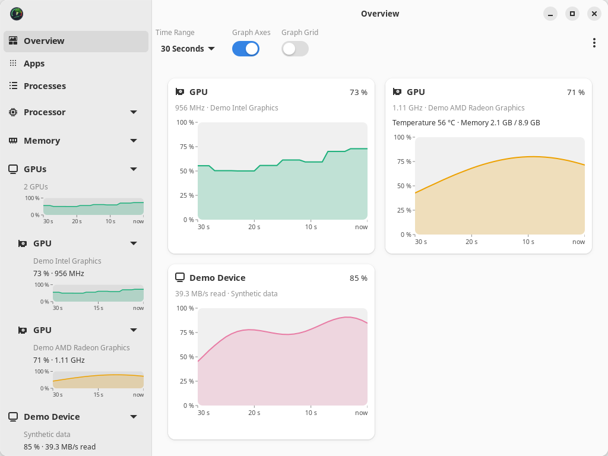
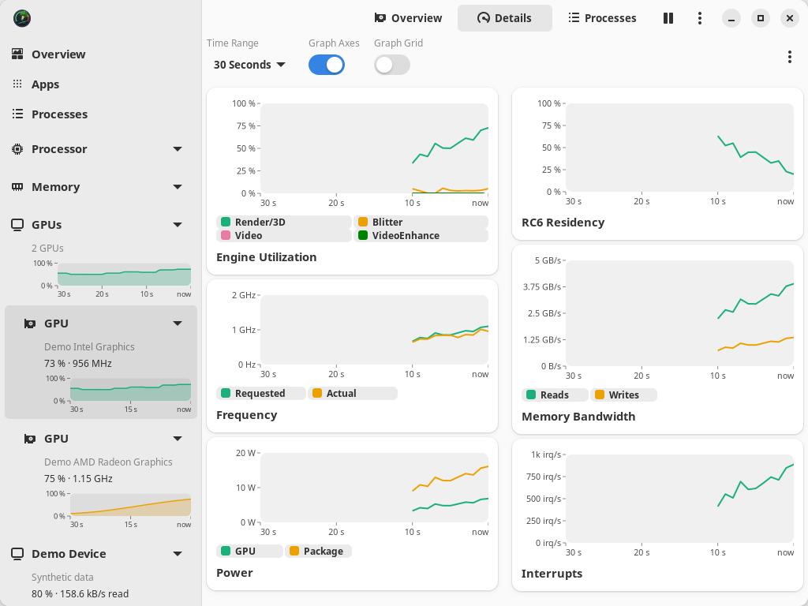
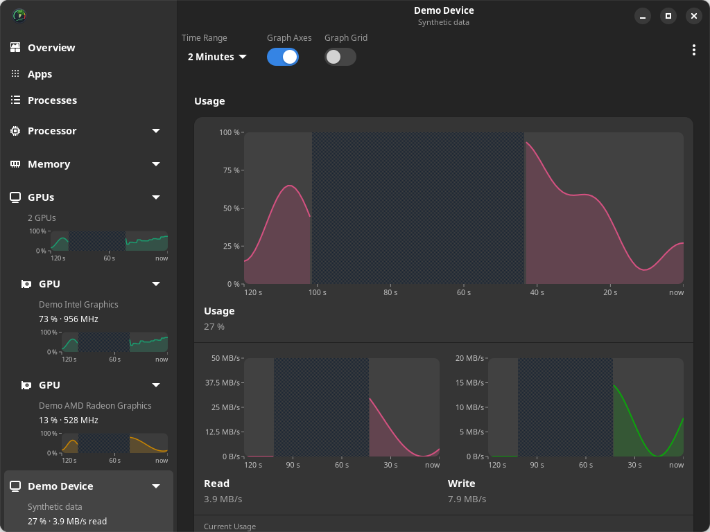
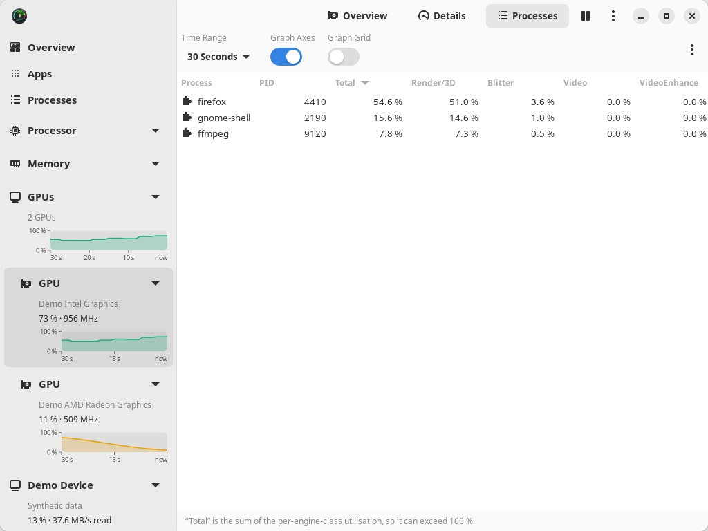
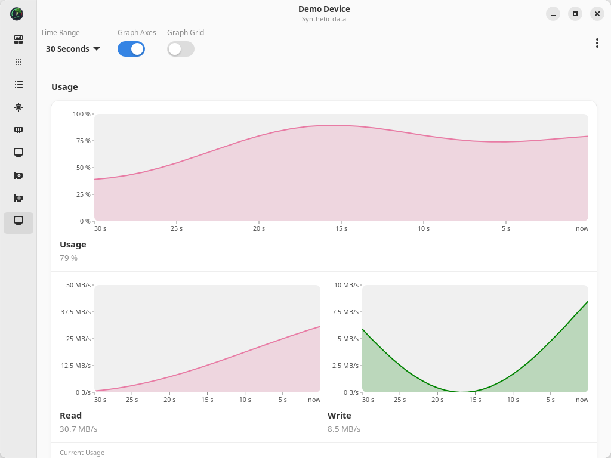
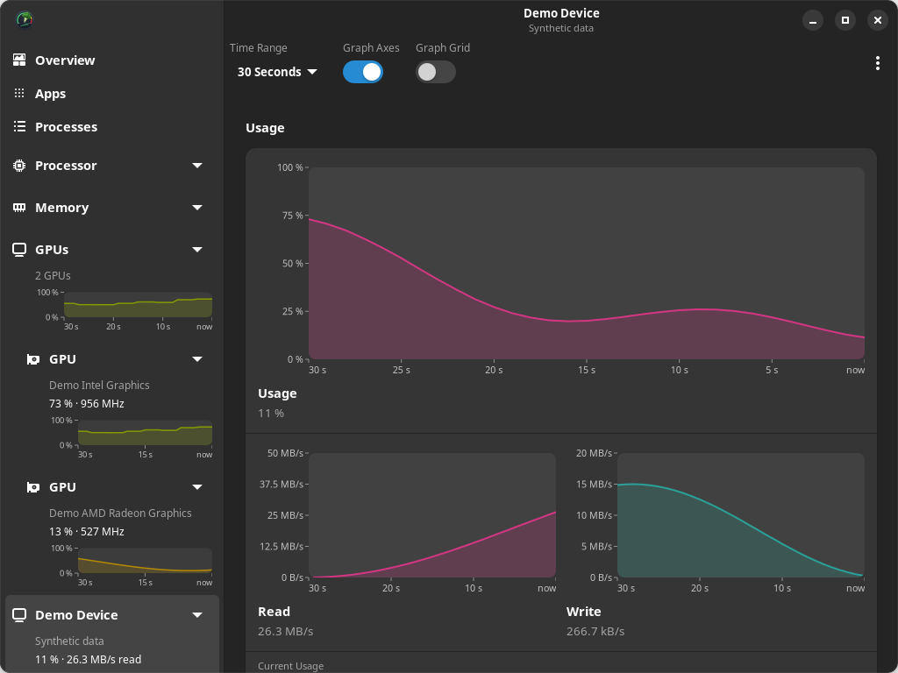

# Proccoli


*Process + broccoli.*

Proccoli is a system monitor for the Linux desktop. It shows what your
processor, memory, graphics card, drives, network and battery are doing,
which apps are using them, and what happened while you weren't looking.
It looks and works like **Resources**, the system monitor that ships with
Ubuntu, and adds detailed statistics for Intel, AMD and NVIDIA graphics.



## At a glance

- **Every device on one page:** live charts for the processor, memory,
  each graphics card, drive, network connection and battery.
- **Apps and processes:** who's using the processor, memory, drives and
  graphics; end, pause or reprioritise them.
- **Graphics in detail:** engines, clocks, power, memory and per-app use
  on Intel, AMD and NVIDIA.
- **A history that keeps recording:** a small background recorder keeps
  every reading, so graphs show the last minutes, hours or days, even
  from before you opened the window.
- **Light on your machine:** Lightweight Mode and an icons-only sidebar
  for small screens and old computers.
- **Yours to style:** light and dark, 25 styles and 21 color palettes,
  five of them safe for color blindness.

## Requirements

- **Operating system:** Ubuntu 24.04 or newer, or Debian 13 or newer
  (GTK 4.10+, libadwaita 1.5+, Python 3.10+), on Wayland or X11.
- **Processor:** any that runs those; nothing is compiled.
- **Memory:** about 120 MiB for the window and 35 MiB for the background
  recorder; less in Lightweight Mode.
- **Disk:** a few MiB for Proccoli; its history is capped at 512 MiB by
  default (you choose the limit).
- **Packages:** `python3-gi python3-gi-cairo gir1.2-gtk-4.0 gir1.2-adw-1`.
  Optional: `intel-gpu-tools` (Intel graphics details), NVIDIA's
  `nvidia-smi` (NVIDIA details), `pkexec` (actions that need an
  administrator). AMD graphics details need nothing extra.

## Install

From the project folder:

```sh
sudo apt install python3-gi python3-gi-cairo gir1.2-gtk-4.0 gir1.2-adw-1
packaging/build-deb.sh
sudo apt install ./dist/proccoli_0.6.0_all.deb ./dist/proccoli-gui_0.6.0_all.deb
```

Proccoli then appears in your app grid. To try it without installing, run
`PYTHONPATH=src python3 -m proccoli --demo` (made-up devices and
activity). Updating, installing only the recorder on a server, and
uninstalling are in the [user guide](docs/USER-GUIDE.md#installing).

## What you can do with it

**Find what's slowing your machine down.** The Overview lists the ten
busiest apps and processes beside the charts; click one to open it, or
open *Apps* and sort by *Processor* or *Memory*.

**See whether your graphics card is busy, and with what.** A GPU's
*Details* tab breaks its work down by engine, clock, power and memory;
*Processes* shows which apps are using it.



**See what happened while you were away.** Set the *Time Range* to an
hour, a day or your own range: the graphs fill from the history. Time
Proccoli wasn't running is shaded, and hovering says how long.



**Deal with a stuck process.** Right-click it in *Apps* or *Processes* to
end, kill, pause or continue it, or to change its priority (some need
your password).



**Keep it small.** Turn on Lightweight Mode (Preferences → System →
*Memory Use*), or
show the sidebar as icons only (F9 hides it).



**Get the numbers out.** *Export Statistics* (the logo's menu) saves
every reading since Proccoli started as CSV files, one per device.

**Make it yours.** Preferences → Appearance: a style and a color palette.



## Privacy and safety

Everything stays on your computer: Proccoli sends nothing anywhere. Its
history and log are private to your user (`~/.local/state/proccoli/`).
It asks for your password only for actions that need an administrator,
such as ending another user's process or Intel's detailed statistics,
and says why each time.

## Help

- **The [user guide](docs/USER-GUIDE.md):** every page, preference,
  keyboard shortcut and file, and
  [troubleshooting](docs/USER-GUIDE.md#troubleshooting).
- **A problem or an idea:**
  [open an issue](https://github.com/mamadingleberry/proccoli/issues).
- **A security problem:** see [SECURITY.md](SECURITY.md).

## Disclaimer

This application was created with the help of
[Claude](https://claude.com/claude-code), an AI assistant made by
Anthropic, and is reviewed by its maintainer. It is an independent
project and is not affiliated with or endorsed by Intel, AMD, NVIDIA,
GNOME or the authors of Resources.

## License

[0BSD](LICENSE): use it for anything, no fee and no attribution required.
