# Proccoli: Design

This document describes how Proccoli is put together: what it copies from
Resources, where it deliberately differs (the swappable GPU page), the layers
of the application, and the classes in each layer. [PLAN.md](PLAN.md) gives
the order in which to build it.

Diagrams use [Mermaid](https://mermaid.js.org/), which GitHub renders.

**The name.** Proccoli is a portmanteau of *process* and *broccoli*.

---

## 1. Goals and non-goals

**Goals**

1. Mirror the Resources user experience: sidebar of resources on the left,
   detail page on the right, Apps and Processes tables, a Preferences dialog,
   and the same page structure (Usage, Sensors and Properties groups).
2. **GPU carve-out:** the GPU page is chosen per GPU, at runtime, by a
   pluggable *GPU backend*. It can be switched while the app is running (for
   example after authenticating, or by choice in Preferences).
3. The first detailed backend is `intel_gpu_top`, reusing what
   intel_gpu_top_gui already does well.
4. Incremental: every milestone in PLAN.md ends with a runnable, tested app.
5. Testable without real hardware. Every data source reads from an injectable
   filesystem root or command runner, so tests use fixture files.

**Non-goals (for now)**

- An AMD detailed backend. The interfaces are designed for it, but it isn't
  built yet. (NVIDIA's arrived in M55, §7.4.)
- NPU pages. Resources has them, but they are out of scope.
- Copying Resources' code, icons or name. Proccoli re-implements the UX from
  scratch, because Resources is GPL and Proccoli is 0BSD (see §11, Licensing).

---

## 2. What Resources does, and what Proccoli changes

### 2.1 Resources' structure (from the Ubuntu 26.04 package, v1.10.2)

Taken from the UI definitions in `/usr/share/resources/resources.gresource`:

```
MainWindow (AdwApplicationWindow, min 360×240)
├── AdwBreakpoint  max-width: 780sp  →  split_view.collapsed = True
└── AdwOverlaySplitView #split_view
    ├── sidebar: AdwToolbarView
    │   ├── AdwHeaderBar (primary menu: Preferences, Keyboard Shortcuts, About)
    │   └── ResStackSidebar → GtkListBox of ResStackSidebarItem
    │         (icon, name, detail label, usage label, progress bar OR mini graph)
    └── content: GtkStack #content_stack (one page per sidebar entry)
        └── each page: AdwToolbarView
            ├── AdwHeaderBar (flat; sidebar toggle shown when collapsed —
            │                 Proccoli: the logo (its main menu) instead, M52, M61;
            │                 search toggle on Apps/Processes)
            └── page widget (ResApplications, ResProcesses, ResCPU, ResMemory,
                             ResGPU, ResDrive, ResNetwork, ResBattery, ResNPU)
```

Device pages (GPU, Drive, Network, Battery) are added at runtime, one per
detected device. Each device page is `GtkScrolledWindow → AdwClamp →
AdwPreferencesGroup`s containing:

- `ResGraphBox`: an `AdwPreferencesRow` with a graph, a title and an info line
- `ResDoubleGraphBox`: two graphs side by side (for example encode and decode)
- `AdwActionRow`s for single values and properties

The pages contain:

| Page      | Usage group                                                                 | Sensors      | Properties |
|-----------|-----------------------------------------------------------------------------|--------------|------------|
| Processor | total usage graph, or a FlowBox of per-thread graphs (switch: logical CPUs) | temperature  | max frequency, logical/physical cores, sockets, uptime, virtualization, architecture |
| Memory    | memory graph, swap graph (with an auth banner for module info)              | –            | slots used, speed, form factor, type, type detail |
| GPU       | usage, encode/decode (double), combined enc/dec, VRAM; frequency, VRAM frequency, power rows | temperature | manufacturer, PCI slot, driver, max power cap, link |
| Drive     | busy %, read speed, write speed; total read/written                         | –            | type, device, capacity, writable, removable, link |
| Network   | receiving, sending; total received/sent                                     | –            | manufacturer, driver, interface, hardware address, network name, link, link speed |
| Battery   | charge, power usage                                                         | –            | health, design capacity, cycles, technology, manufacturer, model, device |

**Apps and Processes** are `GtkColumnView` tables with a search bar, a
toast overlay, and a bottom action bar: *Information*, *Options* (processes
only), and an *End* split button with *Kill / Halt / Continue*. Rows open an
**App Information** or **Process Information** dialog. *Process Options*
edits niceness, priority and CPU affinity.

**Preferences** (backed by GSettings `net.nokyan.Resources`) has four pages:

- *General:* unit prefix, network bits, temperature unit, update interval,
  graph grids, graph data points, sidebar details, descriptions and meter
  type, normalize CPU usage
- *Apps:* column toggles
- *Processes:* niceness option and column toggles
- *Devices:* virtual drives, virtual network interfaces

It also stores the window size, sort columns and last viewed page.
(Proccoli doesn't keep the last page: it always opens on the Overview.)

**Privileged work** goes through helper executables in
`/usr/libexec/resources/`:

- `resources-processes` streams process data, run via `pkexec` to see all
  users' processes
- `resources-kill` and `resources-adjust` signal or renice other users'
  processes

All three are authorised by a polkit policy.

### 2.2 The GPU gap

On an Intel iGPU, Resources' GPU page shows one usage graph, the video
engine, frequency and power. intel_gpu_top_gui shows much more:

| Metric                                         | Resources | intel_gpu_top page |
|------------------------------------------------|:---------:|:------------------:|
| Total GPU usage                                | ✔         | ✔ (derived)        |
| Per-engine busy: Render/3D, Blitter, Video, VideoEnhance, Compute | – | ✔ |
| Engine wait/semaphore time                     | –         | ✔ (optional series) |
| Requested vs actual frequency                  | actual only | ✔ both          |
| GPU vs package power                           | one value | ✔ both             |
| RC6 (idle power state) residency               | –         | ✔                  |
| IMC memory bandwidth (reads/writes)            | –         | ✔ (if reported)    |
| Interrupts per second                          | –         | ✔                  |
| Per-process usage per engine class             | GPU/enc/dec % | ✔ every engine class |
| Multi-tile GPUs (per-GT groups)                | –         | ✔                  |
| Hover crosshair with values, pause, CSV export | –         | ✔                  |
| VRAM usage, temperature                        | ✔ (dGPU)  | – (iGPU has none; the generic data stays available) |

The carve-out keeps Resources' simple summary for everything else (the
sidebar entry and the Apps/Processes GPU columns). Only the GPU **page** is
swapped for a detailed one when a backend can provide it.

---

## 3. Technology decisions

| Decision | Choice | Why |
|---|---|---|
| Language | Python 3 (system interpreter) + PyGObject | Same stack as intel_gpu_top_gui, so code can be reused directly. No build step and nothing from pip. |
| Toolkit | GTK ≥ 4.10, libadwaita ≥ 1.5 | `AdwOverlaySplitView`, `AdwBreakpoint`, `AdwToolbarView` (1.4) and `AdwDialog`, `AdwPreferencesDialog`, `AdwAboutDialog` (1.5). Ubuntu 24.04 ships 1.5 (with GTK 4.14 and GLib 2.80). `AdwShortcutsDialog` (1.8) is used when present. |
| Newer APIs | Only through `ui/compat.py` or a `hasattr` check | Ubuntu 24.04 is the floor and is tested on (M53). `compat` has `spinner` (`Adw.Spinner`, 1.6, else `Gtk.Spinner`), `ensure_font_dpi` (libadwaita 1.5's `sp` breakpoints need a font DPI) and `without_css_variables` (GTK < 4.16 can't read `:root` variables). `app.signal_adder` picks GLib's Unix signal function. `test_static.PlatformFloorTest` rejects unguarded newer libadwaita classes. |
| UI definitions | Built in Python (not `.ui` files) | Simple to review and test, and avoids a GResource compile step. `.ui` files can be added later. |
| Graph drawing | Cairo `Gtk.DrawingArea`, one chart family in `ui/` | Pixel snapping and the hover crosshair come from intel_gpu_top_gui's `GraphView`; since M60 every graph, the Intel Details tab's included, is the shared `Graph` (§9.1). |
| Settings | GSettings with an installed schema, plus an in-memory fallback | Mirrors Resources. The fallback makes running from a source checkout and testing easy. |
| Dependency injection | By hand, in one composition root (`context.py`, §4.2) | No framework needed. Every OS service sits behind `System` and every file read behind `SysRoot`, so tests swap in fakes. |
| Data collection | `/proc` and `/sys` reads on the main loop, plus subprocess readers for streaming tools | `/proc` reads are cheap. `intel_gpu_top` and the privileged helper stream JSON on a worker thread and hand results to the main loop with `GLib.idle_add`. |
| D-Bus | `Gio.DBusProxy` to NetworkManager (Wi-Fi name, connection type) and UPower (battery) | No extra packages; `gir1.2-nm` is not installed by default. |
| Hotplug | Periodic rescans (every few seconds) for drives and network interfaces | GUdev's introspection data isn't installed by default; it can replace the rescans later. |
| Privilege | `pkexec` + polkit policy + one helper script (`proccoli-helper`) | Same model as Resources. |

---

## 4. Architecture overview

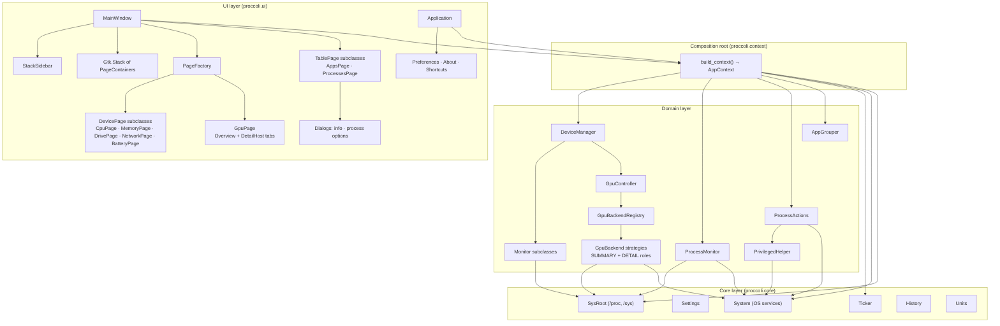

**Dependency rule:** UI → Domain → Core, and never the other way. Domain
objects tell the UI about changes through GObject signals (`device-added`,
`updated`, `detail-changed`, `elevated-io`). They never import Gtk at module
level, which `tests/test_static.py` enforces. The exceptions are the views
that ship with a detail backend (`DetailBackend.create_views()` and the
Intel backend's `views.py`, `clients.py`, the NVIDIA `views.py`). They're
imported lazily, so the domain stays testable without a display.

### 4.1 Package layout

```
proccoli/
├── README.md  CLAUDE.md  LICENSE  Makefile
├── docs/       DESIGN.md  PLAN.md
├── .claude/skills/proccoli-change/SKILL.md   # the checklist for every change
├── src/proccoli/
│   ├── __init__.py            # APP_ID, APP_NAME, version, icon names (the only place)
│   ├── __main__.py  app.py    # Application: actions, dialogs; asks context.py for services
│   ├── context.py             # the composition root (§4.2): the window's and the collector's
│   ├── metrics.py             # proccoli, the background collector (§13.12; no Gtk)
│   ├── metrics_service.py     # its D-Bus service: every reading, for the window (§13.18)
│   ├── core/       system.py  sysroot.py  settings.py  ticker.py  history.py  units.py
│   │               pciids.py  jsonstream.py  runner.py  privileged.py  palette.py
│   │               styles.py  applog.py  trust.py  watchdog.py
│   │               connections.py         # signal handlers let go together (M84)
│   │               history_db.py  history_store.py  history_export.py   # §13.2
│   │               machine_info.py                                       # §13.13
│   │               history_lock.py  background.py                        # §13.12
│   │               profile.py                                            # §13.1
│   │               windows.py                                            # §13.5
│   ├── devices/    base.py  source.py  manager.py  cpu.py  memory.py  drive.py  network.py  nm.py
│   │               battery.py  demo.py  snapshot_codec.py (§13.18)
│   ├── gpu/        info.py  backend.py  registry.py  detect.py  controller.py  fdinfo.py
│   │               generic_drm.py
│   │               intel_gpu_top/  backend.py  history.py  views.py  labels.py  clients.py
│   │               nvidia/         query.py  backend.py  views.py
│   │               amdgpu/         metrics.py  sensors.py  backend.py  views.py   # §7.5
│   ├── processes/  model.py  monitor.py  apps.py  actions.py  top.py
│   ├── helper/     proccoli_helper.py    # installed as libexec/proccoli/proccoli-helper (root)
│   └── ui/         window.py  window_state.py  sidebar.py  page.py  style.py  theme.py
│                   layout.py  elevation.py  reorder.py  sidebar_fields.py  axes.py
│                   sidebar_visibility.py  sidebar_style.py  compat.py  series_visibility.py
│                   hover.py  export.py  summaries.py  lazy.py  toolbar_items.py   # §13.11
│                   time_range.py                                         # §13.8
│       ├── widgets/  graph.py  graph_box.py  double_graph_box.py  info_row.py  meter.py
│       │             app_icon.py  top_table.py  legend.py  legend_chart.py
│       │             chart_card.py  chart_grid.py  detail_charts.py
│       │             reorderable.py  graph_toolbar.py                     # §13.11
│       │             range_editor.py                                      # §13.8
│       ├── pages/    device.py  table.py  factory.py  cpu.py  memory.py  drive.py  network.py
│       │             battery.py  gpu.py  apps.py  processes.py  demo.py  overview.py  error.py
│       └── dialogs/  info.py  process_options.py  preferences.py  about.py  launch_auth.py
├── data/       .desktop  .metainfo.xml  .gschema.xml  .policy  proccoli.service  icons/hicolor/...
├── packaging/  install.sh  build-deb.sh  split.py (which install each file is in, §13.14)
│               make-logo.py  render-icons.py
└── tests/      helpers.py (FakeRoot, FakeSystem, make_context, pump, resize_window)  fixtures/  test_*.py
                ui/shoot.py (screenshots)  ui/perf.py (CPU use)  run-headless.sh
```

### 4.2 Dependency injection: the composition root

Everything is wired by hand in one place, `context.build_context()`, which
returns an `AppContext`. Nothing else creates services, and no module reaches
for the operating system on its own. The background collector (M75,
§13.12) has its own, smaller root in the same module,
`build_metrics_context()` → `MetricsContext` (settings, ticker, system,
sysroot, devices, profile): the same discoverers, no process monitor,
icons, helper or UI.

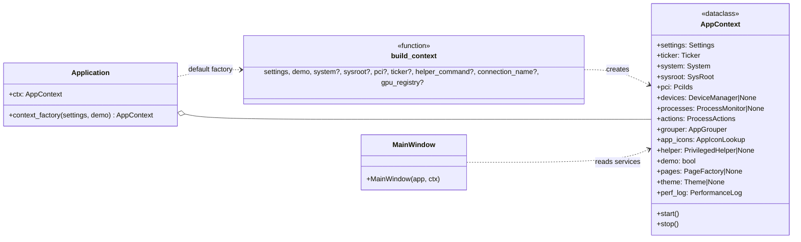

- **Seams:**
  - `SysRoot`: every `/proc` and `/sys` read.
  - `System`: everything else that touches the OS (§5).
  - `Settings.for_tests()`: in-memory settings.
  - `Ticker`: injectable timer and clock.
  - `PageFactory`: which page shows which device kind.
  - `GpuBackendRegistry` (`build_context(gpu_registry=...)`): which GPU
    backends exist.
  - `Application(context_factory=...)`: the whole graph.
  - `Theme(settings, style_manager)`: the look (§9.3). `Application` builds
    it with `Adw.StyleManager.get_default()`; tests pass a fake.
- **Tests** build the real graph with fakes: `tests/helpers.make_context()`
  passes `FakeSystem`, a fixture `SysRoot`, test settings, the test `pci.ids`,
  no helper and no NetworkManager.
- **Enforcement:** `tests/test_static.py` fails if a module outside the
  allowed set calls `os.kill`, `shutil.which`, `subprocess`, `pwd` and
  similar directly, or if a domain module imports Gtk.

## 5. Core layer

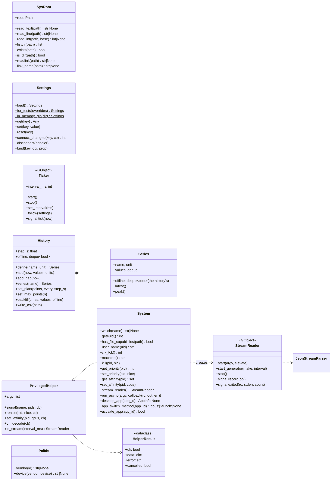

- **`System`** is the only OS facade. Tests use `FakeSystem`
  (`tests/helpers.py`), which records signals, priorities and child
  processes, and answers `which` and the user and app lookups from
  attributes.
- **`PrivilegedHelper`** runs `pkexec proccoli-helper <subcommand>`
  asynchronously, since the password prompt takes time. It turns pkexec's 126
  and 127 into `cancelled`. The helper itself
  (`helper/proccoli_helper.py`) is a standalone script with strict argument
  validation and no shell. Only a root-owned installed helper is used, and
  processes are named by PID *and* start time (§11, *Security*).
- **`Ticker`:** one app-wide timer at the *Update Interval* setting
  (`update-interval`: 1, 2, 3, 5 or 10 s; M65 replaced *Refresh Speed*,
  whose 0.5 and 0.25 s went too fast), so all graphs line up in time.
- **`Settings`:** GSettings when the schema is installed or can be compiled
  from the checkout, otherwise a dictionary with the same defaults and
  validation. A source checkout always uses its own compiled schema first.
  `choose_schema` skips any schema missing a key the app's schema
  describes (`schema_covers`): GSettings aborts the whole program on an
  unknown key. This happened once, when an installed package older than
  the checkout lacked `sidebar-shown`.

## 6. Devices layer: monitors and snapshots

Every sidebar entry except Apps and Processes is a **device**. A device has
an immutable `DeviceInfo`, discovered once, and a `Monitor` that produces a
`Snapshot` on every tick.

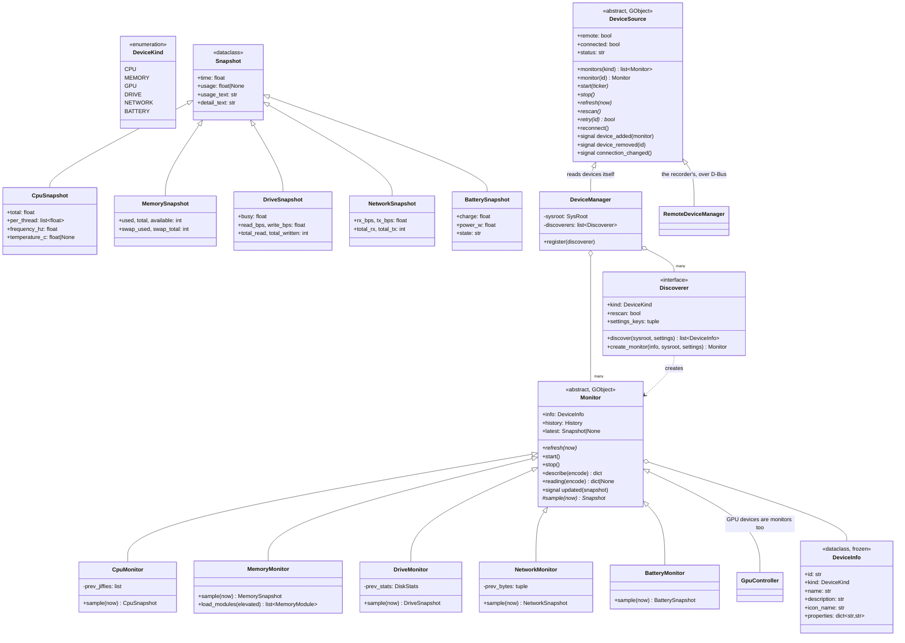

**Data sources per device** (all through `SysRoot`, so every one can be
tested with fixtures):

| Device | Discovery | Per-tick data | Properties |
|---|---|---|---|
| CPU | `/proc/cpuinfo` | `/proc/stat` deltas, `/sys/devices/system/cpu/cpu*/cpufreq` | `/proc/cpuinfo`, `lscpu`-style topology from `/sys/devices/system/cpu`, `/proc/uptime`; temperature from hwmon `coretemp` / `k10temp` |
| Memory | always; description "16.0 GB DDR4 @ 2667 MT/s" (`memory_description`: one decimal, the slowest module's speed) | `/proc/meminfo` | udev's SMBIOS record `/run/udev/data/+dmi:id` (`MEMORY_DEVICE_<n>_*`, readable by any user): slots, type, speed, form factor. Only without it: `dmidecode -t 17` through the helper (banner + Authenticate) |
| Drive | `/sys/block/*` (skip loop/ram; virtual drives optional) | `/sys/block/X/stat` deltas | size, `removable`, `ro`, rotational → HDD/SSD/NVMe, `device/model` |
| Network | `/sys/class/net/*` (skip `lo`; virtual optional: no `device` link) | `/sys/class/net/X/statistics/{rx,tx}_bytes` | MAC address, driver (`device/driver`), speed; SSID and type from NetworkManager over D-Bus; wireless if `X/wireless` exists |
| Battery | `/sys/class/power_supply/*` with `type=Battery` | `capacity`, `power_now` or `current_now × voltage_now` | `energy_full_design`, `cycle_count`, `technology`, `manufacturer`, `model_name` |
| GPU | see §7 | see §7 | see §7 |

**A device that can't be set up (M55)** still appears. If its
`Discoverer.create_monitor()` or the monitor's `start()` raises,
`DeviceManager._build` logs it and keeps a `FailedMonitor` in its place:
a monitor that records nothing and carries `message` (in words) and
`details` (the traceback). Its page is an error page (§9.7);
`DeviceManager.retry(id)` builds it again. A discoverer that fails as a
whole is still only logged (there's no device to show).

**Sidebar naming** mirrors Resources: the Processor's description is its
model and Memory's its size, DDR type and speed; drives are
labelled "Drive" with the model as the description, and network interfaces are "Ethernet Connection",
"Wi-Fi Connection" or "VPN" with the interface name as the description.
These names come from `DeviceInfo.name` and `DeviceInfo.description`.

---

## 7. The GPU carve-out

This is the one place where Proccoli differs from Resources on purpose. Every
GPU gets **one page with up to three tabs**:

| Tab | Content | Comes from |
|---|---|---|
| **Overview** | Resources' GPU page (usage, video engine, VRAM, frequency, power, temperature, properties) | the GPU's **summary source**, which always runs |
| **Details** | the vendor's own view: for Intel, intel_gpu_top_gui's graph grid (per-engine utilisation, frequency, power, RC6, memory bandwidth, interrupts); for NVIDIA, its tools' readings (M55); for AMD, amdgpu's own statistics files (M70) | the GPU's **detail source**, if one exists |
| **Processes** | the vendor's per-process view: for Intel, engine-class use per client | the detail source |

The Overview is always first. The vendor tabs are a second level of
information for the same GPU, so they're **tabs, not a drill-down**:

- **Peer views, switched often.** Engine graphs and the summary are both
  "now" views that users flip between while monitoring. Tabs are one click
  each way with no back button.
- **intel_gpu_top_gui's own shape.** Its Resources | Processes switcher maps
  one-to-one onto Details | Processes.
- **No tabs without a vendor tool.** A GPU without a detail source shows no
  switcher, just the overview, exactly like Resources.
- **The overview links to the details.** It has a "Detailed Statistics"
  row, so they're discoverable from the Resources-style view.

### 7.1 Roles: summary and detail sources

A *GPU backend* (the strategy from §4) now has a **role**:

- **SUMMARY:** sysfs and fdinfo, works for any GPU, cheap, never needs
  privileges. It always runs, so the overview, the sidebar meter and the
  process GPU columns never go blank.
- **DETAIL:** a vendor source (`intel_gpu_top`, NVIDIA's tools, or
  amdgpu's own sysfs files, §7.5). It may need administrator rights, may
  be switched off, and supplies the vendor tabs. While it runs, its
  numbers also feed the overview (`merge_summaries`: the detail source's
  values, gaps filled from the summary source's).

**Honest summaries on APUs (M69, Bugs 2–4).** `GpuSummary` carries two
flags besides its readings. `shared_memory`: an AMD APU's "VRAM" is a
carve-out of system memory and it uses GTT (`mem_info_gtt_*`) as much, so
`memory_used` / `memory_total` / `memory_usage` add both, and the
Overview tab calls it *Graphics Memory*. `power_is_package`: an APU's
hwmon `power1` (labelled `PPT`) is the whole package's, cores included,
so the Overview tab calls it *Processor Package Power*. `GpuInfo.integrated`
for AMD comes from `gpu_metrics`' format revision (2 is the APU layout),
falling back to the carve-out size only without that file. Per process,
`parse_fdinfo` counts each memory region once (amdgpu reports
`drm-total-vram` and the older `drm-memory-vram`, preferring the total),
and an APU's `FdinfoReader(shared_memory=True)` counts GTT too.

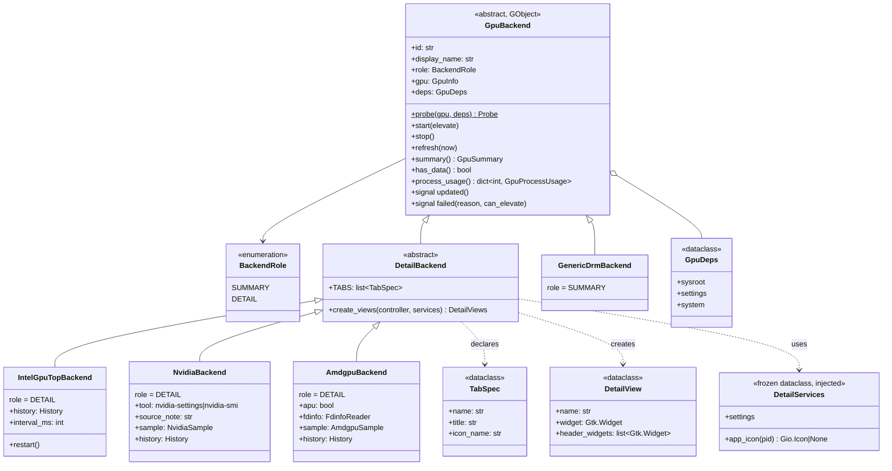

### 7.2 The controller

One `GpuController` per GPU (a `Monitor`, so the rest of the app treats it
like any device) owns both sources:

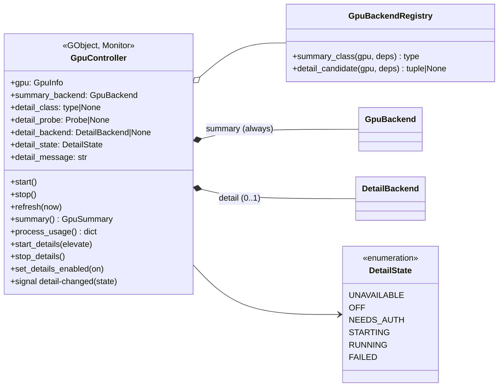

- **Which source feeds what:** `summary()` and `process_usage()` come from
  the detail source while it's RUNNING and has data, otherwise from the
  summary source.
- **Preferences:**
  - `gpu-details-disabled` lists PCI slots whose details are turned off.
  - `gpu-elevate` starts details with pkexec at launch instead of waiting
    for the user.
  - `intel-gpu-top-interval` is the Details tab's update interval, as in
    intel_gpu_top_gui. How much time its charts show is the app's
    `graph-time-range`, like every other graph (M60).

**Detail lifecycle.** A password prompt never appears unless the user asks
for it, either by clicking, or by turning on "Start with administrator
rights" in Preferences:

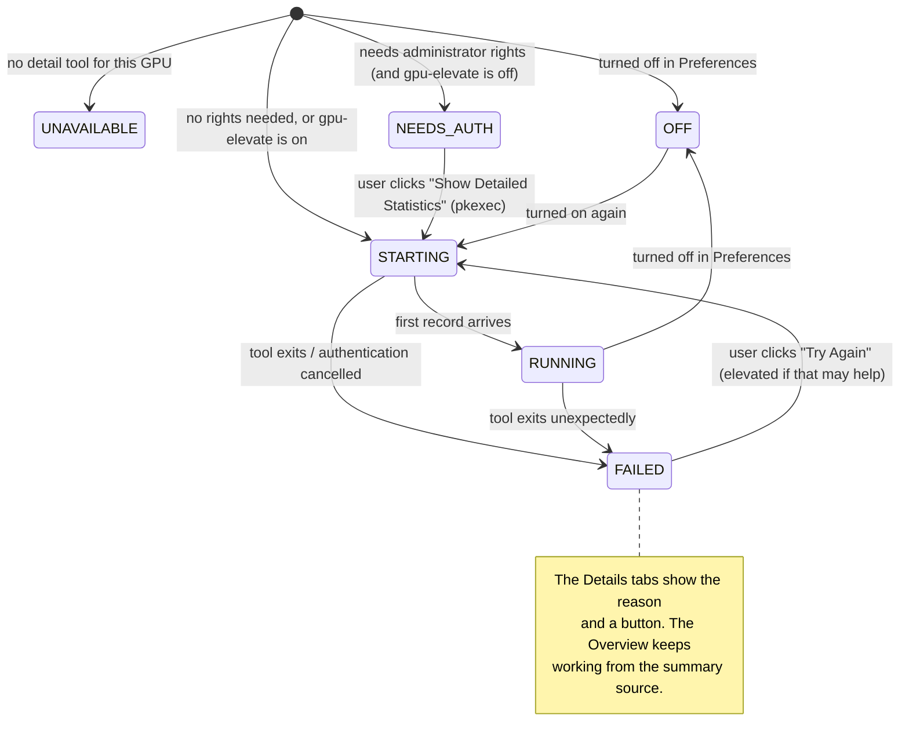

### 7.3 The page

```mermaid
classDiagram
    direction TB
    class GpuPage {
        <<DevicePage>>
        +controller: GpuController
        +stack: Adw.ViewStack
        +switcher: Adw.ViewSwitcher
        +switcher_bar: Adw.ViewSwitcherBar
        +overview: GpuOverview
        +hosts: dict~str, DetailHost~
        +title_widget() Gtk.Widget
        +header_widgets() list
        +show_tab(name)
    }
    class GpuOverview {
        Resources' GPU page: Usage, Sensors, Properties
        + a Detailed Statistics row
    }
    class DetailHost {
        <<Gtk.Stack>>
        +status: Adw.StatusPage
        +set_view(DetailView|None)
        +show_state(state, message)
    }
    class IntelGraphsView {
        <<Adw.BreakpointBin>>
        <<ChartGridView>>
        caption + ChartGrid of ChartCards
        (a LegendChart per group, M60, cards M63)
        compact below 720sp high / 600sp wide
    }
    class IntelClientsView {
        ClientsView: engine-class use per client
    }
    class DetailChartsView {
        <<ChartGridView>>
        GRAPHS table → ChartCards
        values() caption_line() info(title)
        hides lines and cards not reported
    }
    class NvidiaDetailsView
    class AmdgpuDetailsView
    class IntelDetailHeader {
        pause toggle + menu: Update Interval,
        Export as CSV, Clear History
    }
    GpuPage *-- GpuOverview
    GpuPage *-- "0..n" DetailHost : one per TabSpec
    DetailHost o-- IntelGraphsView
    DetailHost o-- IntelClientsView
    DetailHost o-- DetailChartsView
    DetailChartsView <|-- NvidiaDetailsView
    DetailChartsView <|-- AmdgpuDetailsView
    GpuPage o-- IntelDetailHeader : shown on vendor tabs only
    GpuPage o-- GpuController
```

- **The page is never replaced.** The tabs come from the detail class's
  `TABS`, so the switcher doesn't jump around as the state changes.
- **Until the detail source runs,** each vendor tab shows an
  `Adw.StatusPage` for the current state, with the right button: Show
  Detailed Statistics, Try Again, or Turn On.
- **When it starts,** `create_views()` fills the tabs. A new detail backend
  (a restart) brings new views.
- **The switcher sits in the header,** as the page's title widget. In narrow
  windows it moves to a bar at the bottom, as in intel_gpu_top_gui. The
  pause button and menu appear only on the vendor tabs, and the last tab
  used is remembered (`gpu-view`).

Opening the details when administrator rights are needed:

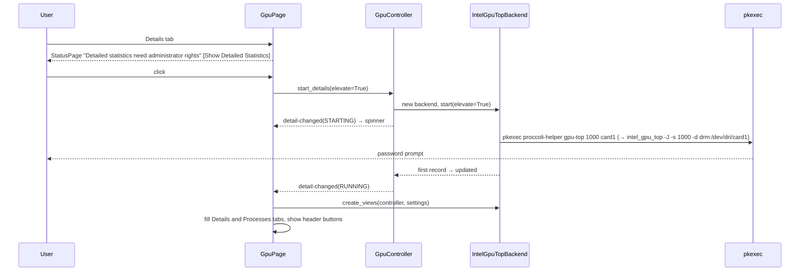

### 7.4 Backend selection

| Backend | Role | Probe result |
|---|---|---|
| `IntelGpuTopBackend` | DETAIL | `PREFERRED` when `vendor == INTEL`, the driver is `i915` or `xe`, and `intel_gpu_top` is installed. `needs_elevation` unless running as root, `perf_event_paranoid` ≤ 0, or the binary has file capabilities. |
| `GenericDrmBackend` | SUMMARY | `FALLBACK` for any DRM card |
| `NvidiaBackend` (M55) | DETAIL | `PREFERRED` when `vendor == NVIDIA`, the driver is `nvidia` (not `nouveau`) and `nvidia-settings` or `nvidia-smi` is installed. Never needs administrator rights. |
| `AmdgpuBackend` (M70) | DETAIL | `PREFERRED` when `vendor == AMD`, the driver is `amdgpu` (not `radeon`) and the device has `gpu_busy_percent` or `gpu_metrics`. Never needs administrator rights or a tool. |

The registry picks the best SUMMARY class and the best DETAIL candidate
separately. Adding a vendor means one DETAIL backend class with its `TABS`
and views, plus a registration line. Nothing else changes.

**Detection: which panel a GPU gets (M55).** `gpu/detect.py` makes the
choice explicit. `plan_gpu(gpu, registry, deps)` asks every registered
backend for its probe (`GpuBackendRegistry.probe_all`, unsupported ones
included, since their reasons explain the choice) and returns a `GpuPlan`:
the chosen summary and detail sources, `panel()` and `explain()`, one line
per backend. `GpuController` makes the plan first and logs it at INFO, for
example:

```
NVIDIA GPU 0000:02:00.0 (driver nvidia): overview + NVIDIA tabs
  intel_gpu_top (detail) not usable: not an Intel GPU
  nvidia (detail) chosen: nvidia-settings, then nvidia-smi
  generic (summary) chosen: …
```

The GPU page shows `detail_text()` as its *Detailed Statistics* property.
When no summary source can serve a GPU, the controller raises with the
plan's explanation, and the GPU gets an error page (§9.7) instead of
vanishing.

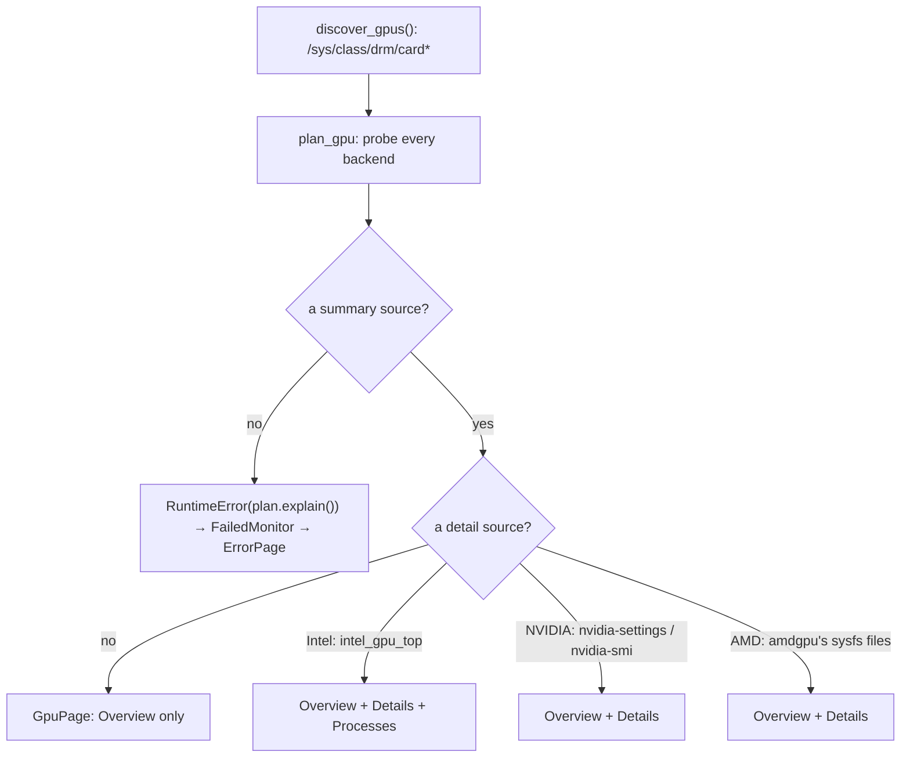

**NVIDIA (M55).** `gpu/nvidia/` polls NVIDIA's tools once per refresh,
through `System.run_async` (never two polls at once; answers arriving
after a stop are dropped by a generation counter):

- **nvidia-settings first**, as asked: `settings_targets_argv` finds this
  GPU's `[gpu:N]` target by PCI slot (`PCIDomain/Bus/Device/Func`), then
  `settings_argv` reads utilisation (graphics, memory, video, PCIe),
  temperature, clocks and memory in terse form each refresh.
- **nvidia-smi when nvidia-settings can't**: not installed, the GPU not
  listed, or no NV-CONTROL. NV-CONTROL is an X11 extension, so in a
  Wayland session (Ubuntu's default) nvidia-settings lists the GPU but
  can't read its utilisation or clocks; the query exits 1 with "No targets
  match", which `NvidiaError.unreachable` marks. nvidia-smi reads the
  driver directly: `smi_argv` asks one GPU (`-i` PCI slot) for
  `SMI_FIELDS` as CSV (utilisation, encoder, decoder, memory, temperature,
  power and limit, clocks, fan, P-state). `source_note` says which tool is
  in use and why; the tool's own error text goes to the log.
- **Failing:** if neither can read the GPU, or a running source has 3 bad
  readings in a row, the backend emits `failed` with the reason, and the
  Details tab shows it with *Try Again* (§7.2's FAILED state).
- The readings (`NvidiaSample`) feed the Overview tab and the sidebar
  through `to_summary()`, and the Details tab (`views.py`: a caption, then
  graphs for utilisation, video engines, video memory, clocks, temperature,
  power and fan, with legends; measures the tool doesn't report are
  hidden). There's no per-process view: `nvidia-smi pmon` takes about a
  second per sample. `GpuController.process_usage()` therefore uses the
  detail source's figures only when it has some.
- Since M70 the Details tab is a `DetailChartsView` (`ui/widgets/
  detail_charts.py`), shared with AMD: a `GRAPHS` table of `ChartCard`s;
  the subclass gives `values()`, `caption_line()` and `info(title)`.

### 7.5 AMD (M70)

amdgpu publishes everything the Details tab needs in sysfs, readable by
every user, so the AMD detail source runs no tool and never asks for a
password. `gpu/amdgpu/`:

- **`metrics.py`** (pure): decodes the binary `gpu_metrics` table. Its
  header gives the layout (`structure_size`, `format_revision`,
  `content_revision`); revision 2 is the APU layout (`struct
  gpu_metrics_v2_X` in the kernel's `kgd_pp_interface.h`): temperatures
  of the graphics, the SoC and each core; package, core and SoC power;
  current clocks; and, from v2.2, `indep_throttle_status`, whose bits
  `throttle_reasons` names. Revision 1 (discrete GPUs) isn't decoded:
  hwmon has the same readings. Checked on a Ryzen 3 4300U (Renoir,
  v2.2) idle and under load; two firmware quirks found there are handled:
  the package power comes in whole watts (the kernel documents
  milliwatts; a package below its own cores' milliwatts must be watts),
  and the memory clock is a level number (no clock is under 100 MHz).
  Unused core slots (a 4-core part fills 4 of 8) are the ones with
  neither a clock nor power.
- **`sensors.py`**: `read_sample(sysroot, device_path, apu, engines,
  hwmon)` → `AmdgpuSample` from `gpu_busy_percent`, `mem_busy_percent`,
  `vcn_busy_percent`, `mem_info_vram_*` and `mem_info_gtt_*`, the
  `pp_dpm_*` clock tables (falling back to `gpu_metrics`), hwmon by label
  (edge, junction and memory temperatures; vddgfx and vddnb; power, cap,
  `pwm1` fan) and `gpu_metrics`. On an APU hwmon's power is the
  package's; the GPU's own comes only from `gpu_metrics` (Renoir doesn't
  report it). `engine_classes` folds fdinfo's engines into graphics,
  compute, copy (`dma`), video decode and encode. `to_summary()` follows
  the same rules as the generic source (M69).
- **`backend.py`**: `AmdgpuBackend(DetailBackend)` reads fdinfo and the
  sample each `refresh(now)`, records it in its `History` (following
  *Graph Time Range* like the other Details tabs, and the history
  database through `history_readings`), and emits `updated`. While it
  runs, `process_usage()` is its own fdinfo reading. It keeps its own
  `FdinfoReader` rather than sharing the summary source's: the two
  sources stay independent, at the cost of a second fdinfo read per tick
  while the Details tab is on. `DemoAmdgpuBackend` makes up readings for
  `--demo` (a second demo GPU, `gpu-demo-amd`).
- **`views.py`**: `AmdgpuDetailsView(DetailChartsView)`: utilization
  (graphics, memory controller, video), engines (only the apps Proccoli
  may inspect, as the caption says), memory (dedicated and shared, as
  percentages; the info line is the total), clocks (graphics, memory,
  fabric, SoC), temperature (GPU, junction, memory, SoC, the hottest
  core), power (GPU, package, cores, SoC, with the cap and what's
  limiting it), voltage and fan. Lines and cards the GPU doesn't report
  are hidden.

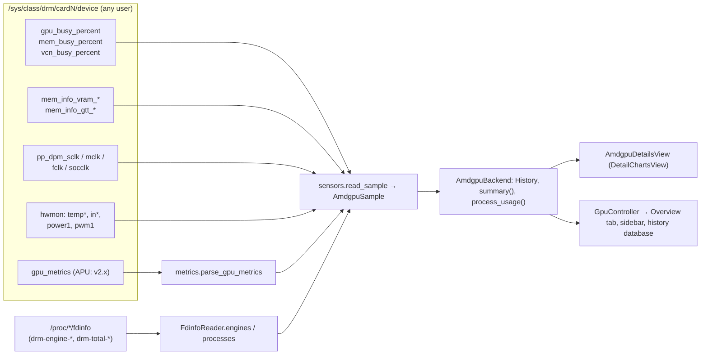

## 8. Processes and Apps

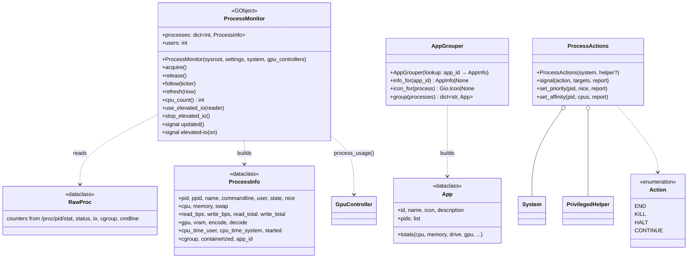

- **Per-process data:**
  - CPU: `/proc/PID/stat` deltas, divided by the CPU count when
    *Normalize Processor Usage* is on (the default): each row is then a
    share of the whole processor and the column adds up to the total; off,
    one busy core is 100 %, as in `top`. Both are wanted (on 24 threads a
    stuck single-threaded process reads 4.2 % or 100 %), so it stays (M58)
  - Memory: `/proc/PID/status` (`VmRSS`, `VmSwap`)
  - Disk I/O: `/proc/PID/io` (own processes only)
  - Cgroup: `/proc/PID/cgroup`, read once per process lifetime
  - GPU columns: summed over every `GpuController.process_usage()`
- **Scanning on demand:** the scan runs only while a table page or an
  information dialog is open (`acquire`/`release`).
- **Other users' disk I/O:** the "Show Drive I/O of All Processes" toggle
  streams `proccoli-helper processes` (root) into the monitor
  (`use_elevated_io`). It fills in the processes we can't read ourselves.
- **App grouping:** by the systemd unit in the cgroup path:
  - `app-<id>.slice` (GNOME 49)
  - `app-gnome-<id>-<n>.scope`
  - `app-flatpak-<id>-<n>.scope`
  - `snap.<name>.<app>-<uuid>.scope` (desktop ID `<name>_<app>`)

  Names, icons and descriptions come from `System.desktop_app`. Everything
  else falls under "System Processes".
- **Icons:** every row of both tables starts with an icon. Apps show
  their own; each process shows the icon of the app it belongs to
  (`AppGrouper.icon_for`, injected into `ProcessesPage`), so an app's
  processes share it. Anything without an icon (System Processes, kernel
  threads, daemons, or a `.desktop` icon the theme doesn't have) shows a
  solid puzzle piece, `MISSING_APP_ICON` (our own
  `<APP_ID>-missing-app-symbolic`; Adwaita's is an outline). Being
  symbolic, it takes the text color: white in the dark style, dark in the
  light style. The GPU's vendor *Processes* tab shows icons the same way:
  it knows only PIDs, so `AppIconLookup(sysroot, grouper).icon_for_pid`
  reads `/proc/<pid>/cgroup` (cached per PID; in `--demo` an empty root,
  since the demo's PIDs are made up). It reaches the view as
  `DetailServices.app_icon`, which the page factory builds from the
  context. `ui/widgets/app_icon.set_app_icon` does the puzzle-piece
  fallback for all three tables.
- **Context menus:** right-click (long-press on touch, Menu key or
  Shift+F10) on an Apps or Processes row selects it (unless it's already
  part of the selection) and opens: Information, Options (Processes), End,
  Kill, Halt, Continue: the same `table.*` actions as the action bar.
  - *Freeze fix (M43):* both the cell's right-click gesture and the
    ColumnView row's own click gesture see the press. The menu used to
    pop up without claiming it, so the row gesture stayed mid-click.
    On Wayland the popup took the button release, and the window then
    ignored all input. `open_cell_menu` now claims the gesture first
    (`EventSequenceState.CLAIMED`), which cancels the row's gesture.
  - *One popover per table:* it's made once and reused
    (`set_menu_model` each time). Its parent is the page's box
    (`menu_parent`), not the clicked cell. Table cells are recycled and
    rebound on every refresh, and a box positions popovers through its
    layout manager. `menu_point` translates the click into the box's
    coordinates; the keyboard menu points at the table's corner.
    `shutdown()` unparents it.
  - Re-sorting under an open menu is safe: `Gtk.MultiSelection` keeps the
    selection on the same rows, i.e. the same processes, not positions
    (checked while investigating: right-click firefox, the table re-sorts
    by processor for 6 s, the selection is still firefox).
- **Switch To** (Apps, top of the menu): GNOME on Wayland lets an app raise
  only its own window, so Proccoli asks the app to show itself
  (`System.activate_app`): D-Bus-activatable apps (most GNOME apps) get
  `org.freedesktop.Application.Activate`; apps declaring
  `SingleMainWindow=true` are relaunched, which shows their window. Others
  (e.g. Firefox, VS Code) would open a second window if relaunched. Since
  M67 (§13.5) `core.windows.WindowSwitcher` decides: Proccoli's GNOME
  Shell extension first (any app with a window), then asking the app
  (now with an activation token, and also for running GApplications that
  own their app ID on the bus), then `wmctrl` in an X11 session. The item
  is offered for every single real app; one nothing can reach gets a
  toast with *Set Up…* (Preferences). Not for System Processes or a
  multi-row selection.
- **Actions:** `ProcessActions` acts directly first (the user's own
  processes). Only what was denied with EPERM goes to the helper, which asks
  for authentication once. Messages name the app ("Ended Firefox"), not the
  number of processes.

## 9. UI layer

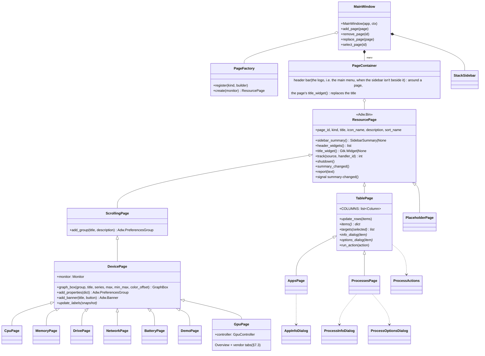

**Dialogs:**
- `ProcessInfoDialog` and `AppInfoDialog` update live while open, and
  acquire the process scan for as long as they're shown.
- `ProcessOptionsDialog` sets the priority (names, or niceness with *Show
  Niceness Values*) and CPU affinity through `ProcessActions`.
- `PreferencesDialog` has General (Appearance: style and palette;
  Administrator Rights; Diagnostics), **Sidebar** (§9.5), Apps,
  Processes, Devices and **GPU** pages. Every row is bound both ways to its key and applies immediately.
  The GPU page has one detailed-statistics switch per GPU that has a detail
  source (`GpuController.set_details_enabled`), plus `gpu-elevate` and the
  intel_gpu_top update interval and history length.
- `about_dialog()` and `shortcuts_dialog()` come from the `SHORTCUTS` table,
  which tests check against the real accelerators.

**Page lifecycle (added in Milestone 1):** pages connect to longer-lived
objects (monitors, settings, GPU controllers). Every such connection is
registered with `ResourcePage.track()`. `MainWindow` calls
`page.shutdown()` when a page is removed (unplugged device), replaced or
the window closes, and `shutdown()` disconnects them all. The GPU page also
drops its detail views (and their backend connections) whenever the detail
source stops or restarts.

### 9.1 Widgets

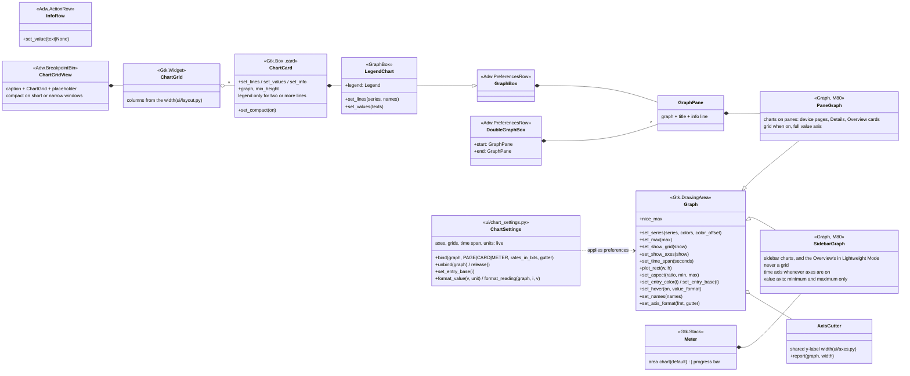

- **One chart family (M63, Idea 4):** every graph gets its preferences
  from a `ChartSettings` (`ui/chart_settings.py`): *Show Graph Axes*,
  *Show Graph Grids*, *Graph Time Range* and the unit preferences, now
  and on every change. Each owner has its own and releases it with its
  graphs: `DevicePage` (`add_graph` binds `PAGE` graphs, with the page's
  `AxisGutter` and, on network pages, *Show Network Speeds in Bits*),
  `OverviewPage` (`CARD`: axes, grid, span, hover), the sidebar
  (`METER`: axes through `Meter.set_show_axes`, grid, span; grids on
  cards and meters since M72, so the toolbar's *Graph Grid* changes
  every chart on screen) and each GPU page's
  Details tabs (`DetailServices.charts`, made per set of views and
  released when they're dropped; it carries the GPU entry's color, so
  the tabs start at it like the Overview tab). `PAGE` graphs also get a
  value axis and `nice_max` in the user's units, the hover box in them
  (`format_reading`), and the owner's entry color (`set_entry_base`).
  Legends and info lines format through `ChartSettings.format_value`, so
  *Data Unit Prefix* and *Temperature Unit* apply everywhere. The GPU
  Details tabs build only `ChartCard`s in a `ChartGridView`; detail
  sources keep readings in base units (B/s, Hz, W, °C) at their history
  boundary (`intel_gpu_top.history.to_base_unit`, the NVIDIA sample's
  `history_values`). `tests/test_static.py` checks that only
  `chart_settings.py` (and Preferences) name the graph keys in views, and
  that `gpu/` builds no `Graph`, `GraphBox` or `LegendChart` itself.
- **One rule for legends:** a chart of two or more lines has a legend
  (`LegendChart`, `ChartCard`); a one-line card has none, and its value
  goes in the info line. Device pages keep Resources' look: graph rows in
  preference groups (`GraphBox`, `DoubleGraphBox`, `LegendChart` for the
  per-CPU chart).

- **Graph:** rounded corners, a fill under the line in the first palette
  color, an optional grid, and lines snapped to device pixels. Colors
  come from the window's theme (§9.3); with the System palette, extra
  series skip colors close to the accent (`palette_without`).
- **InfoRow** with `set_value(None)` hides itself, so pages never show
  "N/A".
- **Axes** (`ui/axes.py` holds the arithmetic): every graph of
  percentages on a 0–100 scale (page graphs, per-thread CPU graphs, sidebar
  charts) gets a left gutter of y labels (0/25/50/75/100 %, labelled as
  far as they fit, always 0 and 100) with tick marks, and a bottom row of
  time labels with ticks: round steps (`nice_step`: 10 s, 1 min, …) back
  from "now" at the right edge, one unit per axis. The span is the
  *Graph Time Range* (`graph-time-range`; M58), followed
  live through `ChartSettings` (below). Small
  graphs use a smaller font, and sidebar charts grow from 36 to 52 px to
  fit the labels. `show-graph-axes` (Preferences → *Show Graph Axes*, on
  by default) turns them off. Since M63 every page graph with a unit has
  a value axis too (an `axis_format`, M60: drive and network speeds,
  power, temperatures, GPU clocks, bandwidth): the y labels are values
  (`value_ticks`: 0 to the maximum in 4, 2 or 1 steps, as many as fit) in
  the user's units (`core.units.format_axis_label`: "2 GB/s", "1.5 GHz",
  "60 °C"). An `AxisGutter` shared by a page's graphs (or a Details tab's)
  gives them one y-label width, so the plots line up whatever their
  units; `nice_max` rounds an automatic maximum in the unit its labels
  show (`nice_max_in_units`: "5 GiB/s", not "4.88").
- **Hover** (M60; `ui/hover.py` holds the arithmetic): page graphs and
  Overview cards (every `NORMAL` graph; not the sidebar's) draw a
  crosshair at the pointer, a marker on each shown line, and a box with
  the time ("12 s ago", from the *Graph Time Range*) and each line's name
  and value (`value_format`, or by unit). `set_hover(False)` turns it
  off. Ported from intel_gpu_top_gui's `GraphView._draw_hover`.
- **Graphs fill the page** (`ui/layout.py` holds the arithmetic), on
  landscape and portrait screens alike (M36):
  - *Width:* the content column is clamped at `MAX_CONTENT_WIDTH` (1600
    px), so graphs use the window; text rows still don't span a 4K screen.
  - *Height:* a `DevicePage` splits the viewport's height among its graph
    rows (`fit_heights`): everything down to the last graph row fits on
    screen, and what's below (Properties) scrolls. Rows are grouped by top
    edge (`group_rows`), so side-by-side graphs share one. Each row stays
    within `height_range(width)` of its narrowest graph, from
    `GraphLimits`:
    - at least 120 px (`min_height`), so small windows scroll;
    - at most 560 px (`max_height`) and half the graph's width
      (`max_ratio`), so a tall portrait window doesn't stretch graphs into
      towers. Height a capped row can't use goes to the other rows; any
      rest stays empty below the content.
  - *Pairs* (`DoubleGraphBox`: GPU video encode/decode, demo read/write)
    sit side by side, and stack (`set_stacked`) when the window is portrait
    or a pane would be narrower than 280 px (`stack_pair`). Pages register
    them with `DevicePage.add_pair`; `_fit_graphs` arranges them first and
    fits again once the new rows are laid out.
  - *When:* `FittingPage` (`ui/page.py`, shared by `DevicePage` and the
    Overview since M50) notices size changes in its own `size_allocate` (it
    drops `AdwBin`'s layout manager, which bypasses that vfunc) and calls
    the page's `fit(width, height)` on idle, never during allocation,
    whenever `fit_key()` changes (the viewport's size, plus whatever else
    the page's layout depends on). Heights change only by 2 px or more, so
    layout can't oscillate. Stacking depends only on the viewport, so it
    can't flip back and forth either. `fit` returning True means "fit
    again once this is laid out".
  - *Overview grid* (M50): see §9.6.
  - *Per-CPU chart (M55, M57):* with *Show Usages of Logical CPUs*, the
    Processor page shows one page graph with a line per logical CPU. (It
    replaced a grid of small per-thread graphs.) Its legend sits inside
    the chart's card, and chart and legend together take **the same area
    as the total chart** (since M59 it's a `LegendChart`, below):
    `DevicePage.reserve(graph, measure)` counts the
    legend's height as part of the graph's area, `fit` shares out areas,
    and each graph gets its area less its reserve (`graph_in_area`, at
    least `MIN_GRAPH_IN_AREA`, 32 px). Switching charts refits
    (`CpuPage.fit_key` includes the visible chart and the legend's height).
    When values in the legend would leave the chart under `COMFORT_GRAPH`
    (96 px; `use_compact_legend`), the legend goes compact: swatch and
    name, the value on hover. The area doesn't depend on the legend, so
    the choice settles; the full legend's height is measured once per
    width.
  - *GPU Details:* `ChartGrid` (`ui/widgets/chart_grid.py`, M63; was
    intel_gpu_top_gui's `GraphGrid`, now used by both Details tabs)
    shares out the spare height and picks its column count from the
    width (`ui/layout.py`: `split_columns`, `extra_heights`,
    `layout_quality`, `choose_columns`); spare height stops at
    `graph_cap(column width)` (same limits), passing what a capped graph
    can't take to the others.

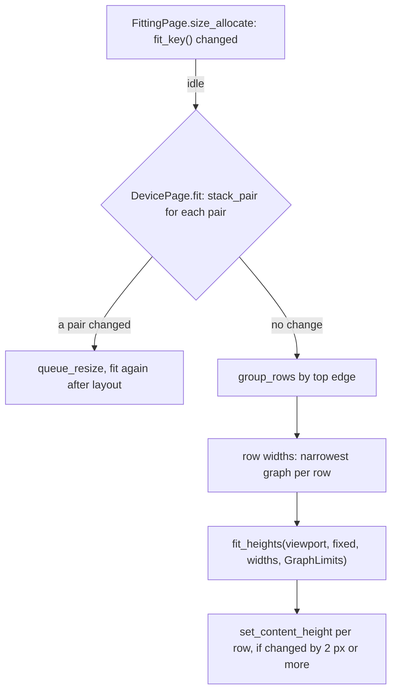

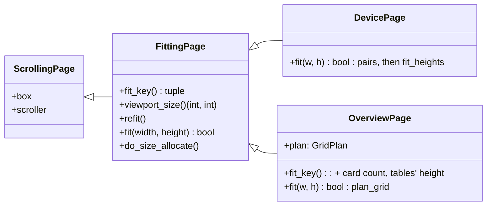

- **Many lines in one graph (M55):** `Graph.set_fill(False)` draws lines
  without the shaded area (16+ filled areas would be mud);
  `set_distinct_colors(True)` gives every series its own color
  (`entry_colors`, the same generator as the sidebar's entry colors, so
  however many CPUs there are, no two lines match); `set_series_shown(i,
  on)` leaves a line out. **Left-click** a legend item hides or shows its
  line; **right-click** (long press on touch) shows only that line, and
  right-clicking it again shows every line (`ui/series_visibility.py`,
  pure; M58). **A chart never shows nothing (M59):** every change ends in
  `never_empty`, so deselecting the only line shown (or hiding the lines
  one by one) brings every line back; lines without data
  (`Legend.set_available`, e.g. a measure a tool doesn't report) never
  count as shown.
- **`LegendChart` (M59), the reusable many-line chart**
  (`ui/widgets/legend_chart.py`): a `GraphBox` with lines only, a distinct
  color per line and the `Legend` inside its card. `set_lines(series,
  names)` and `set_values(texts)` are all a user needs; it carries the
  click rules above and the compact legend (`fit_legend`, below). On a
  device page, `DevicePage.add_legend_chart(group, title, …)` fits it
  like any page graph with the legend counted in its area (`reserve`), and
  `DevicePage.fit` compacts legends after fitting. Standalone (the NVIDIA
  Details tab) it's an ordinary card. Users: the Processor page's per-CPU
  chart and NVIDIA's utilisation, video-engine and clock graphs.

```mermaid
classDiagram
    direction LR
    class GraphBox
    class LegendChart {
        +legend: Legend
        +comfort: int
        +set_lines(series, names)
        +set_values(texts)
        +legend_height(width) int
        +fit_legend() bool
    }
    class Legend {
        +items: list~LegendItem~
        +available: list~bool~
        +shown() list~bool~
        +set_shown(shown)
        +toggle(i)
        +solo(i)
        +set_available(i, on)
        +set_compact(on)
    }
    class series_visibility {
        <<module, pure>>
        +never_empty(shown, available)
        +toggle(shown, i, available)
        +solo(shown, i, available)
    }
    class DevicePage {
        +add_legend_chart(group, title) LegendChart
        +reserve(graph, measure)
        +fit_legends() bool
    }
    GraphBox <|-- LegendChart
    LegendChart *-- Legend
    Legend ..> series_visibility
    DevicePage o-- "*" LegendChart
``` `Legend` (`ui/widgets/legend.py`) is a FlowBox of
  `LegendItem` toggles: a swatch drawn in `graph.color_for(i)` (so it
  follows palette changes with the graph), the name and the current value;
  switching one off hides its line. The NVIDIA Details tab reuses both.
- **Meter:** the sidebar's usage display. By default a 36 px area chart
  across the row (as in Resources) of `SidebarSummary.series`: one
  percentage for Processor, Memory, GPUs, drives (busy time) and
  batteries; receive and send, auto-scaled, for network interfaces. Apps
  and Processes have no summary, so no chart. *Sidebar Meter Type* can
  switch to a slim progress bar.

### 9.2 Window behaviour (mirrors Resources)

- Minimum size 360×240. The `AdwBreakpoint` at `max-width: 780sp` collapses
  the split view: the sidebar becomes an overlay.
- **Sidebar modes, main menu top left (M46, M52, M54, M61):** the sidebar is
  *Full*, *Icons Only* or *Hidden*, at any width, picked from the main
  menu's *Sidebar* section (radio items of the stateful `win.sidebar-mode`
  action). F9 shows and hides it (`win.toggle-sidebar`), keeping the
  style. (Until M52 a toggle button beside the main menu did this, and
  until M54 a *Show Sidebar* check item.) The main menu always stays at
  the window's top left:
  - *The corner (M47, M61):* the app's logo is the main menu's button
    (`main_menu_button`: a flat `Gtk.MenuButton` with the 24 px logo as its
    child, `primary`, so F10 opens it too), alone in the top-left corner
    in both places below. Until M61 the logo was a separate button for
    `app.about`, with a "burger" (≡) menu button beside it; *About
    Proccoli* is now the menu's first item, in a section of its own.
  - *Sidebar beside the content:* the sidebar's header starts with the
    logo.
  - *Sidebar hidden, or folded into an overlay on a narrow window:* every
    `PageContainer` header starts with its own logo (`start_controls`).
    It shows exactly when `header_controls_visible(show_sidebar,
    collapsed)`, i.e. when the sidebar isn't beside the content. All the
    logos share one menu model.
  - *F9 (M52):* `SidebarVisibility.action` is a stateful boolean action
    with no parameter. Its state follows `show-sidebar` (any change: menu,
    F9, the overlay closing after a page is picked, the window
    narrowing); activating it toggles (GIO's default for such an action
    goes through `change-state`, which sets `show-sidebar`).
  - *The modes (M54):* `SidebarVisibility.mode_action` (`sidebar-mode`,
    a string parameter and state) backs the *Sidebar* section's three
    radio items, after *About Proccoli* and *Go To*. Its state is `mode_of(show-sidebar,
    sidebar-style)` and follows both; picking a mode applies
    `choose(mode, style)`: *Hidden* only hides, so the style survives
    and F9 brings it back. Two settings rather than one three-way key
    keep M46's rules (narrow windows never touch `sidebar-shown`) as
    they were. `ui/sidebar_style.py` holds these rules, without a display.
  - *Icons only (M54):* the style reaches the window through the
    injected `on_style` callback. `MainWindow._apply_sidebar_style` calls
    `StackSidebar.set_compact` (every row shows just its icon, centred,
    with no minimise button; its tooltip is `compact_tooltip`: name,
    description, usage line) and sets the split view's minimum and
    maximum sidebar width to `rail_width(header minimum)`, so the logo
    still fits (at least `MIN_RAIL_WIDTH`, 56 px; about 100 px while the
    burger was there). *Full* restores the split view's own
    widths. Each entry's own choices (minimised, hidden parts) are kept
    for when it's full again. Right-click menus and dragging still work.
    Preferences → Sidebar → *Style* sets the same key.
  - `SidebarVisibility(split_view, settings)` (`ui/sidebar_visibility.py`)
    applies the rules. On wide windows `show-sidebar` follows and saves
    `sidebar-shown`. On narrow ones the overlay starts closed, closes when
    a page is picked, and leaves `sidebar-shown` alone, so widening the
    window restores the user's choice. Tests use a fake split view
    without a display. `PageContainer.release()` disconnects a removed
    page's header.

```mermaid
stateDiagram-v2
    direction LR
    state "Wide, sidebar shown" as WS
    state "Wide, sidebar hidden" as WH
    state "Narrow, overlay closed" as NC
    state "Narrow, overlay open" as NO
    [*] --> WS: sidebar-shown = true
    [*] --> WH: sidebar-shown = false
    WS --> WH: logo → Sidebar → Hidden / F9 (saves false)
    WH --> WS: logo → Sidebar → Full or Icons Only / F9 (saves true)
    WS --> NC: window narrows
    WH --> NC: window narrows
    NC --> NO: logo → Sidebar → Full or Icons Only / F9
    NO --> NC: pick a page / F9 / click outside
    NC --> WS: widens, sidebar-shown = true
    NC --> WH: widens, sidebar-shown = false
    note right of WS: the logo (main menu) in the sidebar header, full entries or icons only (sidebar-style)
    note right of WH: the logo (main menu) in every page header
```

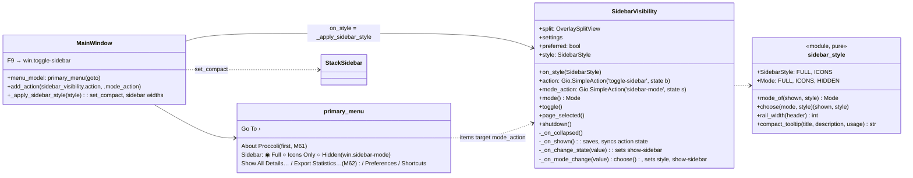
- **Go To (M48):** the main menu's first item is a *Go To* submenu listing
  every pane in the sidebar's display order, so panes can be switched
  without the sidebar (useful while it's hidden). `ui/navigation.py`
  (display-free) builds it: `fill_goto_menu(menu, [(id, title,
  description)])` refills one `Gio.Menu` in place, so an open menu stays
  current. `goto_labels` adds the description when two panes share a
  title (two identical drives), or the page ID if there's none. Items
  target the stateful `win.go-to` action (parameter and state: a page ID).
  Activating it calls `select_page`, and `_on_visible_page` sets its
  state, so the current pane is marked however it was reached. The window
  refills the menu on the sidebar's `entries-changed`, in
  `StackSidebar.display_order()`, which is already right while a row is
  being added. Placeholder pages say "Not available in demo mode." or "Not
  available on this system.", and a static test keeps planning-document
  references out of user-visible strings.

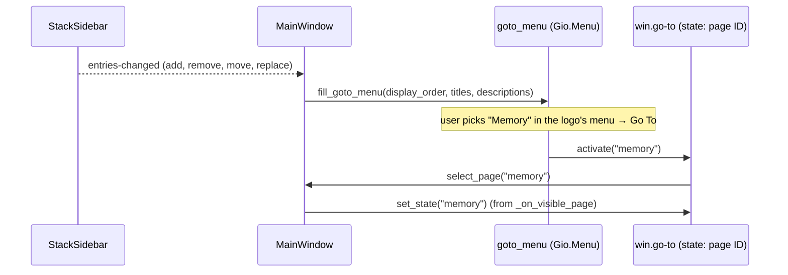
- **Back and forward (M49):** `NavigationHistory` (`ui/navigation.py`, no
  display) keeps the panes visited, browser-style. `visit` starts a new
  branch and drops forward; `back` / `forward` move through the history;
  `remove` forgets an unplugged page and merges the neighbours that
  leaves equal. History holds 50 entries. `MainWindow._on_visible_page`
  records every page change (sidebar, Go To, Overview, …) except those
  made by `go_back` / `go_forward` (`_navigating`). Inputs:
  - the mouse's thumb buttons, through one `Gtk.GestureClick(button=0)`
    on the window in the capture phase. `on_mouse_button` maps GDK
    buttons 8/11 to back and 9/10 to forward (`mouse_direction`), claims
    them, and denies every other button at once, so clicks still reach
    their own widgets. Nothing happens while a dialog is open;
  - `win.back` / `win.forward`, on Alt+Left / Alt+Right, enabled only
    when there's somewhere to go; listed under Keyboard Shortcuts.

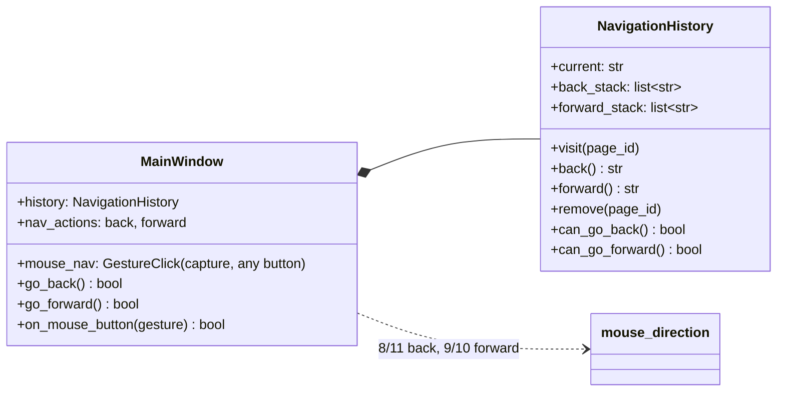
- Built-in page order in the sidebar: Overview (Proccoli-only, M39), Apps,
  Processes, Processor, Memory,
  GPUs (by PCI slot), Drives (by name), Network interfaces (Ethernet, then
  Wi-Fi, then others), Batteries.
- **The user's order** (Proccoli-only): Overview, Apps and Processes stay
  pinned at the top, with no chart and no entry color (`UNCHARTED`). Every other entry can be moved (row menu on right-click, long-press,
  the Menu key or Shift+F10: *Move Up*, *Move Down*, *Minimize*/*Expand*,
  *Reset Order*; Alt+Up/Down; drag and drop) and minimised to its icon and
  name (the chevron on the row). `sidebar-order` holds the order below the
  pinned entries, `sidebar-minimized` the minimised ones.
  `ui/reorder.py` (pure, unit-tested; `sidebar_order.py` until M72, when
  the graph toolbar started sharing it) arranges: pinned first, then the
  saved order; entries it doesn't know (a new drive) go right after their
  predecessor in the built-in order. Drag, drop and the Alt+arrow keys
  are wired by `widgets/reorderable.make_reorderable`, shared with the
  toolbar (§13.11).
- **Parts per entry:** each movable entry can show or hide its name,
  description (model, device ID, interface name...), usage line and chart
  (row menu *Show …* check items; Preferences, §9.5). `sidebar-hidden-fields`
  (`a{sas}`: page ID → hidden parts) holds the choices;
  `ui/sidebar_fields.visible()` combines them with the global *Show Usage
  Details* / *Show Device Descriptions* switches and minimising. The icon
  always stays, so a fully hidden entry is still there to click.

```mermaid
classDiagram
    direction LR
    class StackSidebar {
        +order() list
        +default_order() list
        +move(id, delta)
        +move_before(id, target)
        +set_minimized(id, on)
        +reset_order()
        +set_field_shown(id, field, on)
        +set_compact(on)
        +row_menu(id) Gio.Menu
        +row_actions(id) Gio.ActionGroup
        +assign_colors()
    }
    class reorder {
        <<module, pure>>
        +arrange(default, saved, pinned) list
        +move(order, id, delta, pinned) list
        +move_before(order, id, target, pinned) list
        +can_move(order, id, delta, pinned) bool
    }
    class StackSidebarItem {
        +movable: bool
        +minimized: bool
        +set_minimized(on)
        +set_hidden_fields(fields)
        +set_compact(on) : icon only + tooltip
        +shows(field) bool
        +minimize_button
        +details: icon-aligned box
    }
    StackSidebar ..> reorder
    StackSidebar ..> make_reorderable : drag, drop, Alt+Up/Down
    StackSidebarItem ..> sidebar_fields : visible()
    StackSidebar *-- "many" StackSidebarItem
    StackSidebar ..> Settings : sidebar-order, sidebar-minimized
```
- **Sidebar icons:** each entry has a 16 px symbolic icon left of its name;
  its description, usage line and chart line up under the name. Apps and
  Processes use Adwaita's app grid and list icons. Processor, Memory and GPU
  (a graphics card) use our own (`PROCESSOR_ICON`, `MEMORY_ICON`,
  `GPU_ICON` in `data/icons`, 0BSD: Resources' icons are GPL). Drives use
  Adwaita's icon for their type (solid state, hard disk, removable, optical,
  memory card, virtual), network interfaces theirs (wired, wireless, VPN)
  and batteries `battery-symbolic`.
- The window size and maximised state are saved. The page isn't: every
  launch opens on the Overview (`MainWindow.show_overview()`, also called
  by `Application.do_activate` when Proccoli is launched again while
  open; M55).
- Keyboard: `Ctrl+F` search (table pages), `Ctrl+,` Preferences, `Ctrl+?`
  shortcuts, `Ctrl+Q` quit, `Delete` end process, `Ctrl+Delete` kill
  process, `Ctrl+I` information.

### 9.3 Appearance

```mermaid
classDiagram
    direction LR
    class Theme {
        <<GObject>>
        +settings
        +style_manager
        +dark: bool
        +palette: Palette
        +system_accent() RGB
        +series_rgb(index) RGB
        +accent_rgb() RGB
        +offline_rgba() RGBA
        +accent_css() str
        +entry_rgb(index, series) RGB
        +entry_css() str
        +css() str
        +shutdown()
        +signal changed()
    }
    class Palette {
        <<core.palette, frozen dataclass>>
        +id, name
        +light: hex colors
        +dark: hex colors
        +follows_accent: bool
    }
    class ThemeCss {
        <<ui.style>>
        CSS provider with accent_css()
    }
    class Graph {
        colors from theme_of(self)
    }
    Theme --> Palette
    Theme --> Style
    class Style {
        <<core.styles, frozen dataclass>>
        +id, name
        +base: system|light|dark
        +colors: surface → hex
    }
    ThemeCss o-- Theme
    Graph ..> Theme : via its window
    class StyleManager {
        <<Adw.StyleManager or a test fake>>
        +set_color_scheme(scheme)
        +get_dark() bool
        +get_accent_color_rgba()
        +notify::dark, notify::accent-color
    }
    Theme o-- StyleManager
    Theme ..> Settings : color-scheme
```

- **Styles** (`core/styles.py`, no GTK): *Follow System* (default; maps to
  `Adw.ColorScheme.DEFAULT`, which follows the desktop), *Light*, *Dark*,
  and tinted styles: four named after ExpressVPN's themes, with our own
  colors (*Sand*, *Sky*, *Twilight*, *Midnight*), and since M83 more
  light ones (Mint, Rose, Lavender, Paper, Solarized Light, Gruvbox
  Light, Catppuccin Latte, High Contrast Light) and dark ones (Nord,
  Dracula, Gruvbox Dark, Solarized Dark, Catppuccin Mocha, Tokyo Night,
  Forest, Ember, Black, High Contrast Dark), light ones listed first. A style has a base
  scheme and, if tinted, colors for libadwaita's surfaces (window, view,
  header bar, sidebar, cards, popovers, dialogs; `style_css` writes the
  `--*-color` variables and the pre-1.6 `@define-color` names, loaded by
  `ThemeCss`). Text meets WCAG AAA contrast (7:1) on every surface (tested).
  Changes apply at once; `Theme` emits `changed` once per change.
- **Palettes** (`core/palette.py`, no GTK): eight, after GNOME Terminal's
  built-in schemes plus Nord: **System** (default: the desktop's accent
  color first, then color-blind-friendly steps that don't clash with it),
  GNOME, Tango, Solarized, Linux Console, XTerm, Rxvt and Nord. Each has a
  light variant (the terminal's normal colors) and a dark one (its bright
  colors), in series order blue, red, green, yellow, magenta, cyan.
- **What a palette colors:** every graph series (page graphs, sidebar
  meters, the Intel Details graphs and legends) and, except for System, the
  accent color: `ThemeCss` loads `--accent-bg-color` (and the pre-1.6
  `@define-color` names) at application priority, so switches, progress
  bars and selections match.
- **Time not running (M68):** graphs shade it with a 2×2 dither in
  `offline_rgba(accent, dark)`: the palette's accent mixed 80 % towards
  black, at alpha 0.4 on light styles and 0.75 on dark ones. Near-black
  so it recedes, tinted so it belongs to the palette, and never a series
  color, so it can't be read as data.
- **Where it lives:** `Application` builds the `Theme` into
  `AppContext.theme` (the UI half of the composition root) and a
  `ThemeCss`; `MainWindow` makes a theme if a test didn't, and exposes it
  as `window.theme`.
- **How widgets get it:** no globals. A graph asks its window
  (`theme_of(widget)` reads `widget.get_root().theme`) when it draws;
  outside a themed window it uses the System palette. When the theme
  emits `changed` the window queues a redraw of every drawing area under it
  (`redraw_tree`), because GTK caches each widget's rendering.
- **A color per sidebar entry:** the sidebar numbers its charted entries
  (all but Apps and Processes) in the built-in order (so moving an entry
  keeps its color) and gives each
  `Theme.entry_rgb(i)`: the palette's colors, then lighter and darker
  shades (`entry_colors`), so every entry differs however many there are.
  Its chart uses that color (network's send series a shade of it,
  `secondary`), its progress bar the `.entry-color-<i>` rule `ThemeCss`
  loads, and its page's graphs start at the same color
  (`ResourcePage.set_entry_color` → `Graph.set_entry_base`), so sidebar and
  page match.
- **Preferences → General → Appearance:** *Style* (Follow System, Light,
  Dark) and *Color Palette* (each entry shows its colors for the current
  style).

#### App icon (M38)

The icon is a gauge whose needle is a broccoli. The stalk is the needle's
shaft and its cut end sits on the pivot; the lumpy crown is the needle's
head. The broccoli's awkward shape (thin stem, big top) becomes the most
natural part of the picture, instead of being squeezed into a frame.

- *Flat dial:* dark bezel and face, a 240° scale in GNOME green, yellow
  and red with ticks, and a green sparkline under the pivot (usage over
  time).
- *Broccoli on top:* drawn with depth (gradient stalk with fibres and a
  pale cut face; ten florets with radial shading, each covered in buds lit
  from the upper left), and a soft shadow on the dial. It points at about
  58 % of the scale, in the green.
- *Small sizes:* at 16 px the dial ring, the green broccoli and the red
  end of the scale still read.
- `packaging/make-logo.py` writes the SVG. Buds come from a seeded random
  generator, so every run gives the same file; tests check that the
  committed SVG is exactly its output, that it stays on the canvas, and
  that the PNGs match it. `make icons` runs it, then
  `render-icons.py` renders the PNGs (16–512 px).

### 9.4 Optional authentication at launch

```mermaid
classDiagram
    direction LR
    class ElevationOffer {
        <<dataclass>>
        +id: page ID
        +title, subtitle
        +run(done: ok → None)
    }
    class ElevationRunner {
        +start()
        +results: dict~id, bool~
        one offer at a time
    }
    class ResourcePage {
        +elevation_offer() ElevationOffer|None
    }
    class LaunchAuthDialog {
        <<Adw.AlertDialog>>
        a switch per offer
        Authenticate | Not Now
        Don't ask at start-up
    }
    ResourcePage ..> ElevationOffer : offers
    LaunchAuthDialog o-- "1..n" ElevationOffer
    LaunchAuthDialog ..> ElevationRunner : Authenticate
    MainWindow ..> LaunchAuthDialog : at launch, menu
```

- **Offers** (`ResourcePage.elevation_offer()`), only while there's
  something to unlock:
  - *Memory:* module properties through `dmidecode`, only when udev had
    none (§6).
  - *GPU:* detailed statistics when the detail source is NEEDS_AUTH (§7.2).
  - *Processes:* every process's drive I/O through the helper.
- **At launch,** if `auth-at-launch` is on and there are offers, the window
  shows `LaunchAuthDialog` once it's on screen. *Authenticate* runs the
  switched-on offers with `ElevationRunner`, strictly one after another,
  because each may show a polkit prompt (dmidecode and the I/O stream are
  separate polkit actions; intel_gpu_top never caches). A failure or
  cancelled prompt doesn't stop the rest.
- **Optional:** *Not Now* changes nothing. Every page keeps its own button
  (Memory's *Authenticate*, the GPU tabs' *Show Detailed Statistics*,
  Processes' I/O toggle), and the main menu's *Show All Details…*
  (`win.authenticate`, enabled while there are offers) brings the dialog
  back. "Don't ask at start-up" and Preferences → General → *Ask for
  Administrator Rights at Start-Up* control `auth-at-launch`.

### 9.5 Sidebar preferences

```mermaid
classDiagram
    direction LR
    class PreferencesDialog {
        +sidebar: StackSidebar|None
        +entry_rows: dict~id, Adw.ActionRow~
        +open_entry(id) EntryPage
    }
    class EntryPage {
        <<Adw.NavigationPage>>
        +switches: Field → Adw.SwitchRow
        +minimized: Adw.SwitchRow
        +up, down: Gtk.Button
        +sync()
        +shutdown()
    }
    PreferencesDialog *-- "0..n" EntryPage : push_subpage
    EntryPage ..> StackSidebar : set_field_shown, set_minimized, move
```

- Preferences → **Sidebar**: *All Entries* (the global *Show Usage
  Details*, *Show Device Descriptions* and *Meter Type*, moved from
  General) and *Entries*: one row per movable entry, in sidebar order,
  with its icon and current description (model, device ID, interface
  name...). Apps and Processes aren't listed: they stay on top.
- A row opens the entry's sub-page: *Name*, *Description*, *Usage Details*
  and *Chart* switches (each subtitled with what it shows now),
  *Minimized*, and *Position* with Move Up/Down. Everything goes through
  the window's `StackSidebar` (injected as `sidebar=`), so it uses the same
  settings and rules as the row menu, and the page follows changes made
  there (`sync()`); it disconnects when the dialog closes.

---

### 9.6 Overview page (M39, M41, M50, M51; Lightweight Mode M71)

*In Lightweight Mode* (§13.7) the cards are a plain 3-column list, each
with the sidebar's small chart instead of a fitted one, and the busiest
tables have five rows without icons.

The first sidebar entry, pinned above Apps and Processes. It shows a card
for every entry that has a sidebar chart, in the sidebar's order and
colors: the entry's icon, name and usage on top; its detail and
description below; then a chart of the same series as its sidebar chart.
Clicking a card opens that page. Placeholder pages (no summary at all) get
no card. It's always the page shown at launch (M55).

- **Layout: an N × M grid that tries to fill the page** (M50, M51). Before, chart
  height followed card width (0.4 ×, at most 240 px), which left most of a
  full-screen portrait monitor empty. Now the cards (a homogeneous
  `Gtk.FlowBox`) fill the height the page gives them:
  - *Area:* the viewport less the column's margins and the top tables'
    natural height (and the gap above them). If that would make charts
    shorter than 80 px (`GRID_MIN_CHART`), the cards take the whole
    viewport and the tables scroll into view below. With fewer charts the
    tables always stay on screen.
  - *Shape:* `plan_grid` (`ui/layout.py`, no display) tries 1–4 columns,
    each card at least as wide as its minimum (280 px plus the FlowBox
    child's padding); rows share the height equally. It scores each by
    how far the chart's height/width is from 0.5 (log scale) plus 2 × the
    share of empty cells, so full rows win over a slightly better shape;
    any plan needing charts under 80 px loses to one that doesn't.
  - *Never taller than wide* (M51): the grid only *tries* to fill. A
    chart's height stays strictly below its width (`GRID_MAX_RATIO` 1.0,
    `max_chart_height(w) = ceil(w × ratio) − 1`), so one or two cards on a
    portrait screen don't become towers. The score adds 2 × the share of
    the area left unfilled, so among plans within the cap the one that
    fills most wins: two cards on a landscape page stack (filling) rather
    than sit side by side capped. What the cap leaves stays empty below
    the grid; the tables move up into it.
  - *Chrome:* a card's height apart from its chart is measured from the
    FlowBox child (its padding included), at the planned width. Its width
    apart from the chart (the child's margins, the card's border and
    padding) is measured as the column slot (flow width ÷ columns) less
    the chart's allocated width, so the cap holds on screen. Before the
    first layout it's estimated, and the page fits once more after it.
  - *Applying:* `max_children_per_line` = the planned columns (the
    minimum stays 1, so the window can still be made narrower), and every
    chart's content height = the planned height. A column change refits
    once more after layout, and only once, so rounding can't flip the
    column count back and forth.
  - *When:* `OverviewPage` is a `FittingPage` whose `fit_key()` adds the
    number of cards and the tables' height (they grow from "Waiting for
    data…" to ten rows), so all three refit.

```mermaid
flowchart TD
    A["fit_key() changed: viewport, cards, tables"] -->|idle| B["area = viewport − margins − tables"]
    B --> C["plan_grid(count, width, area, chrome)"]
    C --> D{charts ≥ 80 px?}
    D -->|yes| F[apply: max columns, chart heights]
    D -->|no| E["plan_grid(count, width, viewport − margins): tables below the fold"]
    E --> F
    F --> G{columns changed?}
    G -->|"yes, or chrome width only estimated; first time"| H[fit again after layout]
    G -->|no| I[done]
```
- **Readings line (M57):** under the detail line, a card shows
  `SidebarSummary.facts`: the processor's temperature, a GPU's
  temperature and memory ("Temperature 39 °C · Memory 598.7 MB / 8.5 GB",
  `core.units.device_facts`, in the user's temperature unit and unit
  base). Readings a device doesn't have are left out (an Intel iGPU has
  neither, so no line). The line appears with the first data, so
  `fit_key` counts cards showing one and the grid refits.
- **Data:** a card calls `page.sidebar_summary()` and follows the page's
  `summary-changed`, exactly like a sidebar row. `SidebarSummary.text()`
  builds the usage line for both. Charts redraw only while mapped; axes
  and time span follow `show-graph-axes` and `graph-time-range`.
- **Decoupled from the sidebar (DI):** `OverviewPage(settings,
  navigate)` never touches the sidebar. `StackSidebar` emits
  `entries-changed` whenever its charted entries, their order or their
  colors change (every `assign_colors()`), and `entries()` lists
  `(page, color index)` in display order. The window connects the two
  (`overview.sync(sidebar.entries())`) and passes `select_page` as
  `navigate`. Tests drive `sync()` with fake pages.

```mermaid
classDiagram
    direction LR
    class OverviewPage {
        +settings
        +navigate(page_id)
        +plan: GridPlan
        +plan_for(width, viewport_h) GridPlan
        +grid_area(viewport_h, with_tables) int
        +cards: dict~str, OverviewCard~
        +sync(entries: list~(ResourcePage, int)~)
        +order() list~str~
        +shutdown()
    }
    class OverviewCard {
        +page: ResourcePage
        +graph: Graph
        +set_page(page, color)
        +set_chart_height(px)
        +chrome_height(width) int
        +chrome_width(slot) int?
        +set_style()
        +update()
        +shutdown()
    }
    class StackSidebar {
        +colors: dict~str, int~
        +entries() list~(ResourcePage, int)~
        +signal entries-changed()
    }
    class ResourcePage {
        +sidebar_summary() SidebarSummary
        +signal summary-changed()
    }
    class SidebarSummary {
        +facts: list~str~
        +text() str
        +has_chart() bool
    }
    FittingPage <|-- OverviewPage
    OverviewPage "1" *-- "*" OverviewCard
    OverviewCard --> ResourcePage : follows
    ResourcePage --> SidebarSummary
    MainWindow --> OverviewPage : sync(sidebar.entries()), navigate = select_page
    MainWindow --> StackSidebar : entries-changed
```

```mermaid
sequenceDiagram
    participant W as MainWindow
    participant S as StackSidebar
    participant O as OverviewPage
    participant C as OverviewCard
    participant P as Device page
    W->>S: add_item(page) / move / remove_item / replace_page
    S->>S: assign_colors()
    S-->>W: entries-changed
    W->>O: sync(S.entries())
    O->>C: create, re-color, reorder or drop cards
    P-->>C: summary-changed (each tick)
    C->>P: sidebar_summary()
    C->>C: labels, series, queue_draw if mapped
    C-->>O: child-activated (click)
    O->>W: navigate(page_id) = select_page
```

#### Busiest apps and processes (M41)

Below the cards, **Busiest** shows two tables: the top 10 apps and the
top 10 processes. Each row has rank, icon (the puzzle piece when there's
none), name, processor use and memory.

- **Ranking** (`processes/top.py`, pure): by processor use or memory,
  chosen with the *Processor / Memory* toggle (`overview-top-by`). Ties go
  to the other measure, then the name (case-insensitive), so rows don't
  swap on equal values. *System Processes* isn't ranked as an app: it
  would nearly always be first, and its processes are in the other table.
  The column used for the ranking is highlighted.
- **Data:** the same `ProcessMonitor` and `AppGrouper` as the Apps and
  Processes pages. `TopTables` acquires the monitor only while the
  Overview is mapped, so processes aren't sampled for a page no one sees.
  Memory follows the unit base preference.
- **Widgets:** `TopTable` (`ui/widgets/top_table.py`) makes its 10
  `TopRow`s once and refills them in place, hiding unused ones, so updates
  don't flicker or move keyboard focus. Activating a row opens the Apps
  or Processes page.
- **Layout:** a `FlowBox` puts the tables side by side when each can be at
  least 340 px wide, and stacks them otherwise (portrait windows). It isn't
  homogeneous, so the shorter table leaves no gap.
- **No monitor, no tables:** in demo mode and in tests without one,
  `OverviewPage(processes=None)` shows only the cards.

```mermaid
classDiagram
    direction LR
    class TopTables {
        +monitor: ProcessMonitor
        +grouper: AppGrouper
        +apps: TopTable
        +processes: TopTable
        +by_buttons: dict~TopMetric, ToggleButton~
        +metric: TopMetric
        +refresh()
        +start()  acquire
        +stop()  release
        +shutdown()
    }
    class TopTable {
        +rows: list~TopRow~
        +set_rows(rows)
        +set_sorted_by(metric)
        +shown() list~str~
    }
    class top_py {
        <<module>>
        +TopMetric: CPU, MEMORY
        +rank_key(item, metric)
        +top(items, metric, count)
        +top_apps(apps, metric, count)
        +top_processes(processes, metric, count)
    }
    OverviewPage *-- TopTables : when a monitor exists
    TopTables *-- "2" TopTable
    TopTable *-- "10" TopRow
    TopTables ..> top_py
    TopTables --> ProcessMonitor : updated
```

### 9.7 Error pages (M55)

A device Proccoli can't read keeps its sidebar entry; its page says what
went wrong instead of the device silently missing.

- **When:** `DeviceManager` couldn't build or start the device's monitor
  (it keeps a `FailedMonitor` with the message and traceback, §6), or the
  page factory's builder raised (`PageFactory.create` logs it and returns
  the error page instead).
- **What it shows:** `ErrorPage` (`ui/pages/error.py`): an `Adw.StatusPage`
  with the error icon, "*Name* Isn't Available" and the message; a
  *Technical Details* expander (monospace, selectable, *Copy Details*);
  *Try Again*. It has no sidebar summary, so the entry has no chart.
- **Try Again** emits `retry`. `MainWindow._on_retry` calls
  `DeviceManager.retry(id)` for a failed device (which emits
  `device-removed` and `device-added`, with an error page again if it
  still fails) and keeps the page selected; for a page that failed to
  build, it builds the page again and swaps it in place.
- The GPU page's vendor tabs show their own FAILED state (§7.2) with the
  same error icon and *Try Again*.

```mermaid
sequenceDiagram
    participant DM as DeviceManager
    participant F as PageFactory
    participant W as MainWindow
    participant E as ErrorPage
    DM->>DM: create_monitor() or start() raises
    DM-->>W: device-added(FailedMonitor)
    W->>F: create(monitor)
    F-->>W: ErrorPage(message, traceback)
    Note over E: user clicks Try Again
    E-->>W: retry
    W->>DM: retry(id)
    DM-->>W: device-removed, device-added(monitor or FailedMonitor)
    W->>W: select_page(id)
```

## 10. Runtime flow

### 10.1 Start-up

```mermaid
sequenceDiagram
    participant A as Application
    participant S as Settings
    participant C as build_context
    participant DM as DeviceManager
    participant D as Discoverers
    participant GC as GpuController
    participant W as MainWindow
    participant T as Ticker
    A->>S: load (GSettings or fallback)
    A->>C: build_context(settings, demo)
    C-->>A: AppContext (System, SysRoot, DeviceManager, ProcessMonitor, ProcessActions, PrivilegedHelper)
    A->>DM: ctx.start() → devices.start(ticker)
    DM->>D: discover() for CPU, Memory, GPU, Drive, Network, Battery
    D-->>DM: DeviceInfo list → Monitors (GpuController for GPUs)
    GC->>GC: registry.best(SUMMARY).start(), best(DETAIL) started unless it needs a password
    A->>W: create window
    DM-->>W: device-added(monitor) × N
    W->>W: page = ctx.pages.create(monitor) (GPU: GpuPage with the detail TABS)
    W->>W: add PageContainer + StackSidebarItem
    W->>W: show_overview()
    A->>T: start(update interval)
```

### 10.2 Each tick

```mermaid
sequenceDiagram
    participant T as Ticker
    participant M as Monitor (each)
    participant GC as GpuController
    participant PM as ProcessMonitor
    participant P as visible page
    participant SB as StackSidebar
    T->>M: refresh(now)
    M->>M: sample() → Snapshot, history.add()
    M-->>P: updated(snapshot) (only the visible page redraws graphs)
    M-->>SB: updated → item.update(sidebar_summary)
    T->>GC: refresh(now)
    GC->>GC: summary() from the detail source while RUNNING, gaps filled by the summary source
    T->>PM: refresh(now)
    PM->>GC: process_usage()
    PM-->>P: updated (if Apps/Processes is visible)
```

**Performance:** the process scan runs only while Apps or Processes is
visible (pages acquire and release the `ProcessMonitor`). Hidden device
pages still record history, but they don't redraw.
Each page tracks `get_mapped()`; when it becomes visible again it draws once
with the full history. With the window hidden, the per-process scan drops to
every 5 s.

---

## 11. Cross-cutting concerns

- **Settings schema** (`io.github.mamadingleberry.Proccoli`) mirrors
  Resources' keys: window size and maximised state, temperature unit, unit
  base, refresh speed (replaced by `update-interval`, M65), virtual drives
  and network interfaces, sidebar
  details, description and meter type, network bits, every `apps-show-*` and
  `processes-show-*` column, logical CPUs, graph grids, sort column and
  order, normalize CPU usage, detailed priority. Proccoli adds:
  - `graph-time-range` (M58, replacing Resources' *graph data points*):
    how much time graphs show (30 s; 1, 2, 5, 10 or 30 minutes; 1 or 6
    hours; 1 day; default 1 minute). `core.ticker.graph_plan(settings)`
    turns it into a number of points at the current update interval (at
    most 1200, averaging samples for long ranges, M64), so changing the
    speed no longer changes the time a graph covers; `DeviceManager`
    resizes every history when either changes
  - `lightweight` (M66, Idea 1): Lightweight Mode at the next start
    (§13.1); `--lightweight` turns it on for one run
  - `update-interval` (M65, Idea 6): how often Proccoli takes readings,
    `1-second` (default), `2-seconds`, `3-seconds`, `5-seconds` or
    `10-seconds` (`core.ticker.UPDATE_INTERVALS_MS`). It replaced
    `refresh-speed`, which stays in the schema only so `settings.migrate`
    can carry an old choice over once at start-up (very slow → 5 s, slow →
    2 s, the rest → 1 s; then it's reset). Old nicks in
    `intel-gpu-top-interval` are migrated the same way, and
    `ticker.interval_for` reads either kind
  - `history` (on), `history-max-size` (MiB, default 512, 16–4096) and
    `history-detail-hours` (default 24, 1–168): the history database
    (§13.2, M62). They replaced M58's `stats-log` and `stats-log-max-size`
  - `color-scheme`: the style: `system` (follow the desktop), `light`,
    `dark`, `sand`, `sky`, `twilight` or `midnight`
  - `palette`: one of the eight color palettes (§9.3), `system` by default
  - `auth-at-launch`: offer to authenticate at start-up (§9.4), on by default
  - `sidebar-shown`: whether the sidebar shows on wide windows (§9.2), on
    by default
  - `sidebar-style`: `full` (default) or `icons` (icons only, M54); with
    `sidebar-shown` it gives the menu's three modes (§9.2)
  - `overview-top-by`: what ranks the Overview's busiest apps and
    processes, `cpu` (default) or `memory` (§9.6)
  - `sidebar-order`, `sidebar-minimized` and `sidebar-hidden-fields`: the
    user's sidebar (§9.2)
  - `graph-time-range-custom` (seconds, 10–2592000, default 7200): the
    range when `graph-time-range` is `custom` (M74, §13.8)
  - `show-toolbar` (on) and `toolbar-items` (default `['time-range',
    'axes', 'grids']`): the graph toolbar and its buttons in order (M72,
    §13.11)
  - `export-hardware-addresses` (off): whether exports include network
    cards' hardware addresses (M73, §13.13)
  - `show-graph-axes`: axes on graphs (§9.1; percentages, and since M63
    every page graph with a unit), on by default
  - `log-level`, `log-max-size`, `log-performance-interval`: the
    diagnostics log (below)
  - `gpu-details-disabled`: PCI slots whose detailed statistics are off
  - `gpu-view`: the GPU page's last tab (overview, details, processes)
  - `gpu-elevate`: start the detail source through pkexec at launch
    instead of waiting for the user to ask
  - `intel-gpu-top-interval`: the Details tab's own update interval
    (an `update-interval` nick; empty = the app's). Its history length was
    `intel-gpu-top-history` until M60; it now follows `graph-time-range`
- **Diagnostics log** (`core/applog.py`): standard practice on Linux, a
  rotating file at `$XDG_STATE_HOME/proccoli/proccoli.log`
  (`~/.local/state/proccoli/`). `FileLog` attaches a `RotatingFileHandler`
  to the `proccoli` logger: `log-level` (off, error, warning, info, debug;
  **debug, i.e. everything, by default** since M55) and `log-max-size`
  (KiB, default 1024, 64–65536); one older file is kept, so it never takes
  more than twice the size on disk (tested). Times are **UTC**, ISO 8601
  to the millisecond (`UtcFormatter`: `2026-11-23T21:41:25.154Z`), so logs
  from machines in different time zones line up.
  The terminal keeps its own level (`--debug`). `PerformanceLog` (in the
  context, connected to the ticker first, so it times whole refreshes)
  writes every `log-performance-interval` minutes (default 10, 0 off):
  Proccoli's CPU %, memory, threads, refreshes and the slowest refresh, from
  `/proc/self` through `SysRoot`. Preferences → General → *Diagnostics*
  sets all three and opens the log folder. `Application(log_file=...)`
  and `PreferencesDialog(launcher=...)` are injectable, so tests never
  write to the real home. Log files are private (0600, folder 0700).
- **History database** (`core/history_db.py`, `core/history_store.py`,
  M62): every reading Proccoli shows, kept in
  `$XDG_STATE_HOME/proccoli/history.sqlite3` and summarised as it ages;
  §13.2 has the design. It replaced M58's statistics files (one CSV per
  device in `stats/`), which are imported once and removed. Their format
  lives on as the export format. `Snapshot.stats_values()` /
  `stats_units()` say what's recorded: by default the graphed readings
  (`history_values`); Memory adds used/total bytes of memory and swap,
  GPUs their memory bytes and memory clock.
- **Stall watchdog** (`core/watchdog.py`, M44): a frozen window logs
  nothing, because the main loop that would write is the thing that's
  stuck. `Application` starts a `StallWatchdog`: the main loop beats every
  250 ms (`GLib.timeout_add`), and a daemon thread checks the beat. After 3
  s without one, it logs an error with three samples, 0.3 s apart, of every
  thread's Python stack (`format_stacks`, main thread first), so a loop
  shows its repeating frames. When the beat returns, it logs how long the
  stall lasted. PyGObject releases the GIL while GTK runs C code, so the
  thread runs even then. Clock, sleep, stack capture and scheduling are
  injectable.

```mermaid
sequenceDiagram
    participant M as Main loop
    participant W as StallWatchdog thread
    participant L as Log
    loop every 250 ms
        M->>W: beat() (last_beat = now)
    end
    loop every 250 ms
        W->>W: check(): now - last_beat
    end
    Note over M: stuck (e.g. a GTK layout loop)
    W->>L: ERROR main loop stalled for 3.0 s + 3 stack samples
    M->>W: beat() again
    W->>L: WARNING responsive again after N s
```
- **Errors:** a monitor that fails to read keeps its page, but shows empty
  graphs and an `AdwBanner` with the reason. Backend failures follow the
  state diagram in §7.2. Nothing ever raises into GTK callbacks; exceptions
  are logged with the device ID.
- **Accessibility:** every graph has an accessible label with its current
  value; table columns have headers; the sidebar is keyboard-navigable.
- **Internationalisation:** strings are wrapped in `_()` from the start
  (gettext); translations come later.
- **Licensing (decided): 0BSD (Zero-Clause BSD).** Anyone may use, copy,
  modify and redistribute the code, with or without a fee, without even
  keeping the copyright notice. It is OSI-approved and written for software.
  The Unlicense and CC0 are less suitable: the Unlicense's public-domain
  wording isn't recognised everywhere, and CC0 explicitly withholds a
  patent grant.
  - **Consequence:** Resources is **GPL-3.0-or-later**, so **no code, UI
    files, CSS or assets are copied from it**. Its UX is re-implemented from
    scratch, using only the observable behaviour documented in §2.1.
  - intel_gpu_top_gui code is ours, so it can be reused under 0BSD.
  - Third-party code with attribution or copyleft terms can't be vendored in.
    Depend on it as a system package instead.
- **Naming:** "Proccoli" is a prototype name. The display name, app ID and
  version live only in `src/proccoli/__init__.py`. Everything else reads
  those constants, so a rename means editing that file, renaming the
  `src/proccoli/` package directory, and renaming the `data/` files.

### 11.1 Security: what runs as administrator (M40)

**What runs as root,** always through `pkexec` after the user types an
administrator password:

| Program | Started by | Polkit action | Prompt |
|---|---|---|---|
| `proccoli-helper signal/renice/affinity` | End/Kill/Halt/Continue, Process Options on another user's process | `….signal`, `….renice`, `….affinity` | `auth_admin_keep` |
| `proccoli-helper dmidecode` | Memory → Authenticate (only when udev lacks the modules) | `….dmidecode` | `auth_admin_keep` |
| `proccoli-helper processes` | Processes → drive activity of other users' processes | `….processes` | `auth_admin_keep` |
| `proccoli-helper gpu-top MS cardN` → `intel_gpu_top -J -s MS -d drm:/dev/dri/cardN` | GPU → Show Detailed Statistics, or `gpu-elevate` | `….gpu-top` | `auth_admin_keep` |
| `intel_gpu_top …` directly (fallback: helper older than protocol 3) | as above | `….intel-gpu-top` | `auth_admin` every time |

**Threat model.** The user is an administrator and trusts Proccoli. The
attacker is other code running as the same user, such as a malicious
extension, a compromised npm or pip package, or a script. That code can't
become root on its own. It can, however, try to turn the user's *next
password prompt* into root for itself, or make a root action hit something
the user didn't choose.

**Review findings and what changed:**

| # | Finding | Severity | Fix |
|---|---|---|---|
| 1 | In a source checkout the helper was the checkout's own script, `pkexec python3 ~/…/proccoli_helper.py`. Code running as the user could edit it, or plant a `json.py` next to it (Python puts the script's folder first on `sys.path`). The next prompt, polkit's generic "run python3 as root" one, then ran that code as root. | High | `helper_argv` uses only an installed helper that only root can change (`core.trust.is_trusted_path`: the file and every folder up to `/` owned by root, not group- or world-writable, symlinks resolved). A source checkout's helper runs only with `PROCCOLI_DEV_HELPER=1`, through `python3 -I`. Otherwise those actions are off, with a log line saying why. |
| 2 | `intel_gpu_top` for pkexec came from `PATH`. On Ubuntu `PATH` includes `~/.local/bin`, so a planted `~/.local/bin/intel_gpu_top` would run as root at the next Show Detailed Statistics. | High | Elevated starts use `find_trusted("intel_gpu_top")`: only `/usr/bin`, `/usr/sbin`, `/bin`, `/sbin`, `/usr/local/bin`, `/usr/local/sbin`, and only a root-only copy. Otherwise the start fails with an explanation (`UNTRUSTED_REASON`). Unelevated starts still use `PATH`: they run as the user, so nothing is gained. |
| 3 | The helper acted on bare PIDs. Between the click and the end of the password prompt (seconds), the target can exit and the kernel can reuse its PID for another process, possibly a root one, which the root helper would then kill. | Medium | `ProcessActions` reads each process's start time (`read_start_time`, field 22 of `/proc/PID/stat`) when the user acts and sends `PID@STARTTIME`. The helper acts only if the start time still matches. It signals through a pidfd (`os.pidfd_open` → check → `signal.pidfd_send_signal`), so the check and the signal hit the same process. Without pidfds it checks, then signals. renice and affinity check just before acting (a sub-millisecond race remains; the syscalls have no pidfd form). A process already gone counts as done and isn't sent at all. |
| 4 | The helper's interpreter wasn't isolated. | Low | Shebang `#!/usr/bin/python3 -I`: no script folder on `sys.path`, no `PYTHON*` variables, no user site-packages. pkexec already clears the environment; this is defence in depth. |
| 5 | `str.isdigit()` accepted non-ASCII digits (`"²"` crashed the helper with a traceback; Arabic-Indic digits parsed). | Low | ASCII digits only (`_digits`). |
| 6 | A hung `dmidecode` crashed the helper with a traceback. | Low | Timeout → JSON error, exit 1. |
| 7 | The diagnostics log could be read by other local users when the home folder allows it. It can name processes and devices. | Low | `PrivateRotatingFileHandler`: files 0600 (every rollover too), folder 0700. |
| 8 | An installed helper from before these changes would refuse `PID@STARTTIME`. | Compatibility | The helper declares its `PROTOCOL` (2: identities; 3: `gpu-top`). The app reads it from the file (no root needed, `helper_protocol`) and sends an older helper only what it understands, logging a reinstall hint. |
| 9 | *Found in M41, fixed in M42:* the root `intel_gpu_top` outlived Proccoli. M40 had judged that it dies of SIGPIPE when Proccoli stops reading. It doesn't: it ignores SIGPIPE (`SigIgn` bit 13 in `/proc/PID/status`), and Proccoli can't signal a root process. Four orphans were found on the development machine, the oldest over 12 hours old, each polling the GPU. Each stop, restart (interval change) or quit after Show Detailed Statistics left one behind. | Medium | `proccoli-helper gpu-top MS cardN` runs `intel_gpu_top` with fixed arguments (interval 100–10000 ms, `card\d+`, no `-o`) and relays its output (`relay`). When a write fails (Proccoli stopped reading or exited), it terminates the child, kills it after 2 s if needed, and exits. The helper is root, so it may. `IntelGpuTopBackend` uses it whenever `GpuDeps.helper` speaks protocol 3, falling back (with a warning) to running `intel_gpu_top` directly. Since the arguments are fixed and no files can be written, the action may keep its authorization (`auth_admin_keep`). |

**Reviewed and acceptable as they are:**

- *Retained authorization:* `auth_admin_keep` on the helper actions.
  polkit keeps the authorization for "the same action identifier and
  subject", and pkexec's subject is the process that ran it, i.e.
  Proccoli. pkexec's manual asks that programs whose authorization is kept
  validate their arguments, and the helper validates every argument: fixed
  subcommands, four signals, PID > 1 and not itself, nice −20..19, existing
  CPUs, no free-form paths, no shell. `intel_gpu_top` can write files
  (`-o`), so its action keeps `auth_admin` and asks every time.
- *Root output, unprivileged parser:* the helper and `intel_gpu_top` send
  JSON to Proccoli, which runs as the user. Nothing flows from the user
  into root except validated helper arguments and `intel_gpu_top`'s fixed
  argv. The card name comes from `/sys` and must match `card\d+`.
- *Root processes outliving Proccoli:* Proccoli can't signal a root child,
  so `StreamReader.stop()` closes the pipe instead. The helper's own
  streams (`processes`, `gpu-top`) are Python, which turns the closed pipe
  into `BrokenPipeError`: `processes` exits, and `gpu-top` stops
  `intel_gpu_top` first (finding 9). Both happen within one interval, also
  if Proccoli crashes. Only the fallback for an old helper (`intel_gpu_top`
  run directly) can still outlive Proccoli. A warning in the log says so.
- *What admin views reveal:* elevated drive activity and GPU clients show
  other users' processes to this user. That's the purpose of those views,
  and it's behind the administrator password.
- *`gpu-elevate`:* off by default. When on, a password prompt appears at
  start-up without a click. That's the user's choice, and polkit's dialog
  names the action.

```mermaid
flowchart TD
    U[User clicks Kill on PID 4242] --> A[ProcessActions: os.kill]
    A -->|EPERM| T["read_start_time(4242) at click time"]
    T -->|gone| D[report done, no prompt]
    T -->|start 98765| H{helper_argv}
    H -->|installed, root-only| P["pkexec /usr/libexec/proccoli/proccoli-helper signal KILL 4242@98765"]
    H -->|source checkout| X[off unless PROCCOLI_DEV_HELPER=1, then python3 -I]
    P --> F["pidfd_open(4242)"]
    F --> C{"start time still 98765?"}
    C -->|no: PID reused| N[leave it alone, report gone]
    C -->|yes| S[pidfd_send_signal]
```

## 12. Open decisions

| # | Question | Default if not decided |
|---|---|---|
| 1 | ~~Licence~~ | **Decided:** 0BSD (§11) |
| 2 | Final app name and ID (Proccoli is a prototype name) | `io.github.mamadingleberry.Proccoli` until renamed |
| 3 | Should intel_gpu_top_gui keep living as its own app, or become a thin wrapper around Proccoli's `gpu.intel_gpu_top` package? | Copy the modules in first (Milestone 9); decide about sharing later |
| 4 | Battery page: Resources has one, but it isn't in the requested sidebar list | Build it last (Milestone 14), skip it on desktops |
| 5 | Switch from periodic rescans to GUdev for hotplug? | Rescans; revisit if the CPU cost shows up in profiling |

## 13. Ideas

Designed but not built. PLAN.md's *Ideas* section has the steps; each
becomes the next milestone when picked up.

### 13.1 Lightweight mode (minimal memory)

*Built in Milestone 66 (PLAN.md has the steps, the measurements and the
deviations). As built:*

- **`core/profile.py`:** `Profile.full()` / `Profile.lightweight()`,
  chosen once by `Application` (`lightweight` setting or
  `--lightweight`). Everything gets `ProfileSettings`: the same store, with
  the profile's **pins** answering some keys (time range ≤ 1 minute, no
  axes or grids, no per-CPU chart, an icons-only sidebar (M71; was
  progress-bar meters), Follow System and
  the System palette, log ≤ warnings, no performance lines, table columns
  cut to name, ID, processor and memory), including in change
  notifications. So pages, charts, the theme and the log follow the mode
  without knowing it; Preferences greys pinned rows out. The user's own
  choices stay in the store and come back when the mode is off.
- **Flags** for what has no preference: `lazy_pages` (the window adds a
  `StubPage` per device and for Apps and Processes; `LazyPages` builds
  the real page on first visit and drops it 60 s after it's left,
  through `replace_page`), `overview_chart`/`overview_tables`/
  `overview_top_count` (since M71 a list of cards with the small chart,
  and the five busiest apps and processes without icons, §13.7),
  `extra_graphs` (`DevicePage.add_graph` draws only
  the first graph; the others keep title and figures as text),
  `app_icons` (`ctx.app_icons = None`, `table.shown_column`),
  `gpu_details` (`GpuController` doesn't start the source and says why),
  `pci_on_demand` (`pciids.OnDemandPciIds`), `theme_css`,
  `keep_process_data` (`ProcessMonitor.release` drops the list).
- **Summaries from monitors** (`ui/summaries.py`): an entry's usage,
  detail, series and facts come from its monitor alone, so a stub's entry
  and Overview card look like the built page's (device pages use it too).
- **Measured** (`tests/ui/mem.py`): about 55 % less private memory at
  start, about 35 % after visiting every page (freed memory isn't given
  back by glibc and GTK).

```mermaid
flowchart LR
    S["Settings (the store)"] --> P["ProfileSettings<br/>(pins in lightweight)"]
    F["Profile flags"] --> C["build_context: pci.ids, app icons"]
    F --> W["MainWindow: LazyPages, Overview list"]
    P --> Pages["pages, charts, theme, log:<br/>read settings as usual"]
    W --> L["StubPage ⇄ real page<br/>(replace_page; 60 s after leaving)"]
```

*The design as planned (Idea 1):*

**Aim:** the basic figures (every device's usage, the process list) with
as little memory as possible. Measured on Ubuntu 24.04, Proccoli's private
memory is about 100 MB against 15–17 MB for an empty libadwaita window,
and its Python heap is only about 12 MB of that. The rest is GTK's: every
page's widget tree (all built at start) and what drawing them leaves
behind. So the mode builds and draws less, rather than tuning Python data.

```mermaid
classDiagram
    direction LR
    class Profile {
        <<core.profile, frozen dataclass>>
        +lazy_pages: bool
        +page_drop_s: float|None
        +sidebar_charts: bool
        +overview_chart: full|small
        +overview_tables: bool
        +overview_top_count: int
        +extra_graphs: bool
        +max_time_range: str|None
        +axes: bool
        +themes: bool
        +app_icons: bool
        +gpu_details: bool
        +pci_on_demand: bool
        +log_level: str|None
        +full()$ Profile
        +lightweight()$ Profile
    }
    class AppContext {
        +profile: Profile
    }
    class LazyPage {
        <<ResourcePage>>
        sidebar summary from the monitor
        builds the real page on first map
        drops it page_drop_s after unmap
    }
    class Monitor {
        +sidebar_summary() SidebarSummary
    }
    AppContext *-- Profile
    LazyPage o-- Monitor
    LazyPage ..> PageFactory : builds the real page
```

- **One choice, read once:** the `lightweight` setting (or
  `--lightweight`) picks `Profile.lightweight()` in `build_context`.
  Everything else reads `ctx.profile`, never the setting, so tests build
  either profile directly. Changing it applies at the next start
  (Preferences offers *Restart Now*): the profile decides what the
  composition root builds, and rebuilding a running window is more
  teardown risk than it's worth.
- **Lazy pages:** `LazyPage` stands in for a device page. Its sidebar entry
  and summary come from the monitor (`Monitor.sidebar_summary()`, moved
  out of the pages), so the sidebar never needs the real page. The real
  page is built on first map and dropped `page_drop_s` (60 s) after the
  user leaves it; the Overview stays built.
- **Draw less:** sidebar entries show usage text only; the Overview is a
  compact list (name, usage) without charts or busiest tables; each device
  page keeps one graph (its main usage, at most a 1-minute range, no axes) and shows its
  other figures as text rows; no per-CPU chart.
- **Look:** Follow System and the System palette only; no `ThemeCss`
  provider; the Appearance rows are insensitive with a note.
- **No icons** in Apps and Processes (`ctx.app_icons = None`, no icon
  column).
- **No GPU detail sources** (`GpuController(start_details=False)`): no
  intel_gpu_top stream or NVIDIA polling; the Details tabs say how to turn
  them on. Detection still runs, so every GPU keeps its Overview tab.
- **pci.ids on demand:** `PciIds.on_demand` scans the file for the IDs
  asked for and keeps only those (about 3.6 MB of Python objects saved).
- **Logging:** warning level by default, no performance lines; the
  watchdog stays (one thread, a timestamp).
- **Kept as is:** device discovery and monitors, error pages, Apps and
  Processes tables and their actions, the sidebar modes.
- **Measuring:** `tests/ui/mem.py` reports private memory after start,
  after visiting every page and after 10 minutes, for both profiles; the
  target is at least 40 % less in lightweight mode, with no growth. The
  GTK renderer (cairo instead of GL) is measured on a real desktop and
  adopted only if it pays.

- **Rendering (M81):** Lightweight Mode sets `GSK_RENDERER=cairo`
  before any window (`profile.apply_renderer`; a user's own value wins,
  and Proccoli's own is cleared when *Restart Now* goes back to the full
  window). On a real desktop OpenGL's driver memory dominated: measured
  on Wayland, Lightweight Mode went from 128 MiB private and 19.8 % of a
  core (more than the full window's 117 MiB and 15.1 %) to 56 MiB and
  10.4 %. Earlier figures in this section were headless (Cairo) only.

### 13.2 Metrics history in a SQLite database

*Built in Milestone 62 (PLAN.md has the steps, the measurements and the
deviations from Idea 2).* It replaced the statistics files (§11, M58):
Proccoli no longer writes metric files on its own; files appear only when
the user exports.

**Why SQLite** (Python's `sqlite3`, nothing to install), measured on the
development laptop (61 readings per refresh) for Idea 2, and again on
another machine with `tests/ui/history_size.py` (37 readings, M62):

| | Disk at full detail | Private memory | Reading 10 min of 3 devices |
|---|---|---|---|
| CSV files (M58) | 452 B/s | ~1 MiB (`csv`) | parse the file tails |
| SQLite, table per device, scaled integers | **239 B/s** (207 B/s with 37 readings) | ~0.9 MiB (512 KiB cache; the library is shared) | **6 ms** (1.5 ms), indexed |

It can also summarise old data in place, which files can't.

```mermaid
classDiagram
    direction LR
    class HistoryDb {
        <<core.history_db>>
        +HistoryDb(path, readonly)
        +ensure_device(id, name, kind) table
        +ensure_columns(table, readings) columns
        +record_info(table, time_ms, description, properties) bool
        +device_info(table, start, end) list
        +insert(table, time_ms, values)
        +start_session() / end_session()
        +roll_up(now) / expire() / enforce_cap() / vacuum()
        +rows(table, columns, start, end, level)
        +series(table, columns, start, end)
    }
    class HistoryStore {
        <<core.history_store>>
        +HistoryStore(devices, settings, path, version, wall_clock, idle, import_dir)
        +record(monitor, snapshot)
        +commit()  every 10 s
        +housekeeping()  every 10 min
        +backfill(monitor) int
        +backfill_all()  range or interval changed: empty and refill
        +delete() / size_on_disk()
        +session: int
        +shutdown()
    }
    class export_session {
        <<core.history_export>>
        per-device CSV, minutes CSV, devices.csv, export.json
        machine, current, include_addresses
    }
    class StatisticsExport {
        <<ui.export>>
        +start(window)
        choose_folder, run, launcher, describe injected
    }
    HistoryStore --> HistoryDb : owns one connection
    HistoryStore ..> DeviceManager : follows updated
    HistoryStore ..> History : backfill(times, values)
    export_session ..> HistoryDb : its own read-only connection
    StatisticsExport ..> HistoryStore : commit(), session
    StatisticsExport ..> export_session : on a worker thread
```

`HistoryDb` is the SQL only (no GObject, no settings, no timers), so the
roll-ups and the cap are tested on their own. `HistoryStore` decides when:
it has no timers of its own. Each reading checks whether 10 s have passed
since the last commit and 10 minutes since the last housekeeping, so tests
drive it with a fake wall clock and no main loop. It's started by
`Application` after the context (never in `--demo`); errors are logged
once and recording stops, never raised into the main loop.

**Schema** (`$XDG_STATE_HOME/proccoli/history.sqlite3`, 0600 in a 0700
folder; WAL, `synchronous=NORMAL`, `auto_vacuum=INCREMENTAL`, 512 KiB
cache). All times are UTC epoch milliseconds:

```sql
CREATE TABLE meta    (key TEXT PRIMARY KEY, value TEXT);          -- 'schema': '2'
CREATE TABLE device  (tbl TEXT PRIMARY KEY, id TEXT, name TEXT, kind TEXT,
                      minutes_done INTEGER, hours_done INTEGER);  -- roll-up marks
CREATE TABLE reading (tbl TEXT, col TEXT, name TEXT, unit TEXT, scale INTEGER,
                      PRIMARY KEY (tbl, col)) WITHOUT ROWID;
CREATE TABLE session (start INTEGER PRIMARY KEY, end INTEGER, version TEXT);
-- schema 2 (M73): what each device was, a row from `time` on, only on change
CREATE TABLE device_info (tbl TEXT, time INTEGER, description TEXT,
                          properties TEXT,                     -- JSON object
                          PRIMARY KEY (tbl, time)) WITHOUT ROWID;
-- per device: detail, then the two summary levels
CREATE TABLE "d_cpu"   (time INTEGER PRIMARY KEY, usage_percent INTEGER,
                        temperature_celsius INTEGER, cpu0_percent INTEGER, …);
CREATE TABLE "d_cpu_m" (time INTEGER PRIMARY KEY, n INTEGER, usage_percent_avg INTEGER,
                        usage_percent_min INTEGER, usage_percent_max INTEGER, …);
CREATE TABLE "d_cpu_h" (…same as d_cpu_m…);
```

How the tables relate (`tbl` is the per-device table's name; SQLite
doesn't enforce these keys, `HistoryDb` keeps them consistent):

```mermaid
erDiagram
    meta {
        TEXT key PK "schema"
        TEXT value "2"
    }
    session {
        INTEGER start PK "UTC ms"
        INTEGER end "moved forward each commit"
        TEXT version "Proccoli version"
    }
    device {
        TEXT tbl PK "d_gpu_0000_03_00_0"
        TEXT id "gpu-0000:03:00.0"
        TEXT name
        TEXT kind "cpu, memory, gpu, ..."
        INTEGER minutes_done "rolled up to"
        INTEGER hours_done "rolled up to"
    }
    reading {
        TEXT tbl PK "FK device.tbl"
        TEXT col PK "usage_percent"
        TEXT name "usage"
        TEXT unit "%"
        INTEGER scale "100"
    }
    device_info {
        TEXT tbl PK "FK device.tbl"
        INTEGER time PK "from, UTC ms"
        TEXT description
        TEXT properties "JSON"
    }
    d_device_detail {
        INTEGER time PK "UTC ms"
        INTEGER reading_column "one per reading row"
    }
    d_device_minutes_hours {
        INTEGER time PK "start of the minute or hour"
        INTEGER n "rows summarised"
        INTEGER column_avg_min_max "three per reading row"
    }
    device ||--o{ reading : "describes the columns of"
    device ||--o{ device_info : "was, over time"
    device ||--|| d_device_detail : "d_<id>"
    device ||--|| d_device_minutes_hours : "d_<id>_m, d_<id>_h"
```

`session` stands alone: graphs and exports compare times against it
(the time Proccoli wasn't running, §13.9).

- **Times:** every row's `time` (its primary key) is UTC epoch
  milliseconds. In a detail table it's when the reading was taken: the
  wall clock (`time.time()`, UTC by definition) at the moment the
  `HistoryStore` receives the device's `updated`, in the same tick as
  the read, so within a few milliseconds of it. Readings that are rates
  or shares (processor %, bytes per second) cover the update interval
  that **ends** at that time. A GPU's `detail/…` columns from a running
  detail source (`intel_gpu_top`, `nvidia-smi`) carry the GPU's tick
  time, not the tool's own sample time, so they can be up to one of the
  tool's intervals older. In the minute and hour tables, `time` is the
  start of that minute or hour (UTC). Exports write it as ISO 8601 UTC
  (`2026-11-25T17:38:10.738Z`).
- **Names:** a device's table is `d_` plus its ID in snake case
  (`gpu-0000:02:00.0` → `d_gpu_0000_02_00_0`; the M58 file name of the
  same device gives the same table, which is how the import finds it).
  Columns are the M58 CSV columns (`column_name`: `usage_percent`,
  `read_bytes_per_second`), so the export header is the column list.
- **Values** are integers in fixed units (`SCALES`: hundredths of a
  percent and of a degree, milliwatts, kHz for MHz, bytes, hertz; other
  units thousandths). SQLite stores small integers in 1–2 bytes and zero
  in none, which is most of the saving. `reading.scale` keeps the scale,
  so the file describes itself.
- **A reading that appears later** (a GPU's details starting, per-CPU
  readings after the first sample) is `ALTER TABLE … ADD COLUMN` on all
  three tables, which SQLite does without rewriting them.
- **A clock set back** overwrites only rows at the same times
  (`INSERT OR REPLACE`); the roll-ups start from the earlier of their mark
  and now, so they redo those minutes.
- **Sessions:** a row per run; each commit moves its end forward, so a
  crash loses at most 10 s.

**Retention** (housekeeping every 10 minutes, so it holds for a Proccoli
that never quits):

```mermaid
flowchart LR
    R["every refresh<br/>(buffered, committed every 10 s)"] --> D["detail: history-detail-hours<br/>(24 h, ~17–20 MiB)"]
    D -->|"each finished minute:<br/>avg / min / max"| M["minutes: 30 days<br/>~20–25 MiB"]
    M -->|"each finished hour:<br/>avg (weighted by n) / min / max"| H["hours: until the cap<br/>~4–7.5 MiB a year"]
    H -->|"over history-max-size (512 MiB)"| X["oldest hours first, then minutes,<br/>then detail (never the last hour)"]
```

Each level is deleted only once it has been rolled up (`expire` stops at
each device's mark). Typical steady state: about 40–52 MiB after a year,
120 MiB after ten. Worst case (64 logical CPUs, busy, 0.25 s refresh):
about 260 MiB after a year, 420 MiB after ten, still under the 512 MiB
default cap, which stays a safety net. Without levels, a year at full
detail would be 6–7 GiB. Tests simulate a week and three years.

**Long ranges** (M64): *Graph Time Range* goes up to a day (30 s; 1,
2, 5, 10, 30 minutes; 1 and 6 hours; 1 day). A graph never keeps more
than `MAX_GRAPH_POINTS` (1200) points: `ticker.history_plan(span,
interval)` gives `(points, every)`, and `History.set_plan(points, every,
step_s)` makes each point the average of `every` samples
(`core.history.Averager`; a gap drops a half-made point). A day at 1 s is
1184 points of 73 samples; 10 minutes at 1 s is unchanged (601 of 1),
and 10 minutes at 0.25 s drops from 2401 points to 801 of 3. So a day
costs no more memory or drawing than ten minutes did. `DeviceManager`
gives every monitor the plan (`Monitor.set_history_plan`) when it's
added and when the range or speed changes; the Intel and NVIDIA detail
histories follow it too, at their own interval.

**Graphs from history** (`HistoryStore.backfill`):

```mermaid
flowchart TB
    A["a device's first reading this run,<br/>a Details tab starting,<br/>or graph-time-range / update-interval changed"] --> Q["queue it; one device per idle call"]
    Q --> P["point slots before the oldest point held<br/>(or before now, if none yet), history.step_s apart"]
    P --> C["the monitor's clock → UTC<br/>(offset = wall time − snapshot.time; 0 for wall-clock histories)"]
    C --> B["HistoryDb.buckets: one grouped query per level,<br/>the average of the rows in each slot<br/>(minute averages where detail is gone)"]
    B --> F["backfill: put in front, only what fits, only keys it has;<br/>empty slots stay gaps"]
```

The rows still buffered never need to be read back while the history
holds points: they're newer than its oldest. A history with no point yet
(the first `every` samples of a long range) commits first.

**The Details tabs** (M64): a running detail source's readings go into
the GPU's table too, as `detail/<key>` columns (`DetailBackend.
history_readings()`, added by `GpuController.sample` to the
`GpuSnapshot`: Intel's `group/name`, NVIDIA's series names, in base
units). `Monitor.detail_history()` (the controller: the running source's
`history_target()`) is filled the same way, once per Details tab and
again after a range or speed change: the Intel history keeps wall-clock
times (`WALL_TIMES`), the NVIDIA one the monitors' clock. *Clear History*
on the Intel tab isn't undone by a refill.

**Export** (main menu → *Export Statistics…*, or Preferences → *History*):
`StatisticsExport` asks for a folder (`Gtk.FileDialog`, portal-friendly),
commits what's buffered, and runs `export_session` on a worker thread with
its own read-only connection; a toast shows progress per device, then
*Open Folder*. It writes a new folder `proccoli-statistics-<UTC>Z` (with
` (2)` if taken, so nothing is overwritten) holding, for the running
session (`time >= session.start`):

- one RFC 4180 CSV per device (`time_utc` ISO 8601 UTC with milliseconds,
  `<reading>_<unit>` columns in real units, empty for no reading);
- `<device>-minutes.csv` (`_avg`/`_min`/`_max`) for the part older than
  the detail kept;
- `export.json`: the version, the session's start and end, the machine,
  each device's details and changes (M73, §13.13), and each file's
  device, name, kind, level and columns with units;
- `devices.csv`: the device details, one row per property (M73).

**Preferences → General → *History*:** *Keep History* (turning it off
closes the database and offers to delete it), *Keep Every Reading For*,
*Maximum Size*, *Size on Disk* with *Delete History…* (an
`Adw.AlertDialog`), and *Export…*.

**The M58 files** (`stats/*.csv`, `.csv.1`) are imported on the first
start with the database, one file per idle call, as detail rows; the next
housekeeping summarises and expires them like any others. Then the folder
is removed and one line is logged.

### 13.3 Intel Details graphs on the shared chart code

**Done in Milestone 60** (PLAN.md). Kept here as the record of the
design; §9.1 describes the result. Before it, the Intel *Details* tab drew with the classes
ported from intel_gpu_top_gui (Milestone 9): `GraphView`, `GraphSection`,
`LegendItem`, `Swatch`, `AxisGroup`, and copies of `nice_ceiling`,
`snap_to_device` and the rounded-rectangle helper. Everything else uses
the shared family: `Graph`, `GraphBox`, `Legend`, `LegendChart`,
`ui/axes.py` and the window's `Theme`. Folding the tab into that family:

```mermaid
flowchart LR
    subgraph Now["Intel Details tab before M60"]
        GV[GraphView] --- GS[GraphSection]
        GS --- LI["LegendItem / Swatch"]
        GV --- AG[AxisGroup]
        GS --- GG[GraphGrid]
    end
    subgraph After["After Idea 3"]
        LC["LegendChart per group<br/>(Graph + Legend in one card)"] --- GG2["GraphGrid<br/>(columns; graph_cap, legend in the area)"]
        G2["Graph + set_hover()<br/>(crosshair for every graph)"] --- AX["ui/axes.py<br/>(+ shared gutter width)"]
        LC --- G2
    end
    Now -->|"move hover and the shared gutter into Graph;<br/>delete the ported classes"| After
```

- **Gained by every graph:** the Intel tab's hover crosshair
  (`Graph.set_hover`) and a shared y-axis gutter, so plots in a column
  line up.
- **Gained by the Intel tab:** palettes and distinct colors from the
  `Theme`, the shared axes, the legend's right-click solo, never-empty
  and compact rules, and the *Graph Time Range* (open question in PLAN:
  its own *History Length* goes; its *Update Interval*, intel_gpu_top's
  sampling rate, stays).
- **Kept in the Intel views** (until M63 moved the grid to `ui/` as
  `ChartGrid`, §9.1): `GraphGrid`'s column choice, per-GT
  groups, the compact layout, and the header (pause, export, clear).
- **Enforced afterwards:** `test_static` checks that no module outside
  `ui/` defines its own graph drawing area.

### 13.4 One chart family everywhere

*Built in Milestone 63; §9.1 describes it as built (PLAN.md lists the
deviations). Kept as the design record.* M60 made every graph the shared `Graph`. What's
still done several ways is what surrounds it: settings (five ways, one
of them never live), layout (three fitting systems, none on the NVIDIA
tab), the card (three), number formats (three), colors (four
mechanisms) and when a legend appears. The design gives each concern
one owner in `ui/`:

```mermaid
classDiagram
    direction LR
    class ChartSettings {
        +bind(graph, kind)
        +release()
        axes, grids, time range,
        unit preferences, hover format
    }
    class ChartCard {
        title + info line
        Graph or LegendChart body
        +set_compact(on)
    }
    class ChartGrid {
        <<Gtk.Widget>>
        columns + height sharing
        (arithmetic in ui/layout.py)
    }
    class Graph
    class LegendChart
    class FormatReading["core.units.format_reading"]
    ChartGrid o-- "n" ChartCard
    ChartCard *-- Graph
    ChartCard *-- LegendChart
    ChartSettings ..> Graph : configures
    ChartSettings ..> FormatReading : hover and axis text
    DevicePage ..> ChartSettings
    OverviewPage ..> ChartSettings
    StackSidebar ..> ChartSettings
    IntelGraphsView ..> ChartGrid
    NvidiaDetailsView ..> ChartGrid
```

- Detail sources record readings in base units at the history boundary,
  so `format_reading` (and *Data Units*, *Temperature Unit*) formats
  every number, including axis labels (a short form).
- Device pages keep Resources' preference-group rows (`GraphBox`);
  the Overview and the Details tabs use `ChartCard`s. Both use
  `GraphPane`, so spacing matches.
- `test_static` enforces it: only `ChartSettings` reads the chart keys
  for graphs; `Graph(` is built only in `ui/widgets/`.

### 13.5 Switch To any running app

*Built in Milestone 67 (PLAN.md has the steps). As built:*

- `data/gnome-shell/extensions/proccoli-windows@mamadingleberry.github.io/`
  (installed to `share/gnome-shell/extensions/`, off until turned on):
  an ES-module extension for GNOME Shell 45–50 that exports
  `io.github.mamadingleberry.Proccoli.Windows` at
  `/io/github/mamadingleberry/Proccoli/Windows` on the Shell's session
  connection: `List() → a(tussu)` (window id, pid, app id, title, last
  used) and `Activate(t) → b`. That's all it can do. `tests/test_windows.py`
  checks its XML against `core.windows` and that `gjs` parses it.
- `core/windows.py`: `windows_for(pids, windows, app_id)` (by process, or
  by app ID for helper processes; most recently used first),
  `parse_wmctrl`, `WindowSwitcher.way(app)` / `switch(app,
  launch_context)` (extension → ask the app → X11), `extension_state()`
  (enabled, turned off, needs a log-in, not installed, not GNOME),
  `install(source)` (copies to `~/.local/share/gnome-shell/extensions`
  and adds it to `org.gnome.shell enabled-extensions`, so it starts on at
  the next log-in), `enable()`.
- `System`: `shell_windows`, `shell_activate_window`,
  `shell_extension_info`, `enable_shell_extension`,
  `enable_extension_at_login`, `install_user_extension`,
  `bus_name_owned`, `session_type`, `wmctrl_list`, `wmctrl_activate`;
  `activate_app(app_id, launch_context)` puts the activation token in
  `platform-data` and passes the context to relaunches.
- Apps → *Switch To* for every app (a toast with *Set Up…* when nothing
  reaches it); Preferences → General → *Window Switching* shows the state
  with *Install* (from a source checkout) or *Turn On*.

*The design as planned (Idea 5):* GNOME on Wayland doesn't let one app focus another's
window: `org.gnome.Shell.FocusApp` and `Eval` are refused to ordinary
clients (checked on GNOME Shell 50.1), and there is no
`_NET_ACTIVE_WINDOW` outside X11. M32 therefore asks apps to raise
themselves, which only some can. The design adds a `WindowSwitcher`
(behind `System`) that tries, in order:

```mermaid
flowchart TD
    A[Switch To app] --> E{Proccoli's Shell extension enabled?}
    E -->|yes| L["List() windows; match the app's PIDs"] --> W["Activate(window)"]
    E -->|no| D{D-Bus activatable, or owns its app ID on the bus?}
    D -->|yes| T["Activate with an activation token<br/>(the app raises itself)"]
    D -->|no| S{SingleMainWindow?}
    S -->|yes| R["Relaunch with the launch context's token"]
    S -->|no| X{X11 window and wmctrl?}
    X -->|yes| N[_NET_ACTIVE_WINDOW]
    X -->|no| G["Greyed: hover text says how to enable the extension"]
```

- The extension (`proccoli-windows@mamadingleberry.github.io`, shipped
  in the `.deb`) exports `List()` and `Activate(id)` on the session bus;
  it can't read window contents or act on anything else. It's opt-in:
  the user enables it once.
- Activation tokens come from `Gdk.Display.get_app_launch_context()`, so
  GNOME's focus-stealing prevention lets the target raise its window.

### 13.6 Export any part of the history

*PLAN.md, Idea 7.* *Export Statistics…* (M62) writes only the running
session. The database holds more: detail for `history-detail-hours`,
minutes for 30 days, hours until the cap. The design lets the user pick
a scope first, then splits the range by level, so each moment is
exported once, from the most detailed level that still holds it:

```mermaid
flowchart LR
    D["Export Statistics dialog<br/>scope: This Session · Last Hour/Day/Week · All Saved History<br/>+ estimate"] --> F["folder picker<br/>(Gtk.FileDialog)"]
    F --> W["worker thread: export_range(start, end)"]
    W --> L{"per device, per level"}
    L -->|"where detail is kept"| C1["device.csv"]
    L -->|"older, where minutes are kept"| C2["device-minutes.csv"]
    L -->|"older still"| C3["device-hours.csv"]
    W --> J["export.json: scope, range, sessions, files"]
    W -. "Cancel (threading.Event between hour chunks)" .-> X["folder removed"]
```

- `scope_range(scope, now, session_start, oldest)` gives `(start, end)`;
  `HistoryDb.oldest(table, level)` per level gives the split points.
- `estimate()` counts rows per level in one query and multiplies by an
  average CSV row width per device. A free-space check through `System`
  warns before a large export.
- The existing pieces stay: its own read-only connection, hour-sized
  chunks, a new `proccoli-statistics-<UTC>Z` folder (never overwriting),
  and the toast with *Open Folder*, which gains progress and *Cancel*.

### 13.7 Lightweight Mode: small charts on the Overview, a minimal sidebar

*PLAN.md, Idea 8. Built in Milestone 71; as built below.* It changes
§13.1 (Milestone 66): in Lightweight Mode the trend moves from the
sidebar to the Overview, and the Overview keeps the busiest apps and
processes.

```mermaid
flowchart LR
    subgraph M66["Milestone 66"]
        S1["sidebar: Full / Icons Only / Hidden<br/>full entries with progress bars"]
        O1["Overview: list of readings,<br/>no charts, no busiest tables"]
    end
    subgraph I8["Idea 8 (M71)"]
        S2["sidebar: Icons Only / Hidden only<br/>(sidebar-style pinned; Full left out of the menu)"]
        O2["Overview: readings + the small chart<br/>(Graph SMALL, 36 px, entry color, ChartKind.METER)<br/>+ busiest apps and processes, no icons"]
    end
    M66 --> I8
```

- `ProfileSettings` pins `sidebar-style` to `icons`; `sidebar-shown`
  still chooses between the rail and *Hidden*. `primary_menu(goto,
  modes)` gets `sidebar_style.menu_modes(full_allowed)`, and
  `SidebarVisibility` maps *Full* to *Icons Only* (`choose(...,
  full_allowed=False)`). The overlaid sidebar of a narrow window is icons
  only too: the pin applies everywhere.
- `OverviewCard(chart="small")` builds the same graph as `Meter`
  (`GraphStyle.SMALL`, `METER_HEIGHT`, filled, bound as
  `ChartKind.METER`): no axes, no hover, at most the pinned 1-minute
  range. The page keeps the 3-column list (no grid fitting).
- The busiest apps and processes (`TopTables`) stay below the cards,
  without icons (`profile.app_icons` off; `TopTable(icons=False)` builds
  no image), five rows each (`Profile.overview_top_count`).
  `Profile.overview_tables` is true in Lightweight Mode. The process scan
  still runs only while the Overview, Apps or Processes is shown, and the
  list is dropped when none is (`keep_process_data`), so the tables cost
  only while visible.
- An icons-only sidebar never shows meters, so `StackSidebarItem` builds
  its `Meter` only when first needed (the `meter` property; `has_meter`),
  bound to the sidebar's `ChartSettings` and entry color then.
- **Measured** (`tests/ui/mem.py`, three runs each): 37.1 MiB at start
  against 35.4 MiB before (the process list and two tables while the
  Overview shows); 55.8 MiB against 52.9 MiB after visiting every page.
  Still well under half the full profile's.


### 13.8 Custom graph time range

*PLAN.md, Idea 9. Done as Milestone 74; as built:* any range from 10
seconds to 30 days, besides the presets. One function turns the setting
into seconds, so the rest of the graph code doesn't change:

```mermaid
flowchart LR
    P["Preferences: Graph Time Range<br/>presets · Custom… → RangeEditor (number + unit)"] --> K["graph-time-range = 'custom'<br/>graph-time-range-custom = seconds"]
    TB["Toolbar: Time Range ▾ · Custom… →<br/>Adw.AlertDialog with the RangeEditor"] --> K
    K --> T["ticker.time_range_s(settings)<br/>clamp_range_s: 10 s … 30 days, ≥ 2 update intervals"]
    T --> H["history_plan(span, interval)<br/>≤ 1200 points, each the average of every readings"]
    H --> G["History.set_plan → graphs<br/>(ChartSettings, DeviceManager, GPU detail sources)"]
    H --> B["HistoryStore.backfill<br/>detail ≤ 24 h · minutes ≤ 30 days"]
    T --> A["axes: days past 48 h<br/>NICE_STEPS 2 d, 7 d"]
```

- **One set of keys:** `ticker.RANGE_KEYS` (`graph-time-range`,
  `graph-time-range-custom`) and `PLAN_KEYS` (plus `update-interval`);
  every listener that re-plans histories (`DeviceManager`,
  `HistoryStore`, `ChartSettings`, the Intel, NVIDIA and AMD sources)
  connects to those, so a change to the custom seconds refills graphs
  like a preset change does (M68). `preset_s(nick)` is the old lookup.
- **Number and unit:** `ui/time_range.py` (display-free) shows seconds
  in the largest unit that divides them (5400 s is "90 Minutes"), so a
  value comes back as typed; `limit_note` says why a value was clamped.
  `widgets/range_editor.RangeEditor` (a `SpinButton` and a `DropDown`)
  is shared by Preferences (a row shown only while *Custom…* is chosen)
  and the toolbar's dialog. The toolbar's menu button names the range
  ("3 Days").
- **Memory is flat:** `MAX_GRAPH_POINTS` caps every history at 1200
  points, so a longer range means more readings per point (the
  `Averager` keeps sums). Measured: a history of 8 lines filled to its
  plan holds 351 KiB at 1 day and 354 KiB at 30 days.
- **The 30-day ceiling** is the minute averages' retention
  (`MINUTES_KEPT_DAYS`). Past it only hour averages are left, coarser
  than a point.
- **Lightweight Mode** keeps a custom choice but pins
  `graph-time-range-custom` to at most 60 s; presets over a minute read
  as 1 minute, as before.

### 13.9 Shade the time Proccoli wasn't running

*PLAN.md, Idea 10. Done as Milestone 68; as built:* the parts of a graph
outside every recorded run get a dithered bar; a missing reading inside
a run stays a plain break.

```mermaid
flowchart LR
    DB["HistoryDb.sessions()<br/>(start, end) per run"] --> F["HistoryStore._fill<br/>offline_slots: slot outside every session"]
    F --> H["History.offline (bool per point)<br/>shared as Series.offline"]
    H --> G["Graph._draw_plot: tint → grid → offline_spans → lines"]
    P["dither_pattern(Theme.offline_rgba(), scale)<br/>2×2 checker, EXTEND_REPEAT, FILTER_NEAREST"] --> G
    H --> V["hover: offline_text<br/>'Proccoli wasn't running (2.5 h)'"]
```

- Live points are never offline; without the history database nothing
  is. Time before the first recording isn't drawn at all (a graph starts
  where its data does), and a suspend inside a run is a plain break.
- `offline_spans` places the bars with `graph_runs`' index-to-x mapping,
  half a point wider each side; their edges are rounded to device
  pixels, and the pattern has one pixel per device pixel at any scale.
- Every graph draws them, small ones included: they follow the same
  range.

### 13.10 A shorter, friendlier README

*PLAN.md, Idea 11.* The README becomes a short page about common tasks,
with screenshots; today's reference moves to `docs/USER-GUIDE.md`:

```mermaid
flowchart LR
    R["README.md<br/>intro · hero image · features · install<br/>common tasks · privacy · help"] -->|"details"| U["docs/USER-GUIDE.md<br/>today's README, sections as they are"]
    S["tests/ui/shoot.py demo scenes<br/>make screenshots"] --> I["docs/screenshots/*.png"]
    I --> R
    I --> M["metainfo screenshots"]
```

- Screenshots come only from demo scenes, so they're reproducible and
  never show the machine's own hardware or processes.
- A static test checks that every image the README links to exists.

### 13.11 A graph toolbar

*PLAN.md, Idea 12. Done as Milestone 72; as built:* one toolbar per
window, moved under the shown page's header; each item changes the same
setting Preferences does; ordering shared with the sidebar:

```mermaid
classDiagram
    direction LR
    class reorder {
        <<module, pure>>
        +arrange(default, saved, pinned)
        +move(order, id, delta, pinned)
        +move_before(order, id, target, pinned)
    }
    class make_reorderable {
        <<widgets.reorderable>>
        DragSource · DropTarget · key controller
        keys, modifiers
    }
    class toolbar_items {
        <<module, display-free>>
        ITEMS: ToolbarItem(id, title, key, kind, tooltip, choices, graphs_only, page_kinds, fixed)
        +shown(saved) / set_shown(saved, id, show)
        +toolbar_shown(settings)
        +applies(item, page_kind, has_graphs)
        GRAPH_TIME_RANGES · UPDATE_INTERVALS
    }
    class GraphToolbar {
        <<widgets.graph_toolbar>>
        +set_page(kind, has_graphs)
        +move(id, delta) / move_before(id, target)
        +set_item_shown(id, on)
        actions: toolbar.<menu id>, toolbar.show-<id>, toolbar.reset
    }
    class MainWindow {
        +graph_toolbar
        +_place_toolbar()  on page change and replace
        win.show-toolbar
    }
    MainWindow *-- GraphToolbar
    MainWindow ..> PageContainer : attach_toolbar / detach_toolbar
    GraphToolbar ..> toolbar_items
    GraphToolbar ..> make_reorderable : Ctrl+Shift+Left/Right
    StackSidebar ..> make_reorderable : Alt+Up/Down
    GraphToolbar ..> reorder
    PreferencesDialog ..> toolbar_items : same choices
    GraphToolbar ..> Settings : item keys, toolbar-items, show-toolbar
```

- **One toolbar, moved:** `MainWindow._place_toolbar` adds it as a
  second top bar of the shown page's `PageContainer` (its
  `Adw.ToolbarView`) and calls `set_page(kind, page.has_graphs)`. Pages
  say whether they have graphs (`ResourcePage.has_graphs`: device pages
  and the Overview). Graph items hide elsewhere; *Update Interval*
  applies everywhere; *Logical CPUs* only on the Processor page. The bar
  stays on every graph page even when empty, so its ⋮ menu can bring
  items back.
- **Every item has a title above it:** each item is a vertical cell, a
  dim caption (`ToolbarItem.title`) over its control: a menu showing the
  current choice, or a `Gtk.Switch` for a toggle (no text; it slides
  right and takes the accent color when on). The whole cell is the drag
  source.
- **Only view settings, only on pages with charts:** every item is about
  graphs, so the bar hides on Apps and Processes. *Update Interval*
  isn't an item: it sets how often every reading is taken, everywhere,
  not one page's view, so it stays in Preferences (M72.8).
- **Fixed items:** *Logical CPUs* (`fixed=True`, `page_kinds={"cpu"}`) is
  always last on the Processor page and nowhere else; it's not in
  `toolbar-items`, the ⋮ list or the reorder rules. The Processor page's
  own *Show Usages of Logical CPUs* row shows only when
  `toolbar_shown(settings)` is false (*Show Toolbar* off, Lightweight
  Mode), so the page always has exactly one.
- **Settings both ways:** a toggle sets its key on `toggled` and follows
  `connect_changed`; a menu is a stateful string action whose radio
  items carry the nicks. A key fixed by Lightweight Mode
  (`is_pinned`) shows its pinned value greyed out, but Lightweight Mode
  doesn't build the toolbar at all (`Profile.graph_toolbar`).
- **Keys:** Ctrl+Shift+Left/Right move the focused button (Alt+Left/Right
  are Back and Forward). `make_reorderable` matches the modifiers exactly
  (Caps Lock ignored).
- **Narrow windows:** the items scroll sideways (a `Gtk.ScrolledWindow`
  with an external scrollbar) instead of an overflow menu.
- **Room:** the bar is about 65 px tall with its titles; *Show Toolbar* in the main menu
  (`show-toolbar`) gives that back, e.g. on a 768 px screen where the
  Overview's tables would otherwise move below the fold.

### 13.12 Record the history in the background

*PLAN.md, Idea 13. Done as Milestone 75; as built (the diagrams are the
design, unchanged).*
`proccoli` records while the window is closed; a lock decides
who writes. PLAN.md has the scope, settings table, failure cases, cost
targets and steps; this section has the structure.

**Processes and what starts them:**

```mermaid
flowchart LR
    subgraph SD["the user's systemd (log-in; boot with loginctl enable-linger)"]
        U["proccoli.service<br/>(user unit, disabled until turned on)<br/>Nice=10 · IOSchedulingClass=idle · Restart=on-failure"]
    end
    U --> M["proccoli.metrics<br/>GLib.MainLoop · no Gtk"]
    M --> C["build_metrics_context()<br/>DeviceManager · Ticker · HistoryStore<br/>Profile.metrics(): no processes, icons, helper;<br/>GPU details never elevated"]
    W["Proccoli window<br/>(build_context, as today)"] --> HS2["HistoryStore"]
    C --> HS1["HistoryStore"]
    HS1 & HS2 --> L{"flock<br/>history.lock"}
    L -->|"holder: WRITER"| DB[("history.sqlite3 (WAL)<br/>meta.writer = program, pid, version, since")]
    L -.->|"others: READER<br/>read-only, backfill only,<br/>retry every 10 s"| DB
    S[("dconf")] -->|"change notifications (session bus)"| M
    S -->|"change notifications"| W
    P["Preferences → History<br/>Record in the Background · Start at Boot · Status"] -->|"systemctl --user · loginctl<br/>(System.run_async)"| SD
    P -->|"reads meta.writer"| DB
```

**A `HistoryStore`'s role over time** (the same class in both
processes; the lock is the only difference):

```mermaid
stateDiagram-v2
    [*] --> Reader: start, lock taken
    [*] --> Writer: start, lock free
    Reader --> Writer: retry every 10 s, lock free (open read-write, start a session, meta.writer)
    Writer --> Off: Keep History off (commit, end session, close)
    Off --> Writer: Keep History on, lock free
    Off --> Reader: Keep History on, lock taken
    Writer --> [*]: quit or SIGTERM (commit, end session, the kernel frees the lock)
    Reader --> [*]: quit
    Writer --> Reader: newer schema found (never writes, logged)
```

**A day with both** (the window opens and closes while the collector
records):

```mermaid
sequenceDiagram
    participant SD as systemd --user
    participant M as proccoli
    participant DB as history.sqlite3
    participant W as Proccoli window
    SD->>M: start at log-in
    M->>DB: lock → WRITER, session starts, meta.writer
    loop every update interval
        M->>DB: buffered rows, committed every 10 s
    end
    W->>DB: lock taken → READER (read-only)
    DB-->>W: backfill: the graphs fill at once
    Note over W: live points from its own readings
    W->>W: Preferences: Maximum Size → 256 MiB
    Note over M: dconf notifies, applied at next housekeeping
    W-->>W: quit (nothing to write)
    SD->>M: log-out: SIGTERM
    M->>DB: commit, session ends, lock freed
```

- **New and changed parts:** `core/history_lock.py` (`System.try_lock`,
  fakeable), `HistoryStore(role)`, `Profile.metrics()`,
  `context.build_metrics_context`, `proccoli/metrics.py` (main loop,
  signals, `--once`, `--status`, `--version`),
  `data/proccoli.service`, Preferences' three rows. Nothing in
  `ui/` is imported by the collector (a static test walks its imports).
- **Interfaces between the two:** the database (the lock and
  `meta.writer`) and dconf, never Python calls or D-Bus, so either can
  run alone (and Idea 15 can package them separately).
- **As built:** `HistoryStore(lock=HistoryLock(system, lock_path(path)),
  program=…, graphs=…)`; a store without a lock writes, as before (tests).
  A reader opens the file read-only only once the writer has made it;
  `record` opens on the first reading, so the role is settled before
  anything is buffered. `commit` is where a reader retries the lock and a
  writer notices a deleted file. `session_start()` gives a reader the
  writer's run, for *Export Statistics…*. `Profile.metrics()` has
  `gpu_elevate=False`, which `GpuController` turns into "Detailed
  statistics need administrator rights" without ever calling `pkexec`.
  `MetricsContext.start()` starts the ticker itself. Preferences' rows
  come from `core/background.py` (`BackgroundService`, `status_text`),
  which runs `systemctl --user` and `loginctl` through `System.run_async`.
- **Where it shows (M77):** the unit runs in the desktop's app slice for
  Proccoli (`Slice=app-<app ID>.slice`, cgroup
  `…/app.slice/app-<app ID>.slice/proccoli.service`), so the Apps
  page (`app_id_for_cgroup`) and other process lists group it with the
  window; the Processes page names it `proccoli` (Bug 7).
- **Measured:** 15.6 MiB private memory; 1.08 % of one core at 1 s on the
  Ryzen 3 4300U (half of it the GPU's per-process `fdinfo`).

### 13.13 Exported statistics describe their devices

*PLAN.md, Idea 14. Done as Milestone 73; as built:* each device's
description and properties are kept in the history when they change, so
an export of any range can say what the devices were:

```mermaid
flowchart LR
    I["Monitor.info.description<br/>Monitor.described_properties()<br/>(+ memory modules, GPU detail source)"] -->|"each commit, written only on change"| R["HistoryDb.record_info"]
    R --> T[("device_info (tbl, time,<br/>description, properties JSON)<br/>schema 2")]
    T --> E["export_session(…, machine, current, include_addresses)"]
    M["machine_info(SysRoot, System)<br/>OS · kernel · arch · DMI model; no host name"] --> X["ui.export.export_details(ctx)<br/>(main loop)"]
    C["current DeviceInfo<br/>(devices recorded before schema 2)"] --> X
    X --> E
    E --> J["export.json<br/>machine · devices: description, properties,<br/>as_of, since_utc, changes, files"]
    E --> D["devices.csv<br/>device_id, name, kind, description,<br/>property, value, files"]
    P["IDENTIFYING = {Hardware Address}<br/>unless export-hardware-addresses"] -.-> E
```

- **Rows only on change:** `HistoryStore.commit` calls `record_info` once
  per device per commit; `HistoryDb` keeps the last row per table in
  memory, so an unchanged device costs a JSON dump and a comparison.
- **What changed:** `device_details` reports the details at the end of
  the range, `since_utc`, and `changes` (time, new description, changed
  and removed properties).
- **Schema 2** adds the table on open (`CREATE TABLE IF NOT EXISTS`) and
  raises `meta.schema`; a read-only connection to an older database
  returns no details, and the export falls back to the device as it is
  now (`as_of: "export"`).
- **Privacy:** `ExportPrivacyTest` collects every property key the
  fixture machines produce; a new key fails until it's reviewed as safe
  or added to `IDENTIFYING`. The database itself keeps everything (it's
  private, 0600); only exports leave the identifying ones out.

### 13.14 Separate installs: `proccoli` and `proccoli-gui`

*PLAN.md, Idea 15. Done as Milestone 76; as built:* one source tree, split
along the existing layers into two installs (until M83 also a package
that pulled in both; since M83 `proccoli-gui` depends on `proccoli`, and
the recorder's program is `proccoli`, the window's `proccoli-gui`). `packaging/split.py` is the one place that says which file goes
where; `install.sh`, `build-deb.sh` and the static tests all read it:

```mermaid
flowchart TB
    subgraph M["proccoli (python3, python3-gi: GLib/Gio/GObject only)"]
        C["core/ · devices/ · processes/<br/>gpu/ backends (no views)"]
        S["proccoli.metrics<br/>bin/proccoli<br/>systemd user unit"]
        K["gschema.xml"]
        S --> C
    end
    subgraph G["proccoli-gui (GTK 4, libadwaita)"]
        U["ui/ · gpu/*/views.py · app.py<br/>bin/proccoli"]
        H["helper + polkit policy"]
        X["desktop file · metainfo · icons<br/>GNOME Shell extension"]
    end
    P["proccoli (installs both)"] --> M
    P --> G
    G -->|"Depends: = same version"| M
    U -->|"imports"| C
    DB[("history.sqlite3<br/>dconf settings")]
    S -->|"writes (holds the lock)"| DB
    U -->|"reads; writes only without the collector"| DB
```

- **The rule:** nothing in the library imports `ui/`, `app`, Gtk, Gdk or
  Adw at any level; GPU backends reach their views only through the lazy
  import in `create_views`. A static test enforces it, and the file
  lists are generated from it.
- **The interface between the two** is the database (schema version in
  `meta`) and the settings, never Python calls; the versions move in
  lockstep, and a collector that finds a newer schema stops writing.
- **Upgrades:** `proccoli` (0.4.0, one package) becomes the package that
  installs both; `Replaces: proccoli (<= version)` and `Breaks: proccoli
  (<< version)` on the two real packages hand its files over (`<=`
  because the version hasn't moved since 0.4.0).
- **Install script:** `install.sh --metrics`, `--gui` or both (the
  default); the GUI part refuses to install without the metrics part, and
  the metrics part to uninstall while the GUI is there.
- **Removal:** `proccoli`' `prerm` stops each logged-in user's
  collector (`systemctl --user -M user@ stop`); histories stay.
- **Checks:** `InstallSplitTest` (the library never imports the GUI at
  any level; every file in exactly one part); the metrics part installed
  alone runs with Gtk, Gdk and Adw blocked; the debs' fields, contents and
  `prerm`.

### 13.15 A Web GUI, hosted locally (brainstorm)

*PLAN.md, Idea 16.* A browser view served by `proccoli`,
localhost-only by default, read-only, from the same monitors and
database as the GTK window:

```mermaid
flowchart LR
    subgraph PM["proccoli (Idea 13)"]
        MON["Monitors<br/>(devices, GPU summaries)"] --> HS["HistoryStore"]
        HS --> DB[("history.sqlite3")]
        WEB["web server<br/>http.server or Gio.SocketService<br/>127.0.0.1, token, GET only"]
        MON -->|"live readings"| WEB
        DB -->|"buckets: ready-to-draw points"| WEB
    end
    WEB -->|"/api/devices · /api/history<br/>/api/live (Server-Sent Events)"| B["Browser<br/>static HTML + JS modules + canvas<br/>(shipped with Proccoli, no CDN)"]
    GUI["GTK window"] -.->|"Open in Browser (URL with token)"| B
```

- No new dependencies: `http.server` or Gio, `json`, `ssl` later; no
  JavaScript framework or build step.
- Security first: localhost, a per-user token, `Host` checks, no CORS,
  read-only, process names off by default.

### 13.16 The Web GUI for machines on the local network (brainstorm)

*PLAN.md, Idea 17.* Several machines, each running `proccoli`
with its API on the network; one Web GUI (the hub) pulls from them:

```mermaid
sequenceDiagram
    participant U as User (browser)
    participant H as Hub (a proccoli web view)
    participant M as Machine B (proccoli)
    M-->>H: mDNS announce _proccoli._tcp (Avahi, via Gio D-Bus)
    U->>H: Add machine B
    H->>M: pairing request (HTTPS, self-signed)
    M-->>U: shows code 4-7-2-9 (its GUI or --pair)
    H-->>U: shows code 4-7-2-9
    U->>H: codes match: confirm
    M->>H: token, H pins B's certificate fingerprint
    loop showing B
        H->>M: GET /api/history, /api/live (token, pinned TLS)
        M-->>H: buckets, live readings (SSE)
        H-->>U: B's cards and charts, beside the others
    end
```

- **Pull first:** each machine keeps its own history; the hub stores
  only paired machines (name, address, token, fingerprint).
- **Times line up** because everything is UTC epoch milliseconds; the hub
  warns about a machine whose clock is off.
- **Off by default** on every machine; listening only on chosen
  interfaces, never on a public network.

### 13.17 Overview pages for groups of devices

*PLAN.md, Idea 18.* Kinds with several devices get a group entry, a
group page and indented children:

```mermaid
flowchart TB
    subgraph SB["Sidebar"]
        O["Overview"] --- A["Apps · Processes"] --- P["Processor · Memory"]
        G["▾ GPUs (group page)"] --> G1["Intel Graphics"]
        G --> G2["AMD Radeon Graphics"]
        D["▾ Drives"] --> D1["NVMe SSD"]
        D --> D2["USB drive"]
        N["▾ Network"] --> NE["Ethernet: enp3s0"]
        N --> NW["Wi-Fi: wlp2s0"]
        N --> NO["Other: tun0"]
    end
    R["ui/sidebar_groups.py (pure)<br/>which kinds group (2+ devices; Network by type)<br/>order of groups and children · collapsed groups"] --> SB
    GP["GroupPage<br/>the Overview's cards for the group's devices<br/>+ totals where they add up (network, drives)"]
    G -.-> GP
    D -.-> GP
    N -.-> GP
```

- A kind with one device stays a plain entry, as now.
- Children reorder within their group; groups move as a whole
  (`reorder.py` per list). Collapsed groups are remembered.
- Group pages reuse `OverviewPage`'s cards and planner; totals only where
  summing means something (bytes per second), never for percentages.

### 13.18 The window reads nothing: `proccoli` serves every reading

*PLAN.md, Idea 19. In three parts: **19a built** (M78: the service and
the codec), **19b built** (M79: the window on it), 19c to come.* The collector
is the only process that reads devices or writes the history; the window
shows what it sends, and reads the history read-only:

```mermaid
flowchart LR
    subgraph M["proccoli (always on: enabled for every user; D-Bus activated)"]
        DM["DeviceManager<br/>discoverers · GPU controllers"] --> HS["HistoryStore (the only writer)"]
        DM --> SVC["MetricsService (Gio D-Bus)<br/>Devices() · Subscribe() · Status() · Detail()<br/>Readings signal per update, while subscribed<br/>DeviceAdded / DeviceRemoved"]
        CODEC["snapshot_codec<br/>Snapshot ⇄ a{sv}"] --- SVC
    end
    HS --> DB[("history.sqlite3")]
    SVC -->|"session bus<br/>io.github.mamadingleberry.Proccoli.Metrics"| RDM
    subgraph W["Proccoli window (reads no devices)"]
        RDM["RemoteDeviceManager<br/>RemoteMonitor · RemoteGpuController<br/>(same interfaces as today)"] --> P["pages · sidebar · Overview · toolbar<br/>(unchanged)"]
        RH["HistoryStore, read-only<br/>backfill · export"] --> P
    end
    DB -->|"read-only"| RH
    S[("dconf")] --> M
    S --> W
```

```mermaid
sequenceDiagram
    participant W as Proccoli window
    participant B as session bus
    participant SD as systemd --user
    participant M as proccoli
    W->>B: Devices()
    alt not running
        B->>SD: activate proccoli.service
        SD->>M: start
        M->>B: owns the name
    end
    B->>M: Devices(), Subscribe()
    M-->>W: devices, properties, snapshot types
    loop each update
        M->>M: read devices, buffer history rows
        M-->>W: Readings(time, snapshots)
        W->>W: RemoteMonitor.refresh → History → updated → pages
    end
    M--xW: name lost (stopped, crashed)
    W->>W: banner "Not receiving readings", watch the name
```

- **Interfaces kept:** `RemoteDeviceManager` and its monitors have the
  `DeviceManager` / `Monitor` / `GpuController` interfaces the UI uses,
  so pages don't change; snapshots arrive as the same dataclasses.
- **What it replaces from M75:** the window's writer role, the lock
  takeover, *Record in the Background*. The collector keeps the lock
  (against a second collector).
- **Open:** the process list, Intel Details and memory module details
  (PLAN.md, Idea 19, questions 1–3).
- **As built in 19a (M78):** `metrics_service.MetricsService` owns
  `BUS_NAME` (the app ID + `.Metrics`) at `OBJECT_PATH`, registers the
  interface from `INTROSPECTION`, and connects to the ticker after the
  device manager, so its `send_readings` runs after each refresh.
  Payloads are JSON strings (`Devices`, `Status`, the signals): GVariant
  has no null. A reading is `{device id: {"snapshot": …, "gpu": {state,
  message, source, sample, processes}}}`. `devices/snapshot_codec` builds
  only the classes in `TYPES`. `Subscribe` watches the caller's bus name
  (`Gio.bus_watch_name_on_connection`) so a closed window stops the
  signals. Clients call asynchronously (`watch()`).
- **As built in 19b (M79):** `devices/remote.py`: `RemoteDeviceManager`
  watches `BUS_NAME` with `AUTO_START` (the bus starts the collector
  through its D-Bus service file, `SystemdService=proccoli.service`),
  calls `Devices()`, then `Subscribe()`, and counts as connected once that
  returns. `RemoteMonitor.feed` puts each decoded snapshot on the
  window's own clock (`dataclasses.replace(time=now)`), so history
  filling and live points line up. `RemoteGpuController` keeps the GPU
  page's interface; while the source runs, a `RemoteDetailBackend` gives
  the vendor's views (`AmdgpuBackend.create_views`, NVIDIA's) the
  `sample`, `history`, `gpu` and `source_note` they read; Intel's views
  need `intel_gpu_top` itself (19c). Turning a GPU's details on or off
  is the setting only; the collector's `GpuController` follows
  `gpu-details-disabled`. Devices also carry their sort name
  (`Monitor.sort_name()`, moved there from `ui/summaries`), the
  processor's thread names and sensor, a GPU's `GpuInfo` and plan, and a
  failed device's message (its error page; *Try Again* calls `Retry`).
  `build_context(remote=True)` makes the window's devices remote (local
  only for `--demo` and tests); its `HistoryStore` is `read_only` (no
  lock, never writes, never takes over). The process list stays in the
  window. The window shows a banner over every page when readings stop
  (after a 5 s grace at start), with *Try Again* (`reconnect`).
  Packaging: the D-Bus service file, a `user-preset` (`enable`), and the
  metrics package's `postinst` enables the unit for every user
  (`systemctl --global enable`) and restarts it for those logged in.

### 13.19 Preferences in named sections

*PLAN.md, Idea 20.* Preferences built from a display-free layout table:
pages, groups and order per settings key, with long lists as subpages.

```mermaid
flowchart LR
    L["ui/preferences_layout.py<br/>key → page, group, order<br/>subpages for long lists"] --> D["PreferencesDialog<br/>(Adw.PreferencesDialog)"]
    D --> P1["Appearance"]
    D --> P2["Sidebar → entry subpages"]
    D --> P3["Tables → Apps / Processes columns"]
    D --> P4["Recording"]
    D --> P5["Devices → GPU subpages"]
    D --> P6["System"]
```

- Actions and status rows sit in their own group at a page's end.
- A unit test checks every user-facing key appears exactly once.

### 13.20 Refactoring candidates

*PLAN.md, Idea 21.* R1–R3 done in M84, as drawn; the rest are still
candidates. The two that changed the shape of the layers:

```mermaid
classDiagram
    class DeviceSource {
        <<abstract>>
        +monitors(kind)
        +monitor(id)
        +start(ticker)
        +stop()
        +retry(id)
        +connected bool
        +status str
    }
    DeviceSource <|-- DeviceManager : reads devices, always connected
    DeviceSource <|-- RemoteDeviceManager : reads the recorder over D-Bus
    class Monitor {
        +describe() dict
    }
    class RemoteMonitor {
        built by monitor_for(description)
    }
    Monitor <|-- CpuMonitor
    Monitor <|-- MemoryMonitor
    Monitor <|-- GpuController
    Monitor <|-- RemoteMonitor
    RemoteMonitor <|-- RemoteGpuController
    class Connections {
        +connect(source, signal, fn)
        +disconnect_all()
    }
```

- `DeviceSource` replaces `hasattr(devices, "connected")` checks.
- `Monitor.describe(encode)` and `Monitor.reading(encode)` keep each
  device's wire format in its own class (`FailedMonitor`, `CpuMonitor`,
  `MemoryMonitor`, `GpuController` add their fields); `metrics_service`
  only asks. `encode` (`snapshot_codec.encode`) is passed in, since the
  codec imports the monitor modules. The window reads them back in
  `devices/remote.py` (`monitor_for`, `RemoteMonitor`,
  `RemoteGpuController`).
- `Connections` (`core/connections.py`): `connect`, `watch` (settings
  keys), `add`/`adopt` (handlers connected elsewhere), `disconnect_all`;
  it replaced the hand-kept handler lists in 17 modules.

### 13.21 Recording from boot (lingering)

*PLAN.md, Idea 22.* When the recorder runs, per choice:

```mermaid
flowchart LR
    B["boot"] --> L{"lingering on<br/>for the user?"}
    L -- yes --> U["user's systemd starts<br/>proccoli.service"]
    L -- no --> W["waits for log-in"]
    W --> U
    U --> R["records the history<br/>(~/.local/state/proccoli)"]
    B -. "option C" .-> S["proccoli-system.service<br/>(system unit, DynamicUser)"]
    S -.-> V["/var/lib/proccoli/history.sqlite3<br/>read by every window"]
```

- **A (recommended now):** offer lingering once (a dialog, and
  `proccoli --start-at-boot`); the decision is pure
  (`should_offer_linger`), the call goes through `System`.
- **B:** `postinst` turns lingering on for people with a login; it
  starts all of their user services at boot, not only Proccoli's.
- **C:** a system-wide recorder and history; pairs with the Web GUI
  ideas (§13.15, §13.16).

## 14. Known bugs

Found but not fixed. PLAN.md's *Bugs* section has the steps.

### 14.1 Graphs stretch old points after a time range change

*PLAN.md, Bug 1. Fixed in Milestone 68; kept as the record.* `History` holds points without a per-point spacing;
`graph_runs` draws them evenly, `step_s` apart. A range change updates
`step_s` but keeps the points taken at the old step, and backfill only
fills the room in front:

```mermaid
sequenceDiagram
    participant S as Settings
    participant H as History (graph)
    participant St as HistoryStore
    participant G as Graph
    S->>H: set_plan(1184 points, step 73 s) (was 1137 at 19 s)
    Note over H: keeps its 1137 points, 19 s apart (and 4 s, 1 s ones)
    S->>St: backfill_all()
    St->>H: backfill(room = 47 points)
    H->>G: 1184 points
    Note over G: drawn 73 s apart: ~3 h of data fills a 24 h axis
```

**The fix (M68):** `History.set_plan` regroups the held points into a
longer step's slots by their times (`core.history.regroup`) and empties
the history for a shorter step. With the history database on, the
store's `backfill_all` then empties each history and fills it again in
full from `HistoryDb.buckets`, its slots ending at "now". The Intel
Details `History` does the same.

```mermaid
sequenceDiagram
    participant S as Settings
    participant H as History (graph)
    participant St as HistoryStore
    S->>H: set_plan(1184 points, step 73 s)
    Note over H: regroup: held points averaged into 73 s slots
    S->>St: backfill_all() (idle)
    St->>H: clear(), _fill(through_now): every slot from the database
    Note over H: points 73 s apart, offline slots flagged
```

### 14.2 An APU's package power shown as the GPU's

*PLAN.md, Bug 2. Fixed in Milestone 69.* On an AMD APU hwmon has one
power reading, `power1` labelled `PPT`: the whole package's, processor
cores included (34 W under an all-core load with the GPU idle on a Ryzen
3 4300U). The generic source showed it as the GPU's *Power Usage*.
**Fix:** `GpuSummary.power_is_package`, set for an AMD APU; the Overview
tab calls it *Processor Package Power*. The AMD Details tab splits it
(cores, SoC; the GPU's own when the firmware reports it).

### 14.3 An APU's graphics memory shown as the carve-out alone

*PLAN.md, Bug 3. Fixed in Milestone 69.* An APU's `mem_info_vram_*` is
the small carve-out the firmware reserves (1 GiB here, 85 % used at
idle); the GPU uses GTT (system memory it maps, 7.3 GiB here) as much.
The Overview tab, the sidebar's facts and each process's *Video Memory*
counted only the carve-out. `GpuInfo.integrated` also guessed an APU from
the carve-out's size (under 2 GiB), so a BIOS with a larger UMA setting
made an APU look discrete. **Fix:** `GpuSummary.gtt_*`,
`shared_memory` and `memory_used/total/usage`; the APU is recognised by
`gpu_metrics`' format revision; fdinfo counts GTT for an APU's clients.

### 14.4 AMD processes' video memory counted twice

*PLAN.md, Bug 4. Fixed in Milestone 69.* amdgpu's fdinfo lists each
memory region twice: `drm-total-vram` and the older `drm-memory-vram`
(the resident part). `parse_fdinfo` added every `drm-total-*` and
`drm-memory-*` key, so a process with 415 MB showed about 802 MB.
**Fix:** each region counts once, `drm-total-*` preferred,
`drm-memory-*` only on kernels without it.

### 14.7 The collector's process name was cut short

*PLAN.md, Bug 7. Fixed in M77.* The kernel keeps 15 characters of a
process name; `display_name` restored a cut name from the program's name,
which for a script is the interpreter. It now also tries the script (the
command line's second word): `proccoli-metric` →
`proccoli-metrics` (the collector's name then).

### 14.9 A window's graphs missed the collector's last seconds

*PLAN.md, Bug 9. Fixed in M81.* The collector commits every 10 s and a
window fills its graphs from the database as it subscribes; `Subscribe`
now commits first.

### 14.14 *Restart Now* renamed the window "python3"

*PLAN.md, Bug 14. Fixed in M84.* *Restart Now* replaced the process with
`execv(python3, [python3, /usr/bin/proccoli, …])`; the kernel names a
process after the program it runs, so the window showed as `python3`
in process lists (with Proccoli's icon, from its app group). It now runs
the launcher itself when it's executable (`restart_command`), so the
kernel reads its `#!` line and keeps the launcher's name; a checkout
still restarts as `python3 -m proccoli`.

### 14.13 The Overview's tables changed width with their contents

*PLAN.md, Bug 13. Fixed in M82.* A GTK label's natural width is its whole
text even when it ellipsizes; the name column now has `max_width_chars`
(natural width fixed) and the value columns `width_chars` =
`max_width_chars` at their widest value.

### 14.12 A test started the installed collector

*PLAN.md, Bug 12. Fixed in M82.* The tests' `dbus-daemon` read the session
configuration's service folders, so a call to the collector's unowned
name activated the installed one (on the real history). `PrivateBus`
now has its own configuration without service folders, and the window's
calls use `NO_AUTO_START`.

### 14.11 Lightweight Mode's Processor and Memory pages were blank

*PLAN.md, Bug 11. Fixed in M81.* With a collector the window opens before
its devices arrive, so the Processor and Memory start as placeholders.
`MainWindow._on_device_added` registered the lazy page, then removed the
placeholder, whose removal dropped that lazy entry; it now removes the
old page first.

### 14.10 The Lightweight switch showed the setting, not the mode

*PLAN.md, Bug 10. Fixed in M81.* Preferences' switch shows
`profile_of(settings).is_lightweight`; flipping it sets `lightweight`
(the next start), and *Restart to Apply* names the direction.

### 14.8 Lightweight Mode froze the window at start

*PLAN.md, Bug 8. Fixed in M79.* A `RemoteMonitor` defined its history's
lines only with its first reading; Lightweight Mode's Overview charted
every device before that, so a `None` series reached `Graph` and every
draw raised (Ubuntu's crash reporter then froze the window ~20 s). Lines
now travel with `Devices()` (`history`), and `Graph.set_series` skips a
missing one with a warning.

### 14.6 An AMD GPU's fdinfo was read twice per update

*PLAN.md, Bug 6. Fixed in M75.* The summary backend and the AMD Details
backend each had a `FdinfoReader` for the same GPU. Now `GpuDeps.fdinfo`
holds one per GPU (`fdinfo.shared_reader`), and reading again at the same
update time returns at once:

```mermaid
flowchart LR
    C["GpuController.refresh(now)"] --> G["GenericDrmBackend.refresh(now)"]
    C --> A["AmdgpuBackend.refresh(now)"]
    G --> R["shared FdinfoReader.read(now)<br/>reads /proc/*/fdinfo"]
    A --> R2["same reader.read(now)<br/>same now: returns at once"]
```

### 14.5 The README installed an old version

*PLAN.md, Bug 5. Fixed in Milestone 69.* After 0.4.0 the README's
install command still named `proccoli_0.3.0_all.deb`. **Fix:** the
command names 0.4.0, and `test_meta` checks every package name in the
README against `__version__`.
