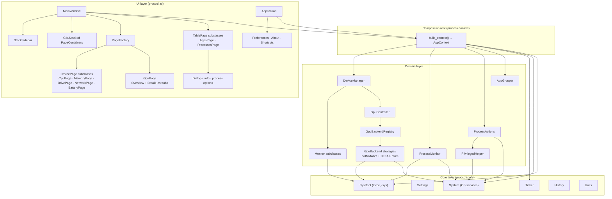
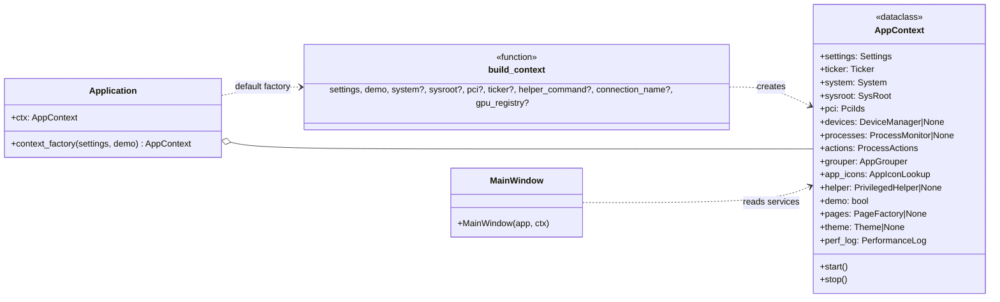

# 4. Architecture overview



**Dependency rule:** UI → Domain → Core, and never the other way. Domain
objects tell the UI about changes through GObject signals (`device-added`,
`updated`, `detail-changed`, `elevated-io`). They never import Gtk at module
level, which `tests/test_static.py` enforces. The exceptions are the views
that ship with a detail backend (`DetailBackend.create_views()` and the
Intel backend's `views.py`, `clients.py`, the NVIDIA `views.py`). They're
imported lazily, so the domain stays testable without a display.

## 4.1 Package layout

```
proccoli/
├── README.md  CLAUDE.md  LICENSE  Makefile
├── docs/       DESIGN.md  PLAN.md (indexes)  design/  plan/ (one file per section, milestone, idea, bug)
├── .claude/skills/proccoli-change/SKILL.md   # the checklist for every change
├── src/proccoli/
│   ├── __init__.py            # APP_ID, APP_NAME, version, icon names (the only place)
│   ├── __main__.py  app.py    # Application: actions, dialogs; asks context.py for services
│   ├── context.py             # the composition root (§4.2): the window's and the collector's
│   ├── metrics.py             # proccoli, the background collector (Idea 13's design; no Gtk)
│   ├── metrics_service.py     # its D-Bus service: every reading, for the window (Idea 19's design)
│   ├── core/       system.py  sysroot.py  settings.py  ticker.py  history.py  units.py
│   │               pciids.py  jsonstream.py  runner.py  privileged.py  palette.py
│   │               styles.py  applog.py  trust.py  watchdog.py
│   │               connections.py         # signal handlers let go together (M84)
│   │               history_db.py  history_store.py  history_export.py   # Idea 2's design
│   │               machine_info.py                                       # Idea 14's design
│   │               history_lock.py  background.py                        # Idea 13's design
│   │               profile.py                                            # Idea 1's design
│   │               windows.py                                            # Idea 5's design
│   ├── devices/    base.py  source.py  manager.py  cpu.py  memory.py  drive.py  network.py  nm.py
│   │               battery.py  demo.py  snapshot_codec.py (Idea 19's design)
│   ├── gpu/        info.py  backend.py  registry.py  detect.py  controller.py  fdinfo.py
│   │               generic_drm.py
│   │               intel_gpu_top/  backend.py  history.py  views.py  labels.py  clients.py
│   │               nvidia/         query.py  backend.py  views.py
│   │               amdgpu/         metrics.py  sensors.py  backend.py  views.py   # §7.5
│   ├── processes/  model.py  monitor.py  apps.py  actions.py  top.py
│   ├── helper/     proccoli_helper.py    # installed as libexec/proccoli/proccoli-helper (root)
│   └── ui/         window.py  window_state.py  sidebar.py  page.py  style.py  theme.py
│                   layout.py  elevation.py  reorder.py  sidebar_fields.py  axes.py
│                   sidebar_visibility.py  sidebar_style.py  compat.py  series_visibility.py
│                   hover.py  export.py  summaries.py  lazy.py  toolbar_items.py   # Idea 12's design
│                   time_range.py                                         # Idea 9's design
│       ├── widgets/  graph.py  graph_box.py  double_graph_box.py  info_row.py  meter.py
│       │             app_icon.py  top_table.py  legend.py  legend_chart.py
│       │             chart_card.py  chart_grid.py  detail_charts.py
│       │             reorderable.py  graph_toolbar.py                     # Idea 12's design
│       │             range_editor.py                                      # Idea 9's design
│       ├── pages/    device.py  table.py  factory.py  cpu.py  memory.py  drive.py  network.py
│       │             battery.py  gpu.py  apps.py  processes.py  demo.py  overview.py  error.py
│       ├── preferences_layout.py  (which page, group and order each setting has)
│       └── dialogs/  info.py  process_options.py  preferences.py  about.py  launch_auth.py
│                     record_from_boot.py  (asked once: record from boot?)
├── data/       .desktop  .metainfo.xml  .gschema.xml  .policy  proccoli.service  icons/hicolor/...
├── packaging/  install.sh  build-deb.sh  split.py (which install each file is in, Idea 15's design)
│               make-logo.py  render-icons.py
└── tests/      helpers.py (FakeRoot, FakeSystem, make_context, pump, resize_window)  fixtures/  test_*.py
                ui/shoot.py (screenshots)  ui/perf.py (CPU use)  run-headless.sh
```

## 4.2 Dependency injection: the composition root

Everything is wired by hand in one place, `context.build_context()`, which
returns an `AppContext`. Nothing else creates services, and no module reaches
for the operating system on its own. The background collector (M75,
[Idea 13's design](ideas/idea-13-record-the-history-in-the-background.md)) has its own, smaller root in the same module,
`build_metrics_context()` → `MetricsContext` (settings, ticker, system,
sysroot, devices, profile): the same discoverers, no process monitor,
icons, helper or UI.



- **Seams:**
  - `SysRoot`: every `/proc` and `/sys` read.
  - `System`: everything else that touches the OS ([§5](05-core-layer.md)).
  - `Settings.for_tests()`: in-memory settings.
  - `Ticker`: injectable timer and clock.
  - `PageFactory`: which page shows which device kind.
  - `GpuBackendRegistry` (`build_context(gpu_registry=...)`): which GPU
    backends exist.
  - `Application(context_factory=...)`: the whole graph.
  - `Theme(settings, style_manager)`: the look ([§9.3](09.3-appearance.md)). `Application` builds
    it with `Adw.StyleManager.get_default()`; tests pass a fake.
- **Tests** build the real graph with fakes: `tests/helpers.make_context()`
  passes `FakeSystem`, a fixture `SysRoot`, test settings, the test `pci.ids`,
  no helper and no NetworkManager.
- **Enforcement:** `tests/test_static.py` fails if a module outside the
  allowed set calls `os.kill`, `shutil.which`, `subprocess`, `pwd` and
  similar directly, or if a domain module imports Gtk.
