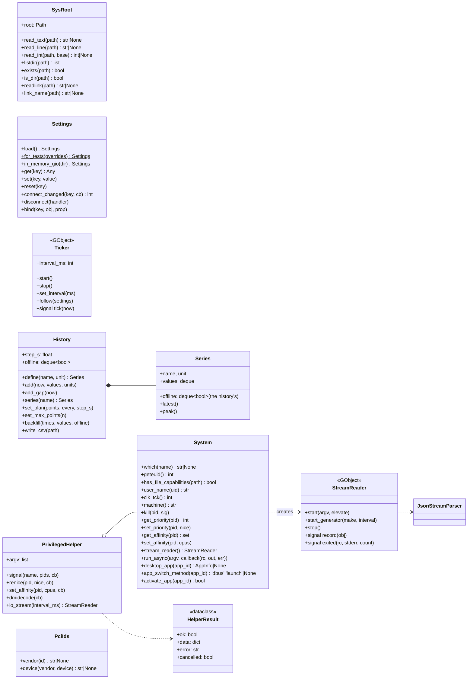

# 5. Core layer

- **`System`** is the only OS facade. Tests use `FakeSystem`
  (`tests/helpers.py`), which records signals, priorities and child
  processes, and answers `which` and the user and app lookups from
  attributes.
- **`PrivilegedHelper`** runs `pkexec proccoli-helper <subcommand>`
  asynchronously, since the password prompt takes time. It turns pkexec's 126
  and 127 into `cancelled`. The helper itself
  (`helper/proccoli_helper.py`) is a standalone script with strict argument
  validation and no shell. Only a root-owned installed helper is used, and
  processes are named by PID *and* start time ([§11](11-cross-cutting-concerns.md), *Security*).
- **`Ticker`:** one app-wide timer at the *Update Interval* setting
  (`update-interval`: 1, 2, 3, 5 or 10 s; it replaced *Refresh Speed*,
  whose 0.5 and 0.25 s went too fast, Feature 6), so all graphs line up
  in time. Each tick is due at `start + n × interval` on the monotonic
  clock and armed as a one-shot timer for the time left: a repeating
  `GLib.timeout_add` counts from the end of the previous tick's work and
  drifted ~5 ms a tick. A late tick isn't made up; a timer that fires a
  fraction early never ticks the same due time twice; a handler that
  stops or re-arms the ticker leaves at most one timer.
- **`Settings`:** GSettings when the schema is installed or can be compiled
  from the checkout, otherwise a dictionary with the same defaults and
  validation. A source checkout always uses its own compiled schema first.
  `choose_schema` skips any schema missing a key the app's schema
  describes (`schema_covers`): GSettings aborts the whole program on an
  unknown key. This happened once, when an installed package older than
  the checkout lacked `sidebar-shown`.
