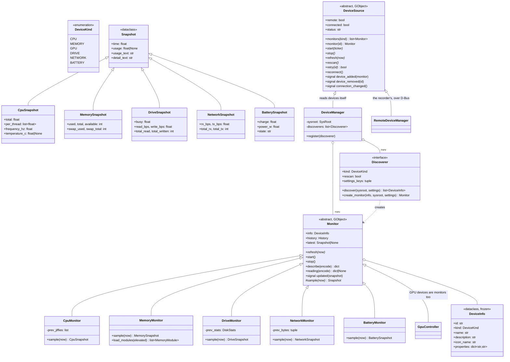

# 6. Devices layer: monitors and snapshots

Every sidebar entry except Apps and Processes is a **device**. A device has
an immutable `DeviceInfo`, discovered once, and a `Monitor` that produces a
`Snapshot` on every tick.

**Data sources per device** (all through `SysRoot`, so every one can be
tested with fixtures):

| Device | Discovery | Per-tick data | Properties |
|---|---|---|---|
| CPU | `/proc/cpuinfo` | `/proc/stat` deltas, `/sys/devices/system/cpu/cpu*/cpufreq` | `/proc/cpuinfo`, `lscpu`-style topology from `/sys/devices/system/cpu`, `/proc/uptime`; temperature from hwmon `coretemp` / `k10temp` |
| Memory | always; description "16.0 GB DDR4 @ 2667 MT/s" (`memory_description`: one decimal, the slowest module's speed) | `/proc/meminfo` | udev's SMBIOS record `/run/udev/data/+dmi:id` (`MEMORY_DEVICE_<n>_*`, readable by any user): slots, type, speed, form factor. Only without it: `dmidecode -t 17` through the helper (banner + Authenticate) |
| Drive | `/sys/block/*` (skip loop/ram; virtual drives optional) | `/sys/block/X/stat` deltas | size, `removable`, `ro`, rotational → HDD/SSD/NVMe, `device/model` |
| Network | `/sys/class/net/*` (skip `lo`; virtual optional: no `device` link) | `/sys/class/net/X/statistics/{rx,tx}_bytes` | MAC address, driver (`device/driver`), speed; SSID and type from NetworkManager over D-Bus; wireless if `X/wireless` exists |
| Battery | `/sys/class/power_supply/*` with `type=Battery` | `capacity`, `power_now` or `current_now × voltage_now` | `energy_full_design`, `cycle_count`, `technology`, `manufacturer`, `model_name` |
| GPU | see [§7](07-the-gpu-carve-out.md) | see [§7](07-the-gpu-carve-out.md) | see [§7](07-the-gpu-carve-out.md) |

**A device that can't be set up (v0.2.0)** still appears. If its
`Discoverer.create_monitor()` or the monitor's `start()` raises,
`DeviceManager._build` logs it and keeps a `FailedMonitor` in its place:
a monitor that records nothing and carries `message` (in words) and
`details` (the traceback). Its page is an error page ([§9.7](09.7-error-pages.md));
`DeviceManager.retry(id)` builds it again. A discoverer that fails as a
whole is still only logged (there's no device to show).

**Sidebar naming** mirrors Resources: the Processor's description is its
model and Memory's its size, DDR type and speed; drives are
labelled "Drive" with the model as the description, and network interfaces are "Ethernet Connection",
"Wi-Fi Connection" or "VPN" with the interface name as the description.
These names come from `DeviceInfo.name` and `DeviceInfo.description`.
