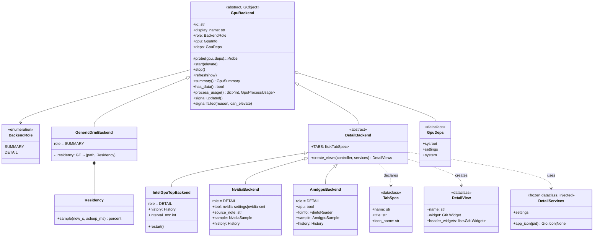

# 7.1 Roles: summary and detail sources

A *GPU backend* (the strategy from [§4](04-architecture-overview.md)) now has a **role**:

- **SUMMARY:** sysfs and fdinfo, works for any GPU, cheap, never needs
  privileges. It always runs, so the overview, the sidebar meter and the
  process GPU columns never go blank.
- **DETAIL:** a vendor source (`intel_gpu_top`, NVIDIA's tools, or
  amdgpu's own sysfs files, [§7.5](07.5-amd.md)). It may need administrator rights, may
  be switched off, and supplies the vendor tabs. While it runs, its
  numbers also feed the overview (`merge_summaries`: the detail source's
  values, gaps filled from the summary source's).

**Honest summaries on APUs (v0.5.0, Bugs 2–4).** `GpuSummary` carries two
flags besides its readings. `shared_memory`: an AMD APU's "VRAM" is a
carve-out of system memory and it uses GTT (`mem_info_gtt_*`) as much, so
`memory_used` / `memory_total` / `memory_usage` add both, and the
Overview tab calls it *Graphics Memory*. `power_is_package`: an APU's
hwmon `power1` (labelled `PPT`) is the whole package's, cores included,
so the Overview tab calls it *Processor Package Power*. `GpuInfo.integrated`
for AMD comes from `gpu_metrics`' format revision (2 is the APU layout),
falling back to the carve-out size only without that file. Per process,
`parse_fdinfo` counts each memory region once (amdgpu reports
`drm-total-vram` and the older `drm-memory-vram`, preferring the total),
and an APU's `FdinfoReader(shared_memory=True)` counts GTT too.

**Where the summary's usage comes from (Bug 19).** In order:
`gpu_busy_percent` (amdgpu); the busiest non-video engine in DRM fdinfo
(the clients the user can see); for Intel (i915, xe), GT 0's idle
residency (`Residency`: `100 × (1 − Δasleep / Δt)`), so a GPU no process
has open reads 0 % instead of nothing. GT 1's residency (the media GT,
Meteor Lake on) is the video figure when fdinfo has no video engines. A
frequency file that reads 0 is 0 Hz, shown as "Idle"
(`frequency_text`). Details: [Bug 19's design](bugs/bug-19-an-idle-intel-gpu-s-overview.md).

