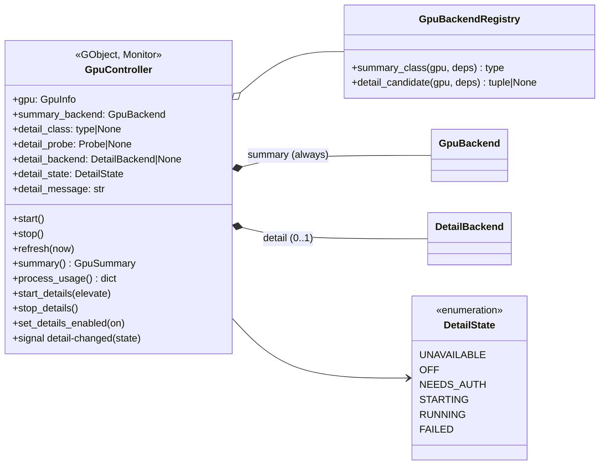
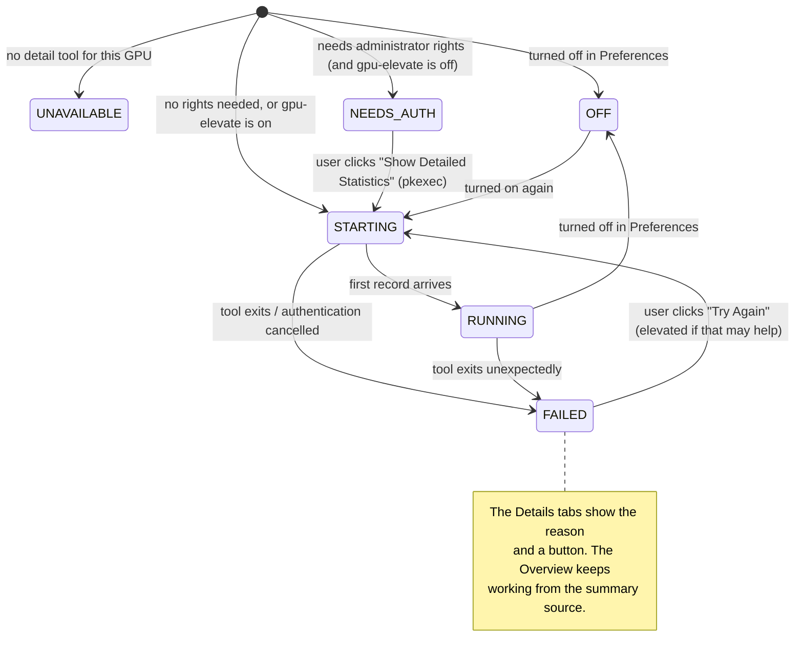

# 7.2 The controller

One `GpuController` per GPU (a `Monitor`, so the rest of the app treats it
like any device) owns both sources:

- **Which source feeds what:** `summary()` and `process_usage()` come from
  the detail source while it's RUNNING and has data, otherwise from the
  summary source.
- **Preferences:**
  - `gpu-details-disabled` lists PCI slots whose details are turned off.
  - `gpu-elevate` starts details with pkexec at launch instead of waiting
    for the user.
  - `intel-gpu-top-interval` is the Details tab's update interval, as in
    intel_gpu_top_gui. How much time its charts show is the app's
    `graph-time-range`, like every other graph (Feature 3).

**Detail lifecycle.** A password prompt never appears unless the user asks
for it, either by clicking, or by turning on "Start with administrator
rights" in Preferences:

