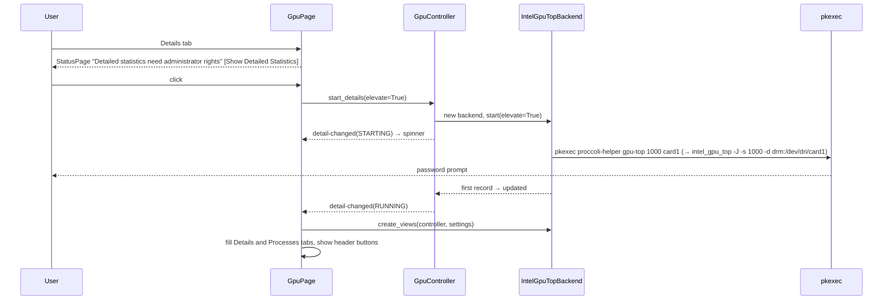

# 7.3 The page

```mermaid
classDiagram
    direction TB
    class GpuPage {
        <<DevicePage>>
        +controller: GpuController
        +stack: Adw.ViewStack
        +switcher: Adw.ViewSwitcher
        +switcher_bar: Adw.ViewSwitcherBar
        +overview: GpuOverview
        +hosts: dict~str, DetailHost~
        +title_widget() Gtk.Widget
        +header_widgets() list
        +show_tab(name)
    }
    class GpuOverview {
        Resources' GPU page: Usage, Sensors, Properties
        + a Detailed Statistics row
    }
    class DetailHost {
        <<Gtk.Stack>>
        +status: Adw.StatusPage
        +set_view(DetailView|None)
        +show_state(state, message)
    }
    class IntelGraphsView {
        <<Adw.BreakpointBin>>
        <<ChartGridView>>
        caption + ChartGrid of ChartCards
        (a LegendChart per group, Feature 3, cards Feature 4)
        compact below 720sp high / 600sp wide
    }
    class IntelClientsView {
        ClientsView: engine-class use per client
    }
    class DetailChartsView {
        <<ChartGridView>>
        GRAPHS table → ChartCards
        values() caption_line() info(title)
        hides lines and cards not reported
    }
    class NvidiaDetailsView
    class AmdgpuDetailsView
    class IntelDetailHeader {
        pause toggle + menu: Update Interval,
        Export as CSV, Clear History
    }
    GpuPage *-- GpuOverview
    GpuPage *-- "0..n" DetailHost : one per TabSpec
    DetailHost o-- IntelGraphsView
    DetailHost o-- IntelClientsView
    DetailHost o-- DetailChartsView
    DetailChartsView <|-- NvidiaDetailsView
    DetailChartsView <|-- AmdgpuDetailsView
    GpuPage o-- IntelDetailHeader : shown on vendor tabs only
    GpuPage o-- GpuController
```

- **The page is never replaced.** The tabs come from the detail class's
  `TABS`, so the switcher doesn't jump around as the state changes.
- **Until the detail source runs,** each vendor tab shows an
  `Adw.StatusPage` for the current state, with the right button: Show
  Detailed Statistics, Try Again, or Turn On.
- **When it starts,** `create_views()` fills the tabs. A new detail backend
  (a restart) brings new views.
- **The switcher sits in the header,** as the page's title widget. In narrow
  windows it moves to a bar at the bottom, as in intel_gpu_top_gui. The
  pause button and menu appear only on the vendor tabs, and the last tab
  used is remembered (`gpu-view`).

Opening the details when administrator rights are needed:


