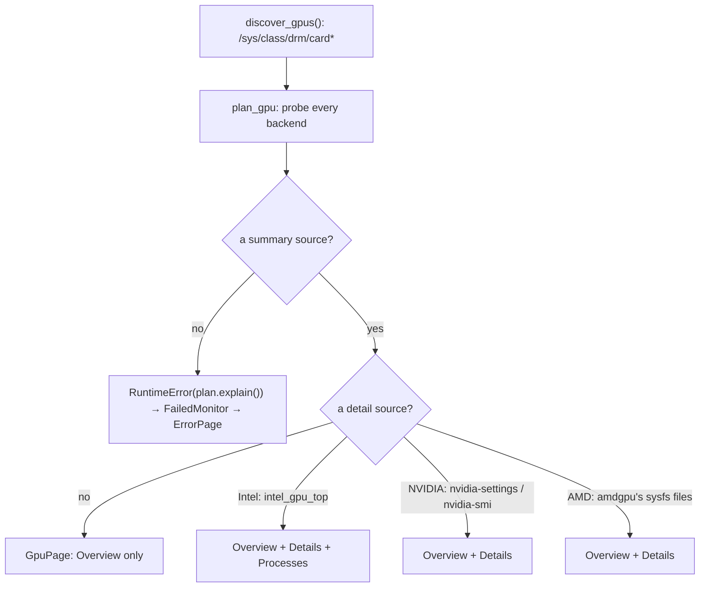

# 7.4 Backend selection

| Backend | Role | Probe result |
|---|---|---|
| `IntelGpuTopBackend` | DETAIL | `PREFERRED` when `vendor == INTEL`, the driver is `i915` or `xe`, and `intel_gpu_top` is installed. `needs_elevation` unless running as root, `perf_event_paranoid` ≤ 0, or the binary has file capabilities. |
| `GenericDrmBackend` | SUMMARY | `FALLBACK` for any DRM card |
| `NvidiaBackend` (M55) | DETAIL | `PREFERRED` when `vendor == NVIDIA`, the driver is `nvidia` (not `nouveau`) and `nvidia-settings` or `nvidia-smi` is installed. Never needs administrator rights. |
| `AmdgpuBackend` (M70) | DETAIL | `PREFERRED` when `vendor == AMD`, the driver is `amdgpu` (not `radeon`) and the device has `gpu_busy_percent` or `gpu_metrics`. Never needs administrator rights or a tool. |

The registry picks the best SUMMARY class and the best DETAIL candidate
separately. Adding a vendor means one DETAIL backend class with its `TABS`
and views, plus a registration line. Nothing else changes.

**Detection: which panel a GPU gets (M55).** `gpu/detect.py` makes the
choice explicit. `plan_gpu(gpu, registry, deps)` asks every registered
backend for its probe (`GpuBackendRegistry.probe_all`, unsupported ones
included, since their reasons explain the choice) and returns a `GpuPlan`:
the chosen summary and detail sources, `panel()` and `explain()`, one line
per backend. `GpuController` makes the plan first and logs it at INFO, for
example:

```
NVIDIA GPU 0000:02:00.0 (driver nvidia): overview + NVIDIA tabs
  intel_gpu_top (detail) not usable: not an Intel GPU
  nvidia (detail) chosen: nvidia-settings, then nvidia-smi
  generic (summary) chosen: …
```

The GPU page shows `detail_text()` as its *Detailed Statistics* property.
When no summary source can serve a GPU, the controller raises with the
plan's explanation, and the GPU gets an error page ([§9.7](09.7-error-pages.md)) instead of
vanishing.



**NVIDIA (M55).** `gpu/nvidia/` polls NVIDIA's tools once per refresh,
through `System.run_async` (never two polls at once; answers arriving
after a stop are dropped by a generation counter):

- **nvidia-settings first**, as asked: `settings_targets_argv` finds this
  GPU's `[gpu:N]` target by PCI slot (`PCIDomain/Bus/Device/Func`), then
  `settings_argv` reads utilisation (graphics, memory, video, PCIe),
  temperature, clocks and memory in terse form each refresh.
- **nvidia-smi when nvidia-settings can't**: not installed, the GPU not
  listed, or no NV-CONTROL. NV-CONTROL is an X11 extension, so in a
  Wayland session (Ubuntu's default) nvidia-settings lists the GPU but
  can't read its utilisation or clocks; the query exits 1 with "No targets
  match", which `NvidiaError.unreachable` marks. nvidia-smi reads the
  driver directly: `smi_argv` asks one GPU (`-i` PCI slot) for
  `SMI_FIELDS` as CSV (utilisation, encoder, decoder, memory, temperature,
  power and limit, clocks, fan, P-state). `source_note` says which tool is
  in use and why; the tool's own error text goes to the log.
- **Failing:** if neither can read the GPU, or a running source has 3 bad
  readings in a row, the backend emits `failed` with the reason, and the
  Details tab shows it with *Try Again* ([§7.2](07.2-the-controller.md)'s FAILED state).
- The readings (`NvidiaSample`) feed the Overview tab and the sidebar
  through `to_summary()`, and the Details tab (`views.py`: a caption, then
  graphs for utilisation, video engines, video memory, clocks, temperature,
  power and fan, with legends; measures the tool doesn't report are
  hidden). There's no per-process view: `nvidia-smi pmon` takes about a
  second per sample. `GpuController.process_usage()` therefore uses the
  detail source's figures only when it has some.
- Since M70 the Details tab is a `DetailChartsView` (`ui/widgets/
  detail_charts.py`), shared with AMD: a `GRAPHS` table of `ChartCard`s;
  the subclass gives `values()`, `caption_line()` and `info(title)`.
