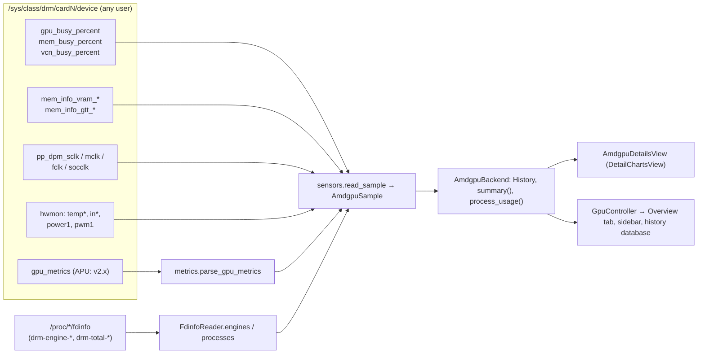

# 7.5 AMD (M70)

amdgpu publishes everything the Details tab needs in sysfs, readable by
every user, so the AMD detail source runs no tool and never asks for a
password. `gpu/amdgpu/`:

- **`metrics.py`** (pure): decodes the binary `gpu_metrics` table. Its
  header gives the layout (`structure_size`, `format_revision`,
  `content_revision`); revision 2 is the APU layout (`struct
  gpu_metrics_v2_X` in the kernel's `kgd_pp_interface.h`): temperatures
  of the graphics, the SoC and each core; package, core and SoC power;
  current clocks; and, from v2.2, `indep_throttle_status`, whose bits
  `throttle_reasons` names. Revision 1 (discrete GPUs) isn't decoded:
  hwmon has the same readings. Checked on a Ryzen 3 4300U (Renoir,
  v2.2) idle and under load; two firmware quirks found there are handled:
  the package power comes in whole watts (the kernel documents
  milliwatts; a package below its own cores' milliwatts must be watts),
  and the memory clock is a level number (no clock is under 100 MHz).
  Unused core slots (a 4-core part fills 4 of 8) are the ones with
  neither a clock nor power.
- **`sensors.py`**: `read_sample(sysroot, device_path, apu, engines,
  hwmon)` → `AmdgpuSample` from `gpu_busy_percent`, `mem_busy_percent`,
  `vcn_busy_percent`, `mem_info_vram_*` and `mem_info_gtt_*`, the
  `pp_dpm_*` clock tables (falling back to `gpu_metrics`), hwmon by label
  (edge, junction and memory temperatures; vddgfx and vddnb; power, cap,
  `pwm1` fan) and `gpu_metrics`. On an APU hwmon's power is the
  package's; the GPU's own comes only from `gpu_metrics` (Renoir doesn't
  report it). `engine_classes` folds fdinfo's engines into graphics,
  compute, copy (`dma`), video decode and encode. `to_summary()` follows
  the same rules as the generic source (M69).
- **`backend.py`**: `AmdgpuBackend(DetailBackend)` reads fdinfo and the
  sample each `refresh(now)`, records it in its `History` (following
  *Graph Time Range* like the other Details tabs, and the history
  database through `history_readings`), and emits `updated`. While it
  runs, `process_usage()` is its own fdinfo reading. It keeps its own
  `FdinfoReader` rather than sharing the summary source's: the two
  sources stay independent, at the cost of a second fdinfo read per tick
  while the Details tab is on. `DemoAmdgpuBackend` makes up readings for
  `--demo` (a second demo GPU, `gpu-demo-amd`).
- **`views.py`**: `AmdgpuDetailsView(DetailChartsView)`: utilization
  (graphics, memory controller, video), engines (only the apps Proccoli
  may inspect, as the caption says), memory (dedicated and shared, as
  percentages; the info line is the total), clocks (graphics, memory,
  fabric, SoC), temperature (GPU, junction, memory, SoC, the hottest
  core), power (GPU, package, cores, SoC, with the cap and what's
  limiting it), voltage and fan. Lines and cards the GPU doesn't report
  are hidden.

