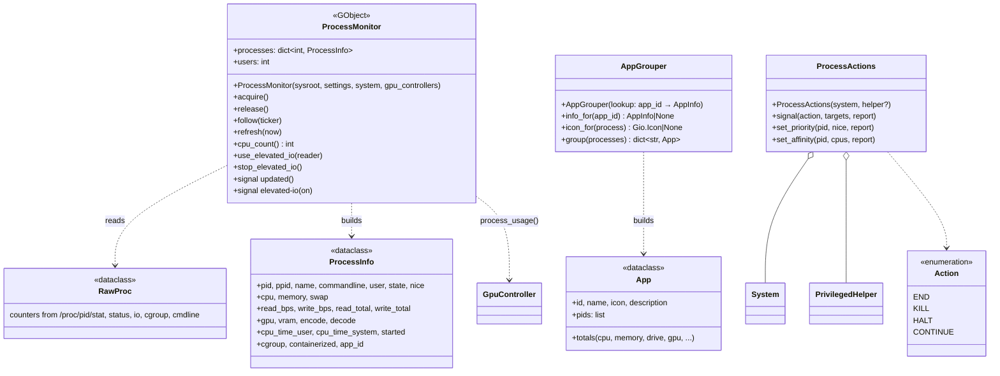

# 8. Processes and Apps

- **Per-process data:**
  - CPU: `/proc/PID/stat` deltas, divided by the CPU count when
    *Normalize Processor Usage* is on (the default): each row is then a
    share of the whole processor and the column adds up to the total; off,
    one busy core is 100 %, as in `top`. Both are wanted (on 24 threads a
    stuck single-threaded process reads 4.2 % or 100 %), so it stays (M58)
  - Memory: `/proc/PID/status` (`VmRSS`, `VmSwap`)
  - Disk I/O: `/proc/PID/io` (own processes only)
  - Cgroup: `/proc/PID/cgroup`, read once per process lifetime
  - GPU columns: summed over every `GpuController.process_usage()`
- **Scanning on demand:** the scan runs only while a table page or an
  information dialog is open (`acquire`/`release`).
- **Other users' disk I/O:** the "Show Drive I/O of All Processes" toggle
  streams `proccoli-helper processes` (root) into the monitor
  (`use_elevated_io`). It fills in the processes we can't read ourselves.
- **App grouping:** by the systemd unit in the cgroup path:
  - `app-<id>.slice` (GNOME 49)
  - `app-gnome-<id>-<n>.scope`
  - `app-flatpak-<id>-<n>.scope`
  - `snap.<name>.<app>-<uuid>.scope` (desktop ID `<name>_<app>`)

  Names, icons and descriptions come from `System.desktop_app`. Everything
  else falls under "System Processes".
- **Icons:** every row of both tables starts with an icon. Apps show
  their own; each process shows the icon of the app it belongs to
  (`AppGrouper.icon_for`, injected into `ProcessesPage`), so an app's
  processes share it. Anything without an icon (System Processes, kernel
  threads, daemons, or a `.desktop` icon the theme doesn't have) shows a
  solid puzzle piece, `MISSING_APP_ICON` (our own
  `<APP_ID>-missing-app-symbolic`; Adwaita's is an outline). Being
  symbolic, it takes the text color: white in the dark style, dark in the
  light style. The GPU's vendor *Processes* tab shows icons the same way:
  it knows only PIDs, so `AppIconLookup(sysroot, grouper).icon_for_pid`
  reads `/proc/<pid>/cgroup` (cached per PID; in `--demo` an empty root,
  since the demo's PIDs are made up). It reaches the view as
  `DetailServices.app_icon`, which the page factory builds from the
  context. `ui/widgets/app_icon.set_app_icon` does the puzzle-piece
  fallback for all three tables.
- **Context menus:** right-click (long-press on touch, Menu key or
  Shift+F10) on an Apps or Processes row selects it (unless it's already
  part of the selection) and opens: Information, Options (Processes), End,
  Kill, Halt, Continue: the same `table.*` actions as the action bar.
  - *Freeze fix (M43):* both the cell's right-click gesture and the
    ColumnView row's own click gesture see the press. The menu used to
    pop up without claiming it, so the row gesture stayed mid-click.
    On Wayland the popup took the button release, and the window then
    ignored all input. `open_cell_menu` now claims the gesture first
    (`EventSequenceState.CLAIMED`), which cancels the row's gesture.
  - *One popover per table:* it's made once and reused
    (`set_menu_model` each time). Its parent is the page's box
    (`menu_parent`), not the clicked cell. Table cells are recycled and
    rebound on every refresh, and a box positions popovers through its
    layout manager. `menu_point` translates the click into the box's
    coordinates; the keyboard menu points at the table's corner.
    `shutdown()` unparents it.
  - Re-sorting under an open menu is safe: `Gtk.MultiSelection` keeps the
    selection on the same rows, i.e. the same processes, not positions
    (checked while investigating: right-click firefox, the table re-sorts
    by processor for 6 s, the selection is still firefox).
- **Switch To** (Apps, top of the menu): GNOME on Wayland lets an app raise
  only its own window, so Proccoli asks the app to show itself
  (`System.activate_app`): D-Bus-activatable apps (most GNOME apps) get
  `org.freedesktop.Application.Activate`; apps declaring
  `SingleMainWindow=true` are relaunched, which shows their window. Others
  (e.g. Firefox, VS Code) would open a second window if relaunched. Since
  M67 ([Idea 5's design](ideas/idea-05-switch-to-any-running-app.md)) `core.windows.WindowSwitcher` decides: Proccoli's GNOME
  Shell extension first (any app with a window), then asking the app
  (now with an activation token, and also for running GApplications that
  own their app ID on the bus), then `wmctrl` in an X11 session. The item
  is offered for every single real app; one nothing can reach gets a
  toast with *Set Up…* (Preferences). Not for System Processes or a
  multi-row selection.
- **Actions:** `ProcessActions` acts directly first (the user's own
  processes). Only what was denied with EPERM goes to the helper, which asks
  for authentication once. Messages name the app ("Ended Firefox"), not the
  number of processes.
