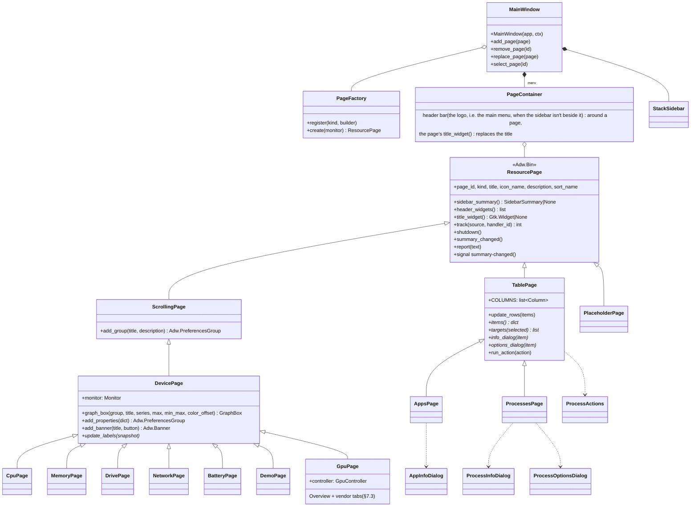
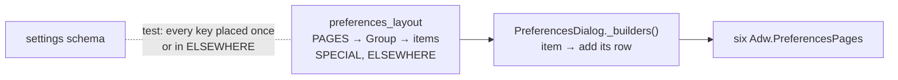

# 9. UI layer

**Dialogs:**
- `ProcessInfoDialog` and `AppInfoDialog` update live while open, and
  acquire the process scan for as long as they're shown.
- `ProcessOptionsDialog` sets the priority (names, or niceness with *Show
  Niceness Values*) and CPU affinity through `ProcessActions`.
- `PreferencesDialog` is built from `ui/preferences_layout.py` (M88):
  six pages (Appearance, **Sidebar** ([§9.5](09.5-sidebar-preferences.md)), Tables, Recording,
  Devices, System), each a tuple of groups, each group's rows in order.
  A row is a settings key or a `SPECIAL` item (rows built from a service,
  or several keys at once: the column lists, the sidebar's entries, the
  GPUs' switches, the history's status and actions). `_builders()` maps
  every item to the function that adds its row; a group whose rows all
  need a service the dialog wasn't given (history store, background
  unit, export, window switcher, log file) is hidden. The column lists
  are `Adw.ExpanderRow`s in place, not subpages, so search still finds
  each column. Every row is bound both ways to its key and applies
  immediately. Devices has one detailed-statistics switch per GPU that
  has a detail source (`GpuController.set_details_enabled`), plus
  `gpu-elevate` and the intel_gpu_top update interval.

- `about_dialog()` and `shortcuts_dialog()` come from the `SHORTCUTS` table,
  which tests check against the real accelerators.

**Page lifecycle (added in Milestone 1):** pages connect to longer-lived
objects (monitors, settings, GPU controllers). Every such connection is
registered with `ResourcePage.track()`. `MainWindow` calls
`page.shutdown()` when a page is removed (unplugged device), replaced or
the window closes, and `shutdown()` disconnects them all. The GPU page also
drops its detail views (and their backend connections) whenever the detail
source stops or restarts.
