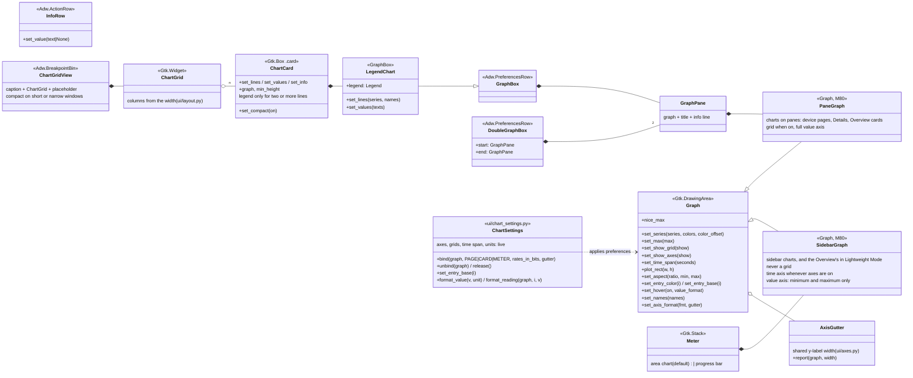
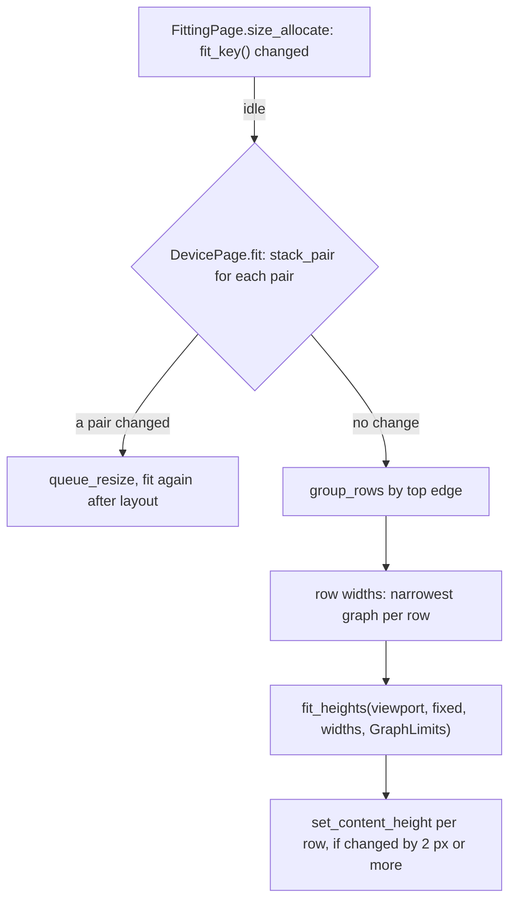
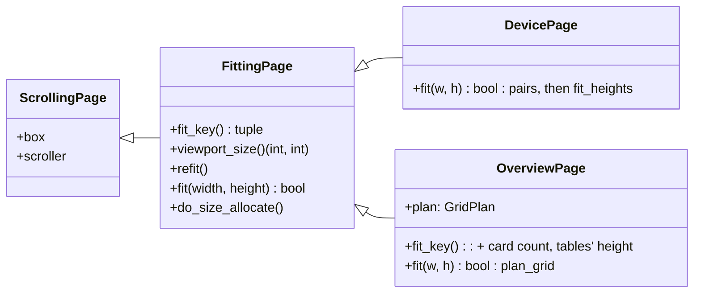

# 9.1 Widgets



- **One chart family (M63, Idea 4):** every graph gets its preferences
  from a `ChartSettings` (`ui/chart_settings.py`): *Show Graph Axes*,
  *Show Graph Grids*, *Graph Time Range* and the unit preferences, now
  and on every change. Each owner has its own and releases it with its
  graphs: `DevicePage` (`add_graph` binds `PAGE` graphs, with the page's
  `AxisGutter` and, on network pages, *Show Network Speeds in Bits*),
  `OverviewPage` (`CARD`: axes, grid, span, hover), the sidebar
  (`METER`: axes through `Meter.set_show_axes`, grid, span; grids on
  cards and meters since M72, so the toolbar's *Graph Grid* changes
  every chart on screen) and each GPU page's
  Details tabs (`DetailServices.charts`, made per set of views and
  released when they're dropped; it carries the GPU entry's color, so
  the tabs start at it like the Overview tab). `PAGE` graphs also get a
  value axis and `nice_max` in the user's units, the hover box in them
  (`format_reading`), and the owner's entry color (`set_entry_base`).
  Legends and info lines format through `ChartSettings.format_value`, so
  *Data Unit Prefix* and *Temperature Unit* apply everywhere. The GPU
  Details tabs build only `ChartCard`s in a `ChartGridView`; detail
  sources keep readings in base units (B/s, Hz, W, °C) at their history
  boundary (`intel_gpu_top.history.to_base_unit`, the NVIDIA sample's
  `history_values`). `tests/test_static.py` checks that only
  `chart_settings.py` (and Preferences) name the graph keys in views, and
  that `gpu/` builds no `Graph`, `GraphBox` or `LegendChart` itself.
- **One rule for legends:** a chart of two or more lines has a legend
  (`LegendChart`, `ChartCard`); a one-line card has none, and its value
  goes in the info line. Device pages keep Resources' look: graph rows in
  preference groups (`GraphBox`, `DoubleGraphBox`, `LegendChart` for the
  per-CPU chart).

- **Graph:** rounded corners, a fill under the line in the first palette
  color, an optional grid, and lines snapped to device pixels. Colors
  come from the window's theme ([§9.3](09.3-appearance.md)); with the System palette, extra
  series skip colors close to the accent (`palette_without`).
- **InfoRow** with `set_value(None)` hides itself, so pages never show
  "N/A".
- **Axes** (`ui/axes.py` holds the arithmetic): every graph of
  percentages on a 0–100 scale (page graphs, per-thread CPU graphs, sidebar
  charts) gets a left gutter of y labels (0/25/50/75/100 %, labelled as
  far as they fit, always 0 and 100) with tick marks, and a bottom row of
  time labels with ticks: round steps (`nice_step`: 10 s, 1 min, …) back
  from "now" at the right edge, one unit per axis. The span is the
  *Graph Time Range* (`graph-time-range`; M58), followed
  live through `ChartSettings` (below). Small
  graphs use a smaller font, and sidebar charts grow from 36 to 52 px to
  fit the labels. `show-graph-axes` (Preferences → *Show Graph Axes*, on
  by default) turns them off. Since M63 every page graph with a unit has
  a value axis too (an `axis_format`, M60: drive and network speeds,
  power, temperatures, GPU clocks, bandwidth): the y labels are values
  (`value_ticks`: 0 to the maximum in 4, 2 or 1 steps, as many as fit) in
  the user's units (`core.units.format_axis_label`: "2 GB/s", "1.5 GHz",
  "60 °C"). An `AxisGutter` shared by a page's graphs (or a Details tab's)
  gives them one y-label width, so the plots line up whatever their
  units; `nice_max` rounds an automatic maximum in the unit its labels
  show (`nice_max_in_units`: "5 GiB/s", not "4.88").
- **Hover** (M60; `ui/hover.py` holds the arithmetic): page graphs and
  Overview cards (every `NORMAL` graph; not the sidebar's) draw a
  crosshair at the pointer, a marker on each shown line, and a box with
  the time ("12 s ago", from the *Graph Time Range*) and each line's name
  and value (`value_format`, or by unit). `set_hover(False)` turns it
  off. Ported from intel_gpu_top_gui's `GraphView._draw_hover`.
- **Graphs fill the page** (`ui/layout.py` holds the arithmetic), on
  landscape and portrait screens alike (M36):
  - *Width:* the content column is clamped at `MAX_CONTENT_WIDTH` (1600
    px), so graphs use the window; text rows still don't span a 4K screen.
  - *Height:* a `DevicePage` splits the viewport's height among its graph
    rows (`fit_heights`): everything down to the last graph row fits on
    screen, and what's below (Properties) scrolls. Rows are grouped by top
    edge (`group_rows`), so side-by-side graphs share one. Each row stays
    within `height_range(width)` of its narrowest graph, from
    `GraphLimits`:
    - at least 120 px (`min_height`), so small windows scroll;
    - at most 560 px (`max_height`) and half the graph's width
      (`max_ratio`), so a tall portrait window doesn't stretch graphs into
      towers. Height a capped row can't use goes to the other rows; any
      rest stays empty below the content.
  - *Pairs* (`DoubleGraphBox`: GPU video encode/decode, demo read/write)
    sit side by side, and stack (`set_stacked`) when the window is portrait
    or a pane would be narrower than 280 px (`stack_pair`). Pages register
    them with `DevicePage.add_pair`; `_fit_graphs` arranges them first and
    fits again once the new rows are laid out.
  - *When:* `FittingPage` (`ui/page.py`, shared by `DevicePage` and the
    Overview since M50) notices size changes in its own `size_allocate` (it
    drops `AdwBin`'s layout manager, which bypasses that vfunc) and calls
    the page's `fit(width, height)` on idle, never during allocation,
    whenever `fit_key()` changes (the viewport's size, plus whatever else
    the page's layout depends on). Heights change only by 2 px or more, so
    layout can't oscillate. Stacking depends only on the viewport, so it
    can't flip back and forth either. `fit` returning True means "fit
    again once this is laid out".
  - *Overview grid* (M50): see [§9.6](09.6-overview-page.md).
  - *Per-CPU chart (M55, M57):* with *Show Usages of Logical CPUs*, the
    Processor page shows one page graph with a line per logical CPU. (It
    replaced a grid of small per-thread graphs.) Its legend sits inside
    the chart's card, and chart and legend together take **the same area
    as the total chart** (since M59 it's a `LegendChart`, below):
    `DevicePage.reserve(graph, measure)` counts the
    legend's height as part of the graph's area, `fit` shares out areas,
    and each graph gets its area less its reserve (`graph_in_area`, at
    least `MIN_GRAPH_IN_AREA`, 32 px). Switching charts refits
    (`CpuPage.fit_key` includes the visible chart and the legend's height).
    When values in the legend would leave the chart under `COMFORT_GRAPH`
    (96 px; `use_compact_legend`), the legend goes compact: swatch and
    name, the value on hover. The area doesn't depend on the legend, so
    the choice settles; the full legend's height is measured once per
    width.
  - *GPU Details:* `ChartGrid` (`ui/widgets/chart_grid.py`, M63; was
    intel_gpu_top_gui's `GraphGrid`, now used by both Details tabs)
    shares out the spare height and picks its column count from the
    width (`ui/layout.py`: `split_columns`, `extra_heights`,
    `layout_quality`, `choose_columns`); spare height stops at
    `graph_cap(column width)` (same limits), passing what a capped graph
    can't take to the others.





- **Many lines in one graph (M55):** `Graph.set_fill(False)` draws lines
  without the shaded area (16+ filled areas would be mud);
  `set_distinct_colors(True)` gives every series its own color
  (`entry_colors`, the same generator as the sidebar's entry colors, so
  however many CPUs there are, no two lines match); `set_series_shown(i,
  on)` leaves a line out. **Left-click** a legend item hides or shows its
  line; **right-click** (long press on touch) shows only that line, and
  right-clicking it again shows every line (`ui/series_visibility.py`,
  pure; M58). **A chart never shows nothing (M59):** every change ends in
  `never_empty`, so deselecting the only line shown (or hiding the lines
  one by one) brings every line back; lines without data
  (`Legend.set_available`, e.g. a measure a tool doesn't report) never
  count as shown.
- **`LegendChart` (M59), the reusable many-line chart**
  (`ui/widgets/legend_chart.py`): a `GraphBox` with lines only, a distinct
  color per line and the `Legend` inside its card. `set_lines(series,
  names)` and `set_values(texts)` are all a user needs; it carries the
  click rules above and the compact legend (`fit_legend`, below). On a
  device page, `DevicePage.add_legend_chart(group, title, …)` fits it
  like any page graph with the legend counted in its area (`reserve`), and
  `DevicePage.fit` compacts legends after fitting. Standalone (the NVIDIA
  Details tab) it's an ordinary card. Users: the Processor page's per-CPU
  chart and NVIDIA's utilisation, video-engine and clock graphs.

```mermaid
classDiagram
    direction LR
    class GraphBox
    class LegendChart {
        +legend: Legend
        +comfort: int
        +set_lines(series, names)
        +set_values(texts)
        +legend_height(width) int
        +fit_legend() bool
    }
    class Legend {
        +items: list~LegendItem~
        +available: list~bool~
        +shown() list~bool~
        +set_shown(shown)
        +toggle(i)
        +solo(i)
        +set_available(i, on)
        +set_compact(on)
    }
    class series_visibility {
        <<module, pure>>
        +never_empty(shown, available)
        +toggle(shown, i, available)
        +solo(shown, i, available)
    }
    class DevicePage {
        +add_legend_chart(group, title) LegendChart
        +reserve(graph, measure)
        +fit_legends() bool
    }
    GraphBox <|-- LegendChart
    LegendChart *-- Legend
    Legend ..> series_visibility
    DevicePage o-- "*" LegendChart
``` `Legend` (`ui/widgets/legend.py`) is a FlowBox of
  `LegendItem` toggles: a swatch drawn in `graph.color_for(i)` (so it
  follows palette changes with the graph), the name and the current value;
  switching one off hides its line. The NVIDIA Details tab reuses both.
- **Meter:** the sidebar's usage display. By default a 36 px area chart
  across the row (as in Resources) of `SidebarSummary.series`: one
  percentage for Processor, Memory, GPUs, drives (busy time) and
  batteries; receive and send, auto-scaled, for network interfaces. Apps
  and Processes have no summary, so no chart. *Sidebar Meter Type* can
  switch to a slim progress bar.
