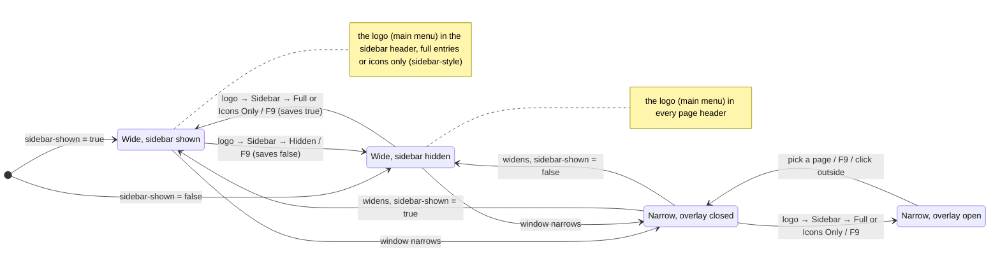
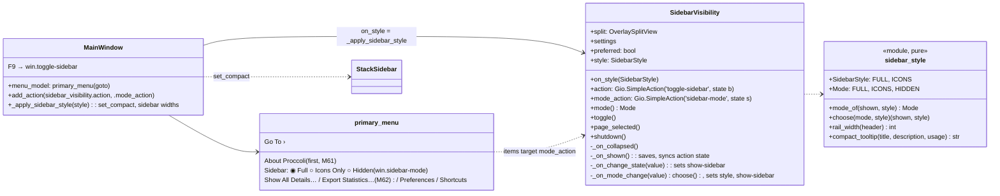
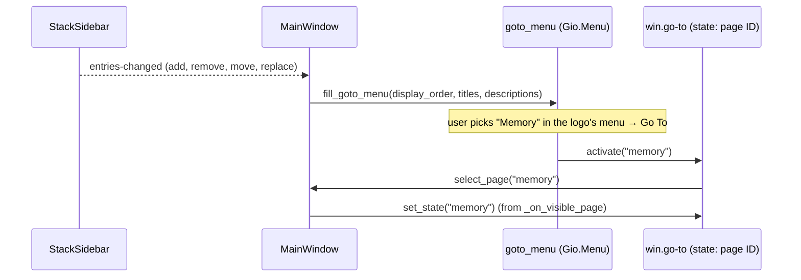
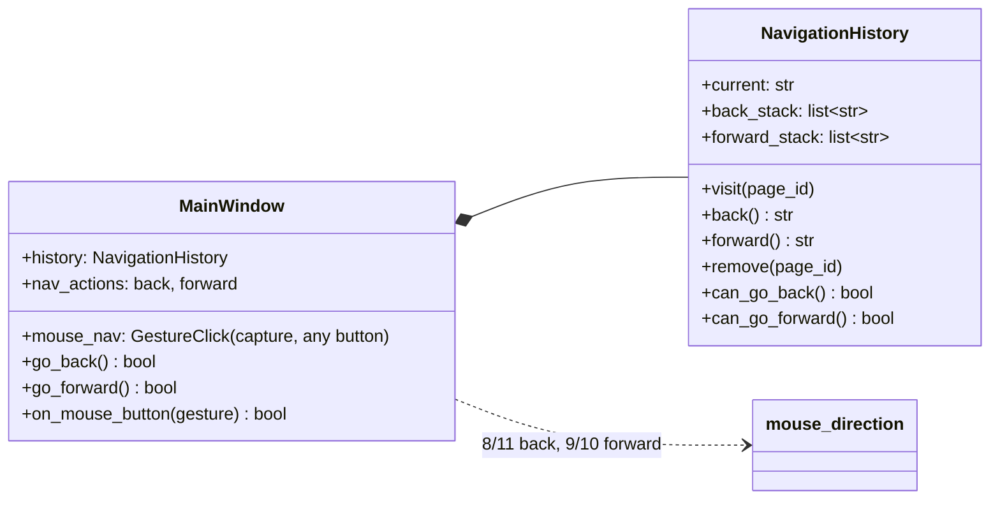
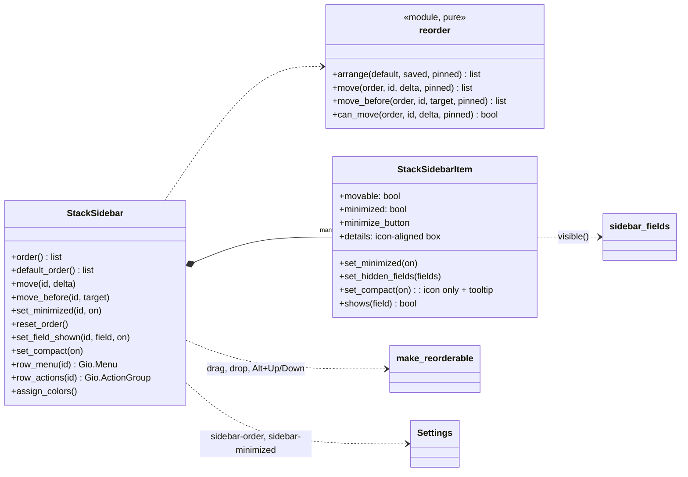

# 9.2 Window behaviour (mirrors Resources)

- Minimum size 360×240. The `AdwBreakpoint` at `max-width: 780sp` collapses
  the split view: the sidebar becomes an overlay.
- **Sidebar modes, main menu top left (M46, M52, M54, M61):** the sidebar is
  *Full*, *Icons Only* or *Hidden*, at any width, picked from the main
  menu's *Sidebar* section (radio items of the stateful `win.sidebar-mode`
  action). F9 shows and hides it (`win.toggle-sidebar`), keeping the
  style. (Until M52 a toggle button beside the main menu did this, and
  until M54 a *Show Sidebar* check item.) The main menu always stays at
  the window's top left:
  - *The corner (M47, M61):* the app's logo is the main menu's button
    (`main_menu_button`: a flat `Gtk.MenuButton` with the 24 px logo as its
    child, `primary`, so F10 opens it too), alone in the top-left corner
    in both places below. Until M61 the logo was a separate button for
    `app.about`, with a "burger" (≡) menu button beside it; *About
    Proccoli* is now the menu's first item, in a section of its own.
  - *Sidebar beside the content:* the sidebar's header starts with the
    logo.
  - *Sidebar hidden, or folded into an overlay on a narrow window:* every
    `PageContainer` header starts with its own logo (`start_controls`).
    It shows exactly when `header_controls_visible(show_sidebar,
    collapsed)`, i.e. when the sidebar isn't beside the content. All the
    logos share one menu model.
  - *F9 (M52):* `SidebarVisibility.action` is a stateful boolean action
    with no parameter. Its state follows `show-sidebar` (any change: menu,
    F9, the overlay closing after a page is picked, the window
    narrowing); activating it toggles (GIO's default for such an action
    goes through `change-state`, which sets `show-sidebar`).
  - *The modes (M54):* `SidebarVisibility.mode_action` (`sidebar-mode`,
    a string parameter and state) backs the *Sidebar* section's three
    radio items, after *About Proccoli* and *Go To*. Its state is `mode_of(show-sidebar,
    sidebar-style)` and follows both; picking a mode applies
    `choose(mode, style)`: *Hidden* only hides, so the style survives
    and F9 brings it back. Two settings rather than one three-way key
    keep M46's rules (narrow windows never touch `sidebar-shown`) as
    they were. `ui/sidebar_style.py` holds these rules, without a display.
  - *Icons only (M54):* the style reaches the window through the
    injected `on_style` callback. `MainWindow._apply_sidebar_style` calls
    `StackSidebar.set_compact` (every row shows just its icon, centred,
    with no minimise button; its tooltip is `compact_tooltip`: name,
    description, usage line) and sets the split view's minimum and
    maximum sidebar width to `rail_width(header minimum)`, so the logo
    still fits (at least `MIN_RAIL_WIDTH`, 56 px; about 100 px while the
    burger was there). *Full* restores the split view's own
    widths. Each entry's own choices (minimised, hidden parts) are kept
    for when it's full again. Right-click menus and dragging still work.
    Preferences → Sidebar → *Style* sets the same key.
  - `SidebarVisibility(split_view, settings)` (`ui/sidebar_visibility.py`)
    applies the rules. On wide windows `show-sidebar` follows and saves
    `sidebar-shown`. On narrow ones the overlay starts closed, closes when
    a page is picked, and leaves `sidebar-shown` alone, so widening the
    window restores the user's choice. Tests use a fake split view
    without a display. `PageContainer.release()` disconnects a removed
    page's header.

- **Go To (M48):** the main menu's first item is a *Go To* submenu listing
  every pane in the sidebar's display order, so panes can be switched
  without the sidebar (useful while it's hidden). `ui/navigation.py`
  (display-free) builds it: `fill_goto_menu(menu, [(id, title,
  description)])` refills one `Gio.Menu` in place, so an open menu stays
  current. `goto_labels` adds the description when two panes share a
  title (two identical drives), or the page ID if there's none. Items
  target the stateful `win.go-to` action (parameter and state: a page ID).
  Activating it calls `select_page`, and `_on_visible_page` sets its
  state, so the current pane is marked however it was reached. The window
  refills the menu on the sidebar's `entries-changed`, in
  `StackSidebar.display_order()`, which is already right while a row is
  being added. Placeholder pages say "Not available in demo mode." or "Not
  available on this system.", and a static test keeps planning-document
  references out of user-visible strings.

- **Back and forward (M49):** `NavigationHistory` (`ui/navigation.py`, no
  display) keeps the panes visited, browser-style. `visit` starts a new
  branch and drops forward; `back` / `forward` move through the history;
  `remove` forgets an unplugged page and merges the neighbours that
  leaves equal. History holds 50 entries. `MainWindow._on_visible_page`
  records every page change (sidebar, Go To, Overview, …) except those
  made by `go_back` / `go_forward` (`_navigating`). Inputs:
  - the mouse's thumb buttons, through one `Gtk.GestureClick(button=0)`
    on the window in the capture phase. `on_mouse_button` maps GDK
    buttons 8/11 to back and 9/10 to forward (`mouse_direction`), claims
    them, and denies every other button at once, so clicks still reach
    their own widgets. Nothing happens while a dialog is open;
  - `win.back` / `win.forward`, on Alt+Left / Alt+Right, enabled only
    when there's somewhere to go; listed under Keyboard Shortcuts.

- Built-in page order in the sidebar: Overview (Proccoli-only, M39), Apps,
  Processes, Processor, Memory,
  GPUs (by PCI slot), Drives (by name), Network interfaces (Ethernet, then
  Wi-Fi, then others), Batteries.
- **The user's order** (Proccoli-only): Overview, Apps and Processes stay
  pinned at the top, with no chart and no entry color (`UNCHARTED`). Every other entry can be moved (row menu on right-click, long-press,
  the Menu key or Shift+F10: *Move Up*, *Move Down*, *Minimize*/*Expand*,
  *Reset Order*; Alt+Up/Down; drag and drop) and minimised to its icon and
  name (the chevron on the row). `sidebar-order` holds the order below the
  pinned entries, `sidebar-minimized` the minimised ones.
  `ui/reorder.py` (pure, unit-tested; `sidebar_order.py` until M72, when
  the graph toolbar started sharing it) arranges: pinned first, then the
  saved order; entries it doesn't know (a new drive) go right after their
  predecessor in the built-in order. Drag, drop and the Alt+arrow keys
  are wired by `widgets/reorderable.make_reorderable`, shared with the
  toolbar ([Idea 12's design](ideas/idea-12-a-graph-toolbar.md)).
- **Parts per entry:** each movable entry can show or hide its name,
  description (model, device ID, interface name...), usage line and chart
  (row menu *Show …* check items; Preferences, [§9.5](09.5-sidebar-preferences.md)). `sidebar-hidden-fields`
  (`a{sas}`: page ID → hidden parts) holds the choices;
  `ui/sidebar_fields.visible()` combines them with the global *Show Usage
  Details* / *Show Device Descriptions* switches and minimising. The icon
  always stays, so a fully hidden entry is still there to click.

- **Sidebar icons:** each entry has a 16 px symbolic icon left of its name;
  its description, usage line and chart line up under the name. Apps and
  Processes use Adwaita's app grid and list icons. Processor, Memory and GPU
  (a graphics card) use our own (`PROCESSOR_ICON`, `MEMORY_ICON`,
  `GPU_ICON` in `data/icons`, 0BSD: Resources' icons are GPL). Drives use
  Adwaita's icon for their type (solid state, hard disk, removable, optical,
  memory card, virtual), network interfaces theirs (wired, wireless, VPN)
  and batteries `battery-symbolic`.
- The window size and maximised state are saved. The page isn't: every
  launch opens on the Overview (`MainWindow.show_overview()`, also called
  by `Application.do_activate` when Proccoli is launched again while
  open; M55).
- Keyboard: `Ctrl+F` search (table pages), `Ctrl+,` Preferences, `Ctrl+?`
  shortcuts, `Ctrl+Q` quit, `Delete` end process, `Ctrl+Delete` kill
  process, `Ctrl+I` information.
