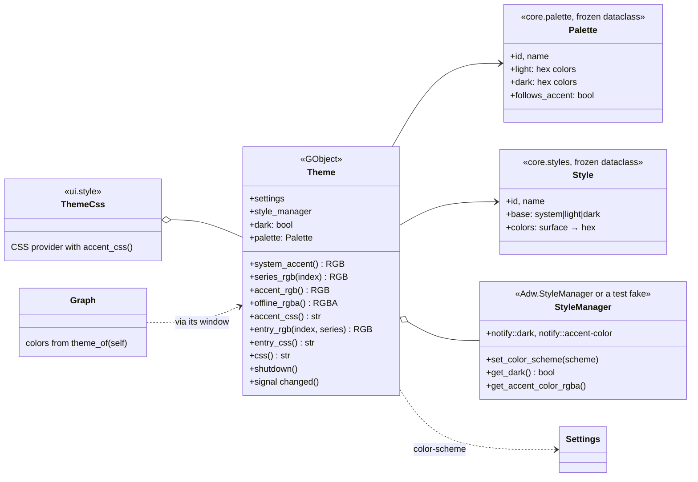

# 9.3 Appearance

- **Styles** (`core/styles.py`, no GTK): *Follow System* (default; maps to
  `Adw.ColorScheme.DEFAULT`, which follows the desktop), *Light*, *Dark*,
  and tinted styles: four named after ExpressVPN's themes, with our own
  colors (*Sand*, *Sky*, *Twilight*, *Midnight*), and since M83 more
  light ones (Mint, Rose, Lavender, Paper, Solarized Light, Gruvbox
  Light, Catppuccin Latte, High Contrast Light) and dark ones (Nord,
  Dracula, Gruvbox Dark, Solarized Dark, Catppuccin Mocha, Tokyo Night,
  Forest, Ember, Black, High Contrast Dark), light ones listed first. A style has a base
  scheme and, if tinted, colors for libadwaita's surfaces (window, view,
  header bar, sidebar, cards, popovers, dialogs; `style_css` writes the
  `--*-color` variables and the pre-1.6 `@define-color` names, loaded by
  `ThemeCss`). Text meets WCAG AAA contrast (7:1) on every surface (tested).
  Changes apply at once; `Theme` emits `changed` once per change.
- **Palettes** (`core/palette.py`, no GTK): eight, after GNOME Terminal's
  built-in schemes plus Nord: **System** (default: the desktop's accent
  color first, then color-blind-friendly steps that don't clash with it),
  GNOME, Tango, Solarized, Linux Console, XTerm, Rxvt and Nord. Each has a
  light variant (the terminal's normal colors) and a dark one (its bright
  colors), in series order blue, red, green, yellow, magenta, cyan.
- **What a palette colors:** every graph series (page graphs, sidebar
  meters, the Intel Details graphs and legends) and, except for System, the
  accent color: `ThemeCss` loads `--accent-bg-color` (and the pre-1.6
  `@define-color` names) at application priority, so switches, progress
  bars and selections match.
- **Time not running (M68):** graphs shade it with a 2×2 dither in
  `offline_rgba(accent, dark)`: the palette's accent mixed 80 % towards
  black, at alpha 0.4 on light styles and 0.75 on dark ones. Near-black
  so it recedes, tinted so it belongs to the palette, and never a series
  color, so it can't be read as data.
- **Where it lives:** `Application` builds the `Theme` into
  `AppContext.theme` (the UI half of the composition root) and a
  `ThemeCss`; `MainWindow` makes a theme if a test didn't, and exposes it
  as `window.theme`.
- **How widgets get it:** no globals. A graph asks its window
  (`theme_of(widget)` reads `widget.get_root().theme`) when it draws;
  outside a themed window it uses the System palette. When the theme
  emits `changed` the window queues a redraw of every drawing area under it
  (`redraw_tree`), because GTK caches each widget's rendering.
- **A color per sidebar entry:** the sidebar numbers its charted entries
  (all but Apps and Processes) in the built-in order (so moving an entry
  keeps its color) and gives each
  `Theme.entry_rgb(i)`: the palette's colors, then lighter and darker
  shades (`entry_colors`), so every entry differs however many there are.
  Its chart uses that color (network's send series a shade of it,
  `secondary`), its progress bar the `.entry-color-<i>` rule `ThemeCss`
  loads, and its page's graphs start at the same color
  (`ResourcePage.set_entry_color` → `Graph.set_entry_base`), so sidebar and
  page match.
- **Preferences → General → Appearance:** *Style* (Follow System, Light,
  Dark) and *Color Palette* (each entry shows its colors for the current
  style).

## App icon (M38)

The icon is a gauge whose needle is a broccoli. The stalk is the needle's
shaft and its cut end sits on the pivot; the lumpy crown is the needle's
head. The broccoli's awkward shape (thin stem, big top) becomes the most
natural part of the picture, instead of being squeezed into a frame.

- *Flat dial:* dark bezel and face, a 240° scale in GNOME green, yellow
  and red with ticks, and a green sparkline under the pivot (usage over
  time).
- *Broccoli on top:* drawn with depth (gradient stalk with fibres and a
  pale cut face; ten florets with radial shading, each covered in buds lit
  from the upper left), and a soft shadow on the dial. It points at about
  58 % of the scale, in the green.
- *Small sizes:* at 16 px the dial ring, the green broccoli and the red
  end of the scale still read.
- `packaging/make-logo.py` writes the SVG. Buds come from a seeded random
  generator, so every run gives the same file; tests check that the
  committed SVG is exactly its output, that it stays on the canvas, and
  that the PNGs match it. `make icons` runs it, then
  `render-icons.py` renders the PNGs (16–512 px).
