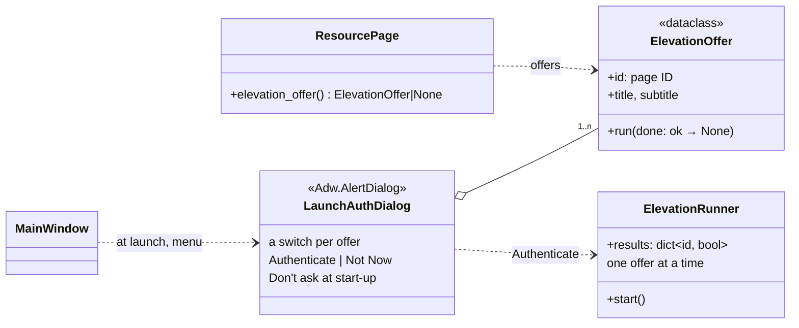

# 9.4 Optional authentication at launch

- **Offers** (`ResourcePage.elevation_offer()`), only while there's
  something to unlock:
  - *Memory:* module properties through `dmidecode`, only when udev had
    none ([§6](06-devices-layer-monitors-and-snapshots.md)).
  - *GPU:* detailed statistics when the detail source is NEEDS_AUTH ([§7.2](07.2-the-controller.md)).
  - *Processes:* every process's drive I/O through the helper.
- **At launch,** if `auth-at-launch` is on and there are offers, the window
  shows `LaunchAuthDialog` once it's on screen. *Authenticate* runs the
  switched-on offers with `ElevationRunner`, strictly one after another,
  because each may show a polkit prompt (dmidecode and the I/O stream are
  separate polkit actions; intel_gpu_top never caches). A failure or
  cancelled prompt doesn't stop the rest.
- **Optional:** *Not Now* changes nothing. Every page keeps its own button
  (Memory's *Authenticate*, the GPU tabs' *Show Detailed Statistics*,
  Processes' I/O toggle), and the main menu's *Show All Details…*
  (`win.authenticate`, enabled while there are offers) brings the dialog
  back. "Don't ask at start-up" and Preferences → General → *Ask for
  Administrator Rights at Start-Up* control `auth-at-launch`.
