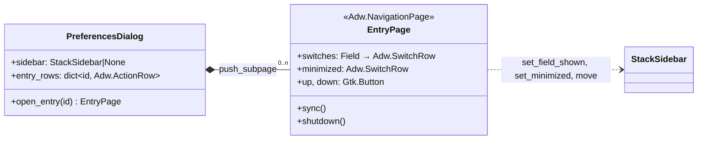

# 9.5 Sidebar preferences

- Preferences → **Sidebar**: *All Entries* (the global *Show Usage
  Details*, *Show Device Descriptions* and *Meter Type*, moved from
  General) and *Entries*: one row per movable entry, in sidebar order,
  with its icon and current description (model, device ID, interface
  name...). Apps and Processes aren't listed: they stay on top.
- A row opens the entry's sub-page: *Name*, *Description*, *Usage Details*
  and *Chart* switches (each subtitled with what it shows now),
  *Minimized*, and *Position* with Move Up/Down. Everything goes through
  the window's `StackSidebar` (injected as `sidebar=`), so it uses the same
  settings and rules as the row menu, and the page follows changes made
  there (`sync()`); it disconnects when the dialog closes.
