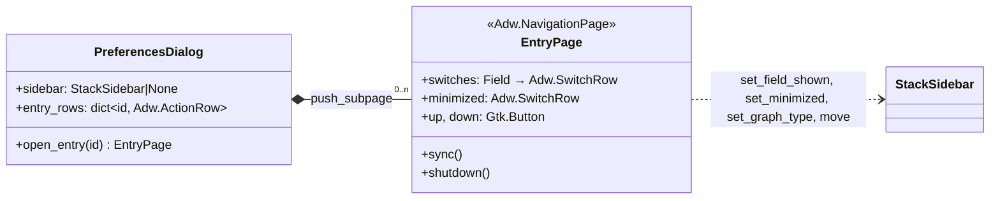

# 9.5 Sidebar preferences

- Preferences → **Sidebar**: *All Entries* (the global *Show Usage
  Details*, *Show Device Descriptions* and *Graph Type* (*Meter Type*
  until Feature 32; the key is still `sidebar-meter-type`), moved from
  General) and *Entries*: one row per movable entry, in sidebar order,
  with its icon and current description (model, device ID, interface
  name...). Apps and Processes aren't listed: they stay on top.
- A row opens the entry's sub-page: *Name*, *Description*, *Usage Details*
  and *Chart* switches (each subtitled with what it shows now),
  *Minimized*, its own *Graph Type* (*Default (Graph)*, *Graph*,
  *Progress Bar*: `sidebar-graph-types` holds only the entries that
  differ, `sidebar_fields.graph_type_for` decides, Feature 32), and
  *Position* with Move Up/Down (within its group, Feature 18). Everything goes through
  the window's `StackSidebar` (injected as `sidebar=`), so it uses the same
  settings and rules as the row menu, and the page follows changes made
  there (`sync()`); it disconnects when the dialog closes.
