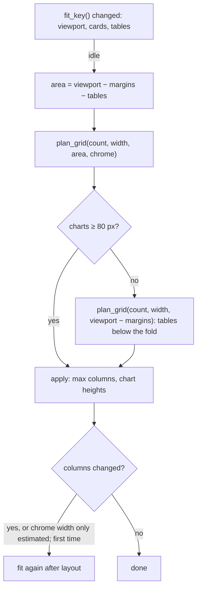
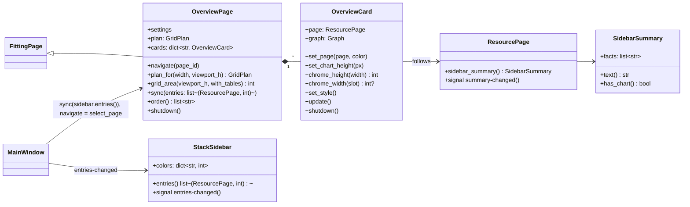
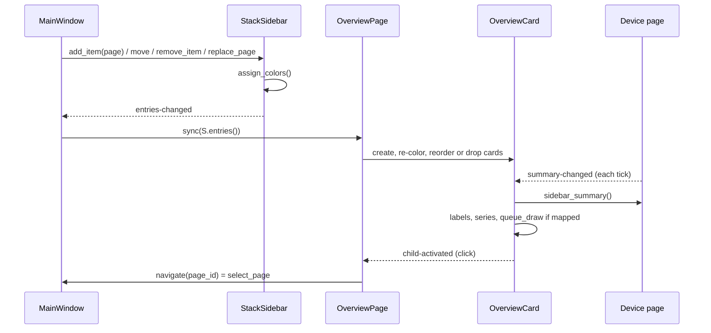
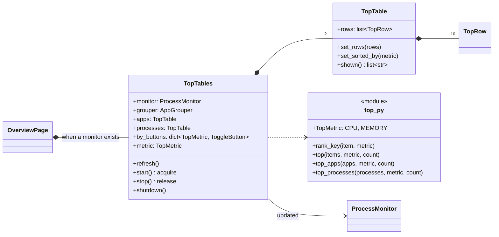

# 9.6 Overview page (M39, M41, M50, M51; Lightweight Mode M71)

*In Lightweight Mode* ([Idea 8's design](ideas/idea-08-lightweight-mode-small-charts-on-the.md)) the cards are a plain 3-column list, each
with the sidebar's small chart instead of a fitted one, and the busiest
tables have five rows without icons.

The first sidebar entry, pinned above Apps and Processes. It shows a card
for every entry that has a sidebar chart, in the sidebar's order and
colors: the entry's icon, name and usage on top; its detail and
description below; then a chart of the same series as its sidebar chart.
Clicking a card opens that page. Placeholder pages (no summary at all) get
no card. It's always the page shown at launch (M55).

- **Layout: an N × M grid that tries to fill the page** (M50, M51). Before, chart
  height followed card width (0.4 ×, at most 240 px), which left most of a
  full-screen portrait monitor empty. Now the cards (a homogeneous
  `Gtk.FlowBox`) fill the height the page gives them:
  - *Area:* the viewport less the column's margins and the top tables'
    natural height (and the gap above them). If that would make charts
    shorter than 80 px (`GRID_MIN_CHART`), the cards take the whole
    viewport and the tables scroll into view below. With fewer charts the
    tables always stay on screen.
  - *Shape:* `plan_grid` (`ui/layout.py`, no display) tries 1–4 columns,
    each card at least as wide as its minimum (280 px plus the FlowBox
    child's padding); rows share the height equally. It scores each by
    how far the chart's height/width is from 0.5 (log scale) plus 2 × the
    share of empty cells, so full rows win over a slightly better shape;
    any plan needing charts under 80 px loses to one that doesn't.
  - *Never taller than wide* (M51): the grid only *tries* to fill. A
    chart's height stays strictly below its width (`GRID_MAX_RATIO` 1.0,
    `max_chart_height(w) = ceil(w × ratio) − 1`), so one or two cards on a
    portrait screen don't become towers. The score adds 2 × the share of
    the area left unfilled, so among plans within the cap the one that
    fills most wins: two cards on a landscape page stack (filling) rather
    than sit side by side capped. What the cap leaves stays empty below
    the grid; the tables move up into it.
  - *Chrome:* a card's height apart from its chart is measured from the
    FlowBox child (its padding included), at the planned width. Its width
    apart from the chart (the child's margins, the card's border and
    padding) is measured as the column slot (flow width ÷ columns) less
    the chart's allocated width, so the cap holds on screen. Before the
    first layout it's estimated, and the page fits once more after it.
  - *Applying:* `max_children_per_line` = the planned columns (the
    minimum stays 1, so the window can still be made narrower), and every
    chart's content height = the planned height. A column change refits
    once more after layout, and only once, so rounding can't flip the
    column count back and forth.
  - *When:* `OverviewPage` is a `FittingPage` whose `fit_key()` adds the
    number of cards and the tables' height (they grow from "Waiting for
    data…" to ten rows), so all three refit.

- **Readings line (M57):** under the detail line, a card shows
  `SidebarSummary.facts`: the processor's temperature, a GPU's
  temperature and memory ("Temperature 39 °C · Memory 598.7 MB / 8.5 GB",
  `core.units.device_facts`, in the user's temperature unit and unit
  base). Readings a device doesn't have are left out (an Intel iGPU has
  neither, so no line). The line appears with the first data, so
  `fit_key` counts cards showing one and the grid refits.
- **Data:** a card calls `page.sidebar_summary()` and follows the page's
  `summary-changed`, exactly like a sidebar row. `SidebarSummary.text()`
  builds the usage line for both. Charts redraw only while mapped; axes
  and time span follow `show-graph-axes` and `graph-time-range`.
- **Decoupled from the sidebar (DI):** `OverviewPage(settings,
  navigate)` never touches the sidebar. `StackSidebar` emits
  `entries-changed` whenever its charted entries, their order or their
  colors change (every `assign_colors()`), and `entries()` lists
  `(page, color index)` in display order. The window connects the two
  (`overview.sync(sidebar.entries())`) and passes `select_page` as
  `navigate`. Tests drive `sync()` with fake pages.

## Busiest apps and processes (M41)

Below the cards, **Busiest** shows two tables: the top 10 apps and the
top 10 processes. Each row has rank, icon (the puzzle piece when there's
none), name, processor use and memory.

- **Ranking** (`processes/top.py`, pure): by processor use or memory,
  chosen with the *Processor / Memory* toggle (`overview-top-by`). Ties go
  to the other measure, then the name (case-insensitive), so rows don't
  swap on equal values. *System Processes* isn't ranked as an app: it
  would nearly always be first, and its processes are in the other table.
  The column used for the ranking is highlighted.
- **Data:** the same `ProcessMonitor` and `AppGrouper` as the Apps and
  Processes pages. `TopTables` acquires the monitor only while the
  Overview is mapped, so processes aren't sampled for a page no one sees.
  Memory follows the unit base preference.
- **Widgets:** `TopTable` (`ui/widgets/top_table.py`) makes its 10
  `TopRow`s once and refills them in place, hiding unused ones, so updates
  don't flicker or move keyboard focus. Activating a row opens the Apps
  or Processes page.
- **Layout:** a `FlowBox` puts the tables side by side when each can be at
  least 340 px wide, and stacks them otherwise (portrait windows). It isn't
  homogeneous, so the shorter table leaves no gap.
- **No monitor, no tables:** in demo mode and in tests without one,
  `OverviewPage(processes=None)` shows only the cards.

