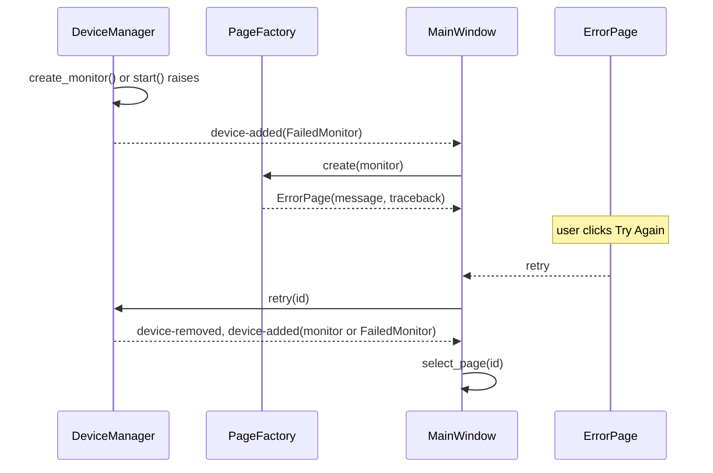

# 9.7 Error pages (v0.2.0)

A device Proccoli can't read keeps its sidebar entry; its page says what
went wrong instead of the device silently missing.

- **When:** `DeviceManager` couldn't build or start the device's monitor
  (it keeps a `FailedMonitor` with the message and traceback, [§6](06-devices-layer-monitors-and-snapshots.md)), or the
  page factory's builder raised (`PageFactory.create` logs it and returns
  the error page instead).
- **What it shows:** `ErrorPage` (`ui/pages/error.py`): an `Adw.StatusPage`
  with the error icon, "*Name* Isn't Available" and the message; a
  *Technical Details* expander (monospace, selectable, *Copy Details*);
  *Try Again*. It has no sidebar summary, so the entry has no chart.
- **Try Again** emits `retry`. `MainWindow._on_retry` calls
  `DeviceManager.retry(id)` for a failed device (which emits
  `device-removed` and `device-added`, with an error page again if it
  still fails) and keeps the page selected; for a page that failed to
  build, it builds the page again and swaps it in place.
- The GPU page's vendor tabs show their own FAILED state ([§7.2](07.2-the-controller.md)) with the
  same error icon and *Try Again*.

