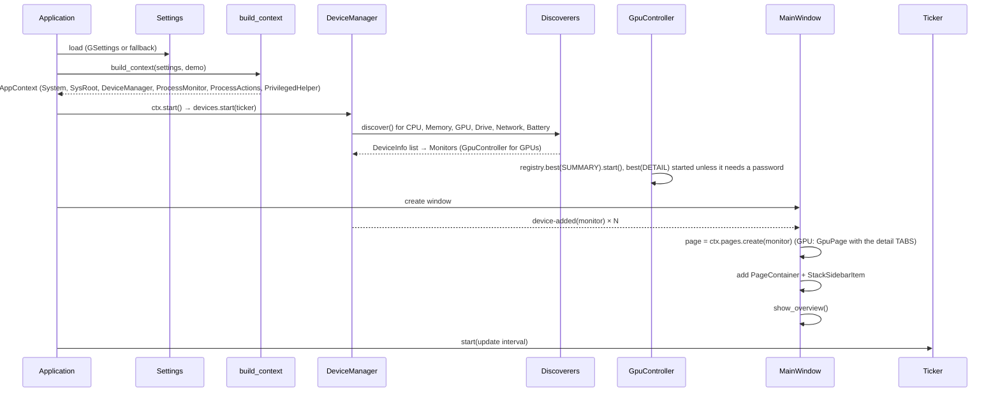
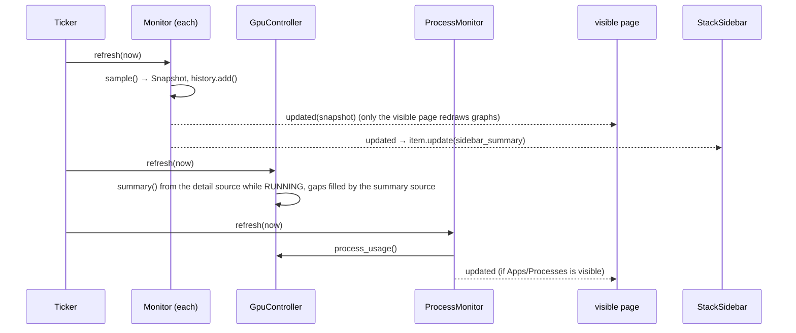

# 10. Runtime flow

## 10.1 Start-up

## 10.2 Each tick

**Performance:** the process scan runs only while Apps or Processes is
visible (pages acquire and release the `ProcessMonitor`). Hidden device
pages still record history, but they don't redraw.
Each page tracks `get_mapped()`; when it becomes visible again it draws once
with the full history. With the window hidden, the per-process scan drops to
every 5 s.
