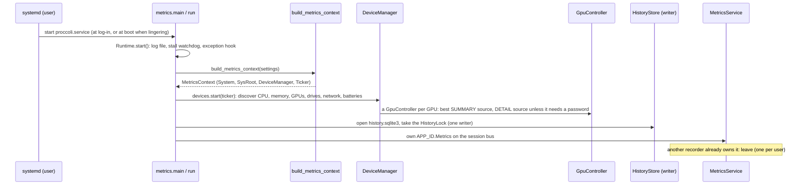
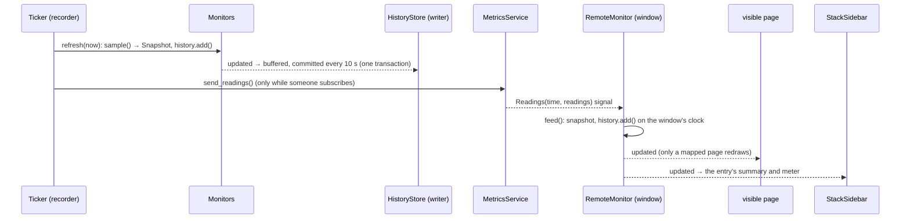

# 10. Runtime flow

Two programs run: the recorder (`proccoli`) reads the devices and keeps
the history; the window (`proccoli-gui`) shows them. See
[DESIGN_UML.md](DESIGN_UML.md) for the deployment picture.

## 10.1 The recorder starts



## 10.2 The window starts

```mermaid
sequenceDiagram
    participant A as Application
    participant C as build_context(remote=True)
    participant RDM as RemoteDeviceManager
    participant MS as MetricsService (recorder)
    participant HS as HistoryStore (read-only)
    participant W as MainWindow
    A->>A: Runtime.start(); Settings; the profile (Lightweight Mode or not)
    A->>C: build_context(settings, remote=True)
    C-->>A: AppContext (RemoteDeviceManager, ProcessMonitor, ProcessActions, helper)
    RDM->>MS: watch the bus name (starts the recorder if it's away), Devices()
    MS-->>RDM: every device's description → a RemoteMonitor each
    RDM->>MS: Subscribe() (the recorder commits its buffer first)
    A->>HS: open the history read-only
    A->>W: create the window
    RDM-->>W: device-added × N → a page each (ctx.pages), sidebar groups, the Overview
    HS-->>W: each device's graphs filled from the history (one per idle call)
```

## 10.3 Each update



- **Processes** are read by the window itself (`ProcessMonitor`): too
  many and too fast-changing to send. It scans only while Apps,
  Processes or the Overview's busiest tables are on screen; Apps and
  Processes also stop while the window is suspended (screen locked,
  minimised). Each table refresh is one splice.
- **A time range change:** the window asks the recorder to `Flush()`,
  then refills its graphs from the history at the new step.
- **Hidden pages** keep their history but don't redraw; a page drawn again
  shows its full history at once.
- **The recorder goes away:** the window shows a banner with *Try Again*,
  and picks the readings up when the recorder is back.
