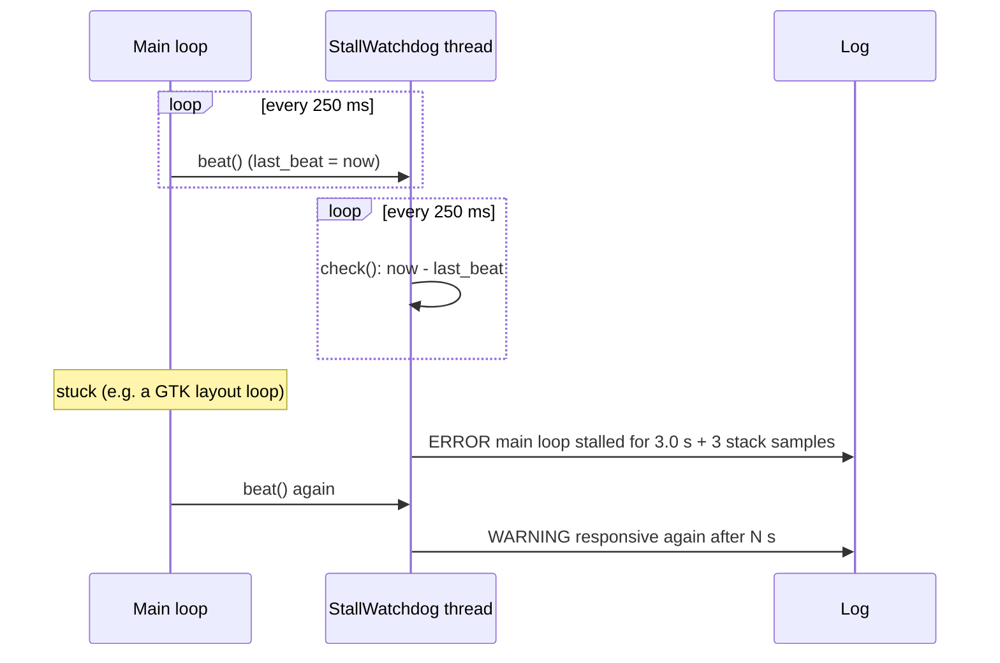
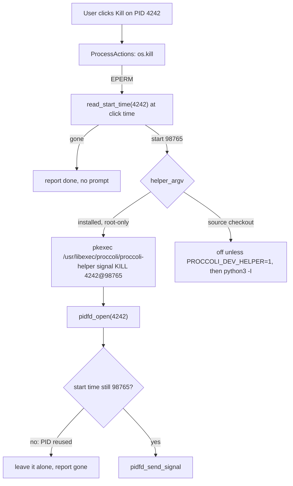

# 11. Cross-cutting concerns

- **Settings schema** (`io.github.mamadingleberry.Proccoli`) mirrors
  Resources' keys: window size and maximised state, temperature unit, unit
  base, refresh speed (replaced by `update-interval`, M65), virtual drives
  and network interfaces, sidebar
  details, description and meter type, network bits, every `apps-show-*` and
  `processes-show-*` column, logical CPUs, graph grids, sort column and
  order, normalize CPU usage, detailed priority. Proccoli adds:
  - `graph-time-range` (M58, replacing Resources' *graph data points*):
    how much time graphs show (30 s; 1, 2, 5, 10 or 30 minutes; 1 or 6
    hours; 1 day; default 1 minute). `core.ticker.graph_plan(settings)`
    turns it into a number of points at the current update interval (at
    most 1200, averaging samples for long ranges, M64), so changing the
    speed no longer changes the time a graph covers; `DeviceManager`
    resizes every history when either changes
  - `lightweight` (M66, Idea 1): Lightweight Mode at the next start
    ([Idea 1's design](ideas/idea-01-lightweight-mode.md)); `--lightweight` turns it on for one run
  - `update-interval` (M65, Idea 6): how often Proccoli takes readings,
    `1-second` (default), `2-seconds`, `3-seconds`, `5-seconds` or
    `10-seconds` (`core.ticker.UPDATE_INTERVALS_MS`). It replaced
    `refresh-speed`, which stays in the schema only so `settings.migrate`
    can carry an old choice over once at start-up (very slow → 5 s, slow →
    2 s, the rest → 1 s; then it's reset). Old nicks in
    `intel-gpu-top-interval` are migrated the same way, and
    `ticker.interval_for` reads either kind
  - `history` (on), `history-max-size` (MiB, default 512, 16–4096) and
    `history-detail-hours` (default 24, 1–168): the history database
    ([Idea 2's design](ideas/idea-02-metrics-history-in-a-sqlite-database.md), M62). They replaced M58's `stats-log` and `stats-log-max-size`
  - `color-scheme`: the style: `system` (follow the desktop), `light`,
    `dark`, `sand`, `sky`, `twilight` or `midnight`
  - `palette`: one of the eight color palettes ([§9.3](09.3-appearance.md)), `system` by default
  - `auth-at-launch`: offer to authenticate at start-up ([§9.4](09.4-optional-authentication-at-launch.md)), on by default
  - `linger-offered` (M89): the window has asked once whether to record
    from boot ([Idea 22's design](ideas/idea-22-recording-from-boot.md)); off by default
  - Where each setting appears in Preferences, or why it's set elsewhere:
    `ui/preferences_layout.py` (M88; a test holds every key to it)
  - `sidebar-shown`: whether the sidebar shows on wide windows ([§9.2](09.2-window-behaviour.md)), on
    by default
  - `sidebar-style`: `full` (default) or `icons` (icons only, M54); with
    `sidebar-shown` it gives the menu's three modes ([§9.2](09.2-window-behaviour.md))
  - `overview-top-by`: what ranks the Overview's busiest apps and
    processes, `cpu` (default) or `memory` ([§9.6](09.6-overview-page.md))
  - `sidebar-order`, `sidebar-minimized` and `sidebar-hidden-fields`: the
    user's sidebar ([§9.2](09.2-window-behaviour.md))
  - `graph-time-range-custom` (seconds, 10–2592000, default 7200): the
    range when `graph-time-range` is `custom` (M74, [Idea 9's design](ideas/idea-09-custom-graph-time-range.md))
  - `show-toolbar` (on) and `toolbar-items` (default `['time-range',
    'axes', 'grids']`): the graph toolbar and its buttons in order (M72,
    [Idea 12's design](ideas/idea-12-a-graph-toolbar.md))
  - `export-hardware-addresses` (off): whether exports include network
    cards' hardware addresses (M73, [Idea 14's design](ideas/idea-14-exported-statistics-describe-their-devices.md))
  - `show-graph-axes`: axes on graphs ([§9.1](09.1-widgets.md); percentages, and since M63
    every page graph with a unit), on by default
  - `log-level`, `log-max-size`, `log-performance-interval`: the
    diagnostics log (below)
  - `gpu-details-disabled`: PCI slots whose detailed statistics are off
  - `gpu-view`: the GPU page's last tab (overview, details, processes)
  - `gpu-elevate`: start the detail source through pkexec at launch
    instead of waiting for the user to ask
  - `intel-gpu-top-interval`: the Details tab's own update interval
    (an `update-interval` nick; empty = the app's). Its history length was
    `intel-gpu-top-history` until M60; it now follows `graph-time-range`
- **Diagnostics log** (`core/applog.py`): standard practice on Linux, a
  rotating file at `$XDG_STATE_HOME/proccoli/proccoli.log`
  (`~/.local/state/proccoli/`). `FileLog` attaches a `RotatingFileHandler`
  to the `proccoli` logger: `log-level` (off, error, warning, info, debug;
  **debug, i.e. everything, by default** since M55) and `log-max-size`
  (KiB, default 1024, 64–65536); one older file is kept, so it never takes
  more than twice the size on disk (tested). Times are **UTC**, ISO 8601
  to the millisecond (`UtcFormatter`: `2026-11-23T21:41:25.154Z`), so logs
  from machines in different time zones line up.
  The terminal keeps its own level (`--debug`). `PerformanceLog` (in the
  context, connected to the ticker first, so it times whole refreshes)
  writes every `log-performance-interval` minutes (default 10, 0 off):
  Proccoli's CPU %, memory, threads, refreshes and the slowest refresh, from
  `/proc/self` through `SysRoot`. Preferences → General → *Diagnostics*
  sets all three and opens the log folder. `Application(log_file=...)`
  and `PreferencesDialog(launcher=...)` are injectable, so tests never
  write to the real home. Log files are private (0600, folder 0700).
- **History database** (`core/history_db.py`, `core/history_store.py`,
  M62): every reading Proccoli shows, kept in
  `$XDG_STATE_HOME/proccoli/history.sqlite3` and summarised as it ages;
  [Idea 2's design](ideas/idea-02-metrics-history-in-a-sqlite-database.md) has the design. It replaced M58's statistics files (one CSV per
  device in `stats/`), which are imported once and removed. Their format
  lives on as the export format. `Snapshot.stats_values()` /
  `stats_units()` say what's recorded: by default the graphed readings
  (`history_values`); Memory adds used/total bytes of memory and swap,
  GPUs their memory bytes and memory clock.
- **Stall watchdog** (`core/watchdog.py`, M44): a frozen window logs
  nothing, because the main loop that would write is the thing that's
  stuck. `Application` starts a `StallWatchdog`: the main loop beats every
  250 ms (`GLib.timeout_add`), and a daemon thread checks the beat. After 3
  s without one, it logs an error with three samples, 0.3 s apart, of every
  thread's Python stack (`format_stacks`, main thread first), so a loop
  shows its repeating frames. When the beat returns, it logs how long the
  stall lasted. PyGObject releases the GIL while GTK runs C code, so the
  thread runs even then. Clock, sleep, stack capture and scheduling are
  injectable.

- **Errors:** a monitor that fails to read keeps its page, but shows empty
  graphs and an `AdwBanner` with the reason. Backend failures follow the
  state diagram in [§7.2](07.2-the-controller.md). Nothing ever raises into GTK callbacks; exceptions
  are logged with the device ID.
- **Accessibility:** every graph has an accessible label with its current
  value; table columns have headers; the sidebar is keyboard-navigable.
- **Internationalisation:** strings are wrapped in `_()` from the start
  (gettext); translations come later.
- **Licensing (decided): 0BSD (Zero-Clause BSD).** Anyone may use, copy,
  modify and redistribute the code, with or without a fee, without even
  keeping the copyright notice. It is OSI-approved and written for software.
  The Unlicense and CC0 are less suitable: the Unlicense's public-domain
  wording isn't recognised everywhere, and CC0 explicitly withholds a
  patent grant.
  - **Consequence:** Resources is **GPL-3.0-or-later**, so **no code, UI
    files, CSS or assets are copied from it**. Its UX is re-implemented from
    scratch, using only the observable behaviour documented in [§2.1](02-what-resources-does-and-what-proccoli.md).
  - intel_gpu_top_gui code is ours, so it can be reused under 0BSD.
  - Third-party code with attribution or copyleft terms can't be vendored in.
    Depend on it as a system package instead.
- **Naming:** "Proccoli" is a prototype name. The display name, app ID and
  version live only in `src/proccoli/__init__.py`. Everything else reads
  those constants, so a rename means editing that file, renaming the
  `src/proccoli/` package directory, and renaming the `data/` files.

## 11.1 Security: what runs as administrator (M40)

**What runs as root,** always through `pkexec` after the user types an
administrator password:

| Program | Started by | Polkit action | Prompt |
|---|---|---|---|
| `proccoli-helper signal/renice/affinity` | End/Kill/Halt/Continue, Process Options on another user's process | `….signal`, `….renice`, `….affinity` | `auth_admin_keep` |
| `proccoli-helper dmidecode` | Memory → Authenticate (only when udev lacks the modules) | `….dmidecode` | `auth_admin_keep` |
| `proccoli-helper processes` | Processes → drive activity of other users' processes | `….processes` | `auth_admin_keep` |
| `proccoli-helper gpu-top MS cardN` → `intel_gpu_top -J -s MS -d drm:/dev/dri/cardN` | GPU → Show Detailed Statistics, or `gpu-elevate` | `….gpu-top` | `auth_admin_keep` |
| `intel_gpu_top …` directly (fallback: helper older than protocol 3) | as above | `….intel-gpu-top` | `auth_admin` every time |

**Threat model.** The user is an administrator and trusts Proccoli. The
attacker is other code running as the same user, such as a malicious
extension, a compromised npm or pip package, or a script. That code can't
become root on its own. It can, however, try to turn the user's *next
password prompt* into root for itself, or make a root action hit something
the user didn't choose.

**Review findings and what changed:**

| # | Finding | Severity | Fix |
|---|---|---|---|
| 1 | In a source checkout the helper was the checkout's own script, `pkexec python3 ~/…/proccoli_helper.py`. Code running as the user could edit it, or plant a `json.py` next to it (Python puts the script's folder first on `sys.path`). The next prompt, polkit's generic "run python3 as root" one, then ran that code as root. | High | `helper_argv` uses only an installed helper that only root can change (`core.trust.is_trusted_path`: the file and every folder up to `/` owned by root, not group- or world-writable, symlinks resolved). A source checkout's helper runs only with `PROCCOLI_DEV_HELPER=1`, through `python3 -I`. Otherwise those actions are off, with a log line saying why. |
| 2 | `intel_gpu_top` for pkexec came from `PATH`. On Ubuntu `PATH` includes `~/.local/bin`, so a planted `~/.local/bin/intel_gpu_top` would run as root at the next Show Detailed Statistics. | High | Elevated starts use `find_trusted("intel_gpu_top")`: only `/usr/bin`, `/usr/sbin`, `/bin`, `/sbin`, `/usr/local/bin`, `/usr/local/sbin`, and only a root-only copy. Otherwise the start fails with an explanation (`UNTRUSTED_REASON`). Unelevated starts still use `PATH`: they run as the user, so nothing is gained. |
| 3 | The helper acted on bare PIDs. Between the click and the end of the password prompt (seconds), the target can exit and the kernel can reuse its PID for another process, possibly a root one, which the root helper would then kill. | Medium | `ProcessActions` reads each process's start time (`read_start_time`, field 22 of `/proc/PID/stat`) when the user acts and sends `PID@STARTTIME`. The helper acts only if the start time still matches. It signals through a pidfd (`os.pidfd_open` → check → `signal.pidfd_send_signal`), so the check and the signal hit the same process. Without pidfds it checks, then signals. renice and affinity check just before acting (a sub-millisecond race remains; the syscalls have no pidfd form). A process already gone counts as done and isn't sent at all. |
| 4 | The helper's interpreter wasn't isolated. | Low | Shebang `#!/usr/bin/python3 -I`: no script folder on `sys.path`, no `PYTHON*` variables, no user site-packages. pkexec already clears the environment; this is defence in depth. |
| 5 | `str.isdigit()` accepted non-ASCII digits (`"²"` crashed the helper with a traceback; Arabic-Indic digits parsed). | Low | ASCII digits only (`_digits`). |
| 6 | A hung `dmidecode` crashed the helper with a traceback. | Low | Timeout → JSON error, exit 1. |
| 7 | The diagnostics log could be read by other local users when the home folder allows it. It can name processes and devices. | Low | `PrivateRotatingFileHandler`: files 0600 (every rollover too), folder 0700. |
| 8 | An installed helper from before these changes would refuse `PID@STARTTIME`. | Compatibility | The helper declares its `PROTOCOL` (2: identities; 3: `gpu-top`). The app reads it from the file (no root needed, `helper_protocol`) and sends an older helper only what it understands, logging a reinstall hint. |
| 9 | *Found in M41, fixed in M42:* the root `intel_gpu_top` outlived Proccoli. M40 had judged that it dies of SIGPIPE when Proccoli stops reading. It doesn't: it ignores SIGPIPE (`SigIgn` bit 13 in `/proc/PID/status`), and Proccoli can't signal a root process. Four orphans were found on the development machine, the oldest over 12 hours old, each polling the GPU. Each stop, restart (interval change) or quit after Show Detailed Statistics left one behind. | Medium | `proccoli-helper gpu-top MS cardN` runs `intel_gpu_top` with fixed arguments (interval 100–10000 ms, `card\d+`, no `-o`) and relays its output (`relay`). When a write fails (Proccoli stopped reading or exited), it terminates the child, kills it after 2 s if needed, and exits. The helper is root, so it may. `IntelGpuTopBackend` uses it whenever `GpuDeps.helper` speaks protocol 3, falling back (with a warning) to running `intel_gpu_top` directly. Since the arguments are fixed and no files can be written, the action may keep its authorization (`auth_admin_keep`). |

**Reviewed and acceptable as they are:**

- *Retained authorization:* `auth_admin_keep` on the helper actions.
  polkit keeps the authorization for "the same action identifier and
  subject", and pkexec's subject is the process that ran it, i.e.
  Proccoli. pkexec's manual asks that programs whose authorization is kept
  validate their arguments, and the helper validates every argument: fixed
  subcommands, four signals, PID > 1 and not itself, nice −20..19, existing
  CPUs, no free-form paths, no shell. `intel_gpu_top` can write files
  (`-o`), so its action keeps `auth_admin` and asks every time.
- *Root output, unprivileged parser:* the helper and `intel_gpu_top` send
  JSON to Proccoli, which runs as the user. Nothing flows from the user
  into root except validated helper arguments and `intel_gpu_top`'s fixed
  argv. The card name comes from `/sys` and must match `card\d+`.
- *Root processes outliving Proccoli:* Proccoli can't signal a root child,
  so `StreamReader.stop()` closes the pipe instead. The helper's own
  streams (`processes`, `gpu-top`) are Python, which turns the closed pipe
  into `BrokenPipeError`: `processes` exits, and `gpu-top` stops
  `intel_gpu_top` first (finding 9). Both happen within one interval, also
  if Proccoli crashes. Only the fallback for an old helper (`intel_gpu_top`
  run directly) can still outlive Proccoli. A warning in the log says so.
- *What admin views reveal:* elevated drive activity and GPU clients show
  other users' processes to this user. That's the purpose of those views,
  and it's behind the administrator password.
- *`gpu-elevate`:* off by default. When on, a password prompt appears at
  start-up without a click. That's the user's choice, and polkit's dialog
  names the action.

