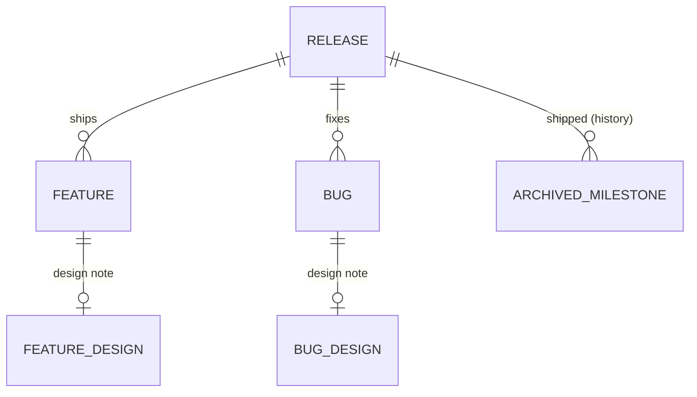

# 13. Features, Bugs and Releases

How work on Proccoli is tracked (Feature 26). The rules (which files,
what they hold, their statuses, which index line changes when) are in the
`software-design` skill's *Tracking work* section
(`.claude/skills/software-design/SKILL.md`) and only there; releases are
cut as the `software-project` skill says. This section is the picture.

