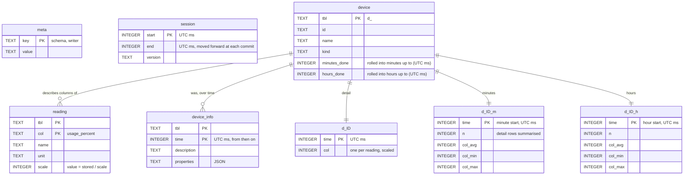

# Proccoli: database design

The metrics history: one SQLite file per user,
`$XDG_STATE_HOME/proccoli/history.sqlite3` (default
`~/.local/state/proccoli/`), written by the recorder (`proccoli`) and
read by the window. The code is `core/history_db.py` (the SQL) and
`core/history_store.py` (when to write and tidy); the design history is
[Feature 2](features/feature-02-metrics-history-in-a-sqlite-database.md).
The classes around it are in [DESIGN_UML.md](DESIGN_UML.md).

**Keep it current:** a change to a table, column, key, index, retention
rule or the schema version updates this file in the same change;
`tests/test_docs.py` fails when a table the code creates isn't named
here.

## Kind of store

OLTP-style: small, frequent appends (a row per device each update) and
range reads by time. SQLite in WAL mode, one writer (the `HistoryLock`)
and any number of read-only readers. Exports turn ranges into CSV.

## Schema (version 2)

- **Per-device tables** (`d_<id>`, `_m`, `_h`) are created when a device
  first appears; a new reading is an `ALTER TABLE … ADD COLUMN` on all
  three, which SQLite does without rewriting.
- **Values** are scaled integers (hundredths of a percent and of a
  degree, milliwatts, bytes, hertz), stored in 1–8 bytes.
- **Times** are UTC epoch milliseconds everywhere; the window converts to
  local time only to show them.
- `reading` and `device_info` are `WITHOUT ROWID` (their key is the row).

## Retention

| Level | Kept | Setting |
|---|---|---|
| Detail (`d_<id>`) | `history-detail-hours` (default 24 h) | Preferences → History |
| Minutes (`_m`) | 30 days (`MINUTES_KEPT_DAYS`) | — |
| Hours (`_h`) | until the size cap | — |
| Whole file | under `history-max-size` (default 512 MiB): oldest hours a month at a time, then minutes a day at a time, then detail an hour at a time | Preferences → History |

Housekeeping runs every few minutes, not only at quit: roll up, expire,
cap, checkpoint the WAL.

## Versions and permissions

- `meta.schema` is the version. An older file gains new tables on open
  (nothing to migrate); a newer one stops a writer (`NewerSchema`), so a
  downgrade never damages it.
- The file is `0600` and its folder `0700`: only its user can read it.
