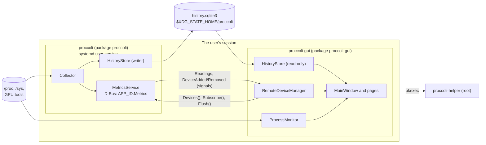
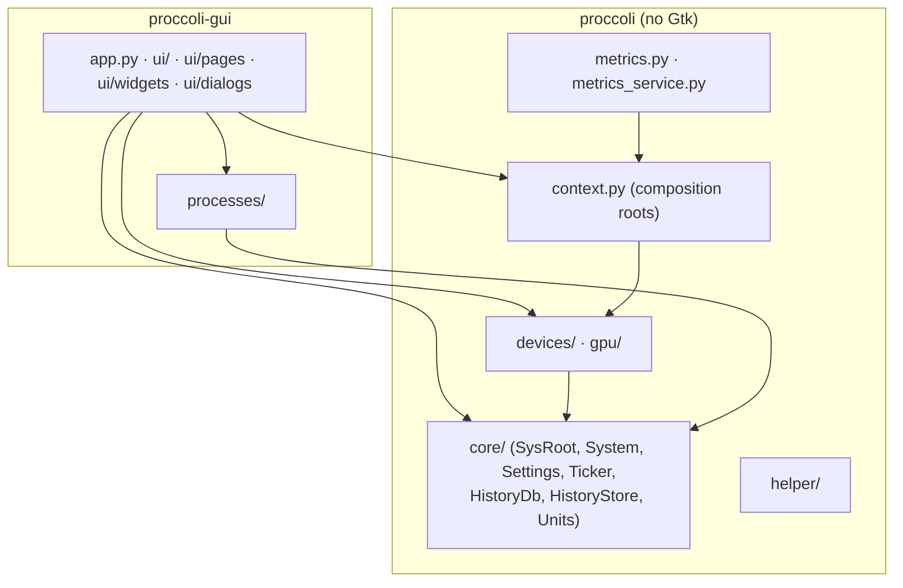
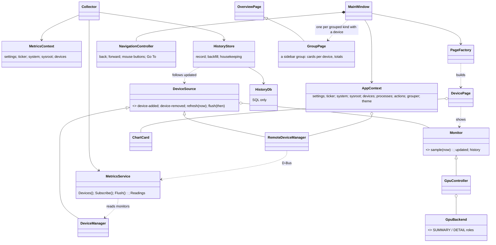
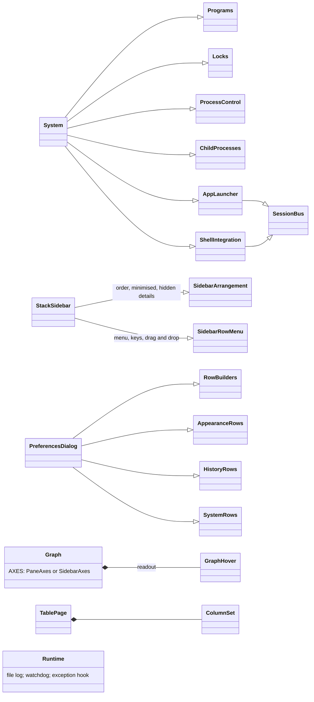

# Proccoli: high-level UML

The overview to open first: the two programs, the packages, and the main
classes. Each section file has the detail ([§4](04-architecture-overview.md)
architecture, [§5](05-core-layer.md) core, [§6](06-devices-layer-monitors-and-snapshots.md)
devices, [§7](07-the-gpu-carve-out.md) GPU, [§9](09-ui-layer.md) UI,
[§10](10-runtime-flow.md) runtime). The database is in
[DESIGN_DB.md](DESIGN_DB.md).

**Keep it current:** a change that adds, removes or renames a program, a
package, a class shown here, or a link between them updates this file
in the same change.

## Deployment: two programs, two packages

The recorder reads every device; the window reads processes itself (they
change too fast and are too many to send) and everything else from the
recorder and the history.

## Packages and layers

UI → Domain → Core, never back. Nothing in the `proccoli` package imports
Gtk or the GUI (`tests/test_static.py`, `InstallSplitTest`).

## Main classes

## Classes made of parts

Some big classes are made of parts, each its own class and module, so
each can be read and tested on its own (Feature 21). The callers see one
object.

