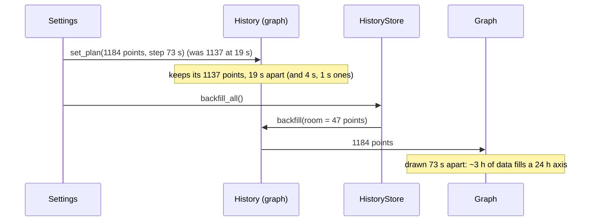
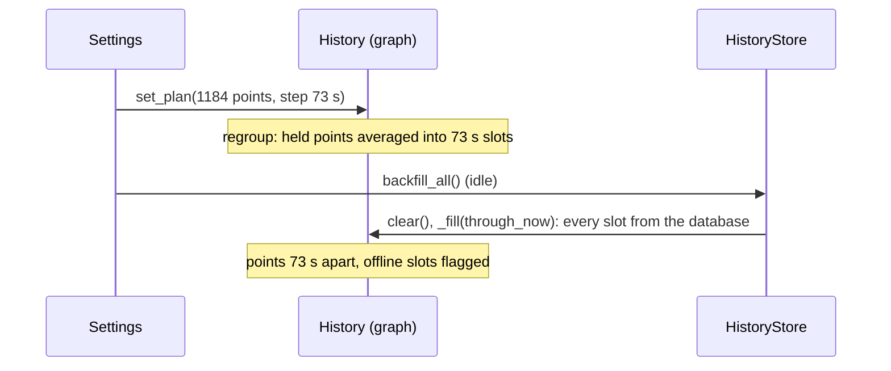

# Bug 1: Graphs stretch old points after a time range change

Plan: [plan/bugs/bug-01-graphs-stretch-old-points-after-a.md](../../plan/bugs/bug-01-graphs-stretch-old-points-after-a.md)

*[PLAN.md, Bug 1](../../plan/bugs/bug-01-graphs-stretch-old-points-after-a.md). Fixed in v0.4.0; kept as the record.* `History` holds points without a per-point spacing;
`graph_runs` draws them evenly, `step_s` apart. A range change updates
`step_s` but keeps the points taken at the old step, and backfill only
fills the room in front:

**The fix (v0.4.0):** `History.set_plan` regroups the held points into a
longer step's slots by their times (`core.history.regroup`) and empties
the history for a shorter step. With the history database on, the
store's `backfill_all` then empties each history and fills it again in
full from `HistoryDb.buckets`, its slots ending at "now". The Intel
Details `History` does the same.

