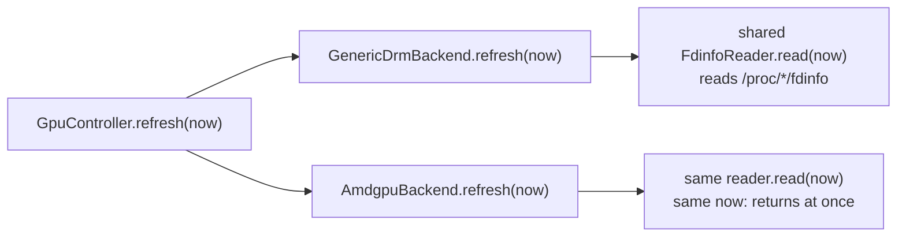

# Bug 6: An AMD GPU's fdinfo was read twice per update

Plan: [plan/bugs/bug-06-an-amd-gpu-s-fdinfo-is.md](../../plan/bugs/bug-06-an-amd-gpu-s-fdinfo-is.md)

*[PLAN.md, Bug 6](../../plan/bugs/bug-06-an-amd-gpu-s-fdinfo-is.md). Fixed in M75.* The summary backend and the AMD Details
backend each had a `FdinfoReader` for the same GPU. Now `GpuDeps.fdinfo`
holds one per GPU (`fdinfo.shared_reader`), and reading again at the same
update time returns at once:

