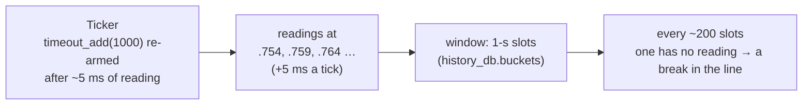

# Bug 17: Graphs from the history miss a point every few minutes

Plan: [plan/bugs/bug-17-one-point-gaps-every-few-minutes.md](../../plan/bugs/bug-17-one-point-gaps-every-few-minutes.md)

*[PLAN.md, Bug 17](../../plan/bugs/bug-17-one-point-gaps-every-few-minutes.md). Fixed in v0.6.0.* The recorder's ticks drift ~5 ms each
(`GLib.timeout_add` counts from the end of the callback), so readings
are 1004–1006 ms apart and one 1-s graph slot in ~200 is empty when the
window lays the history out:

As built (v0.6.0), as proposed: a drift-free ticker (`start + n × interval`), and buckets
that let a reading which slipped by less than half a step fill the
empty slot beside it; real gaps (longer than 1½ steps) stay.
