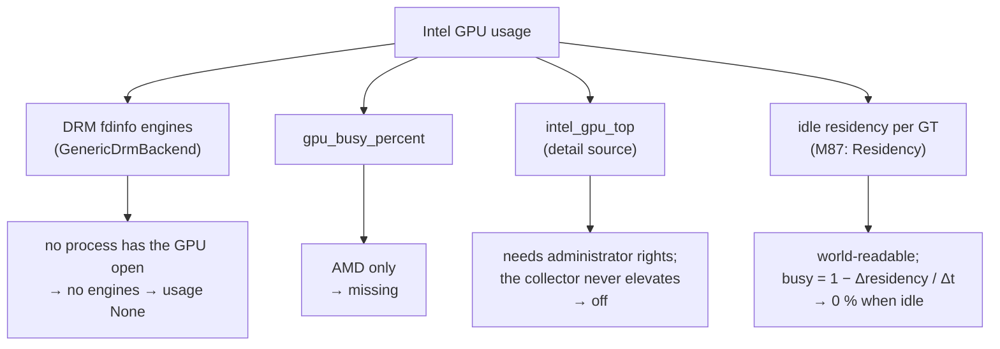

# Bug 19: An idle Intel GPU's Overview card is a blank chart

Plan: [plan/bugs/bug-19-an-idle-intel-gpu-s-overview.md](../../plan/bugs/bug-19-an-idle-intel-gpu-s-overview.md)

*[PLAN.md, Bug 19](../../plan/bugs/bug-19-an-idle-intel-gpu-s-overview.md). Fixed in M87.* Where an Intel GPU's usage can come from, and
why each source is empty when nothing uses the GPU and the window reads
from the collector:

Built (M87): `generic_drm.Residency` turns a GT's idle residency into a
busy percent (`100 × (1 − Δasleep / Δt)`, clamped; no figure on the first
sample or after the counter went backwards). `residency_paths` looks for
`gt/gt<N>/rc6_residency_ms`, the older `power/rc6_residency_ms` (GT 0)
and xe's `tile0/gt<N>/gtidle/idle_residency_ms`. Order of precedence for
usage: `gpu_busy_percent`, fdinfo engines, GT 0's residency; GT 1's
(the media GT) is the video figure when fdinfo has none. A frequency
file reading 0 is 0 Hz, shown as "Idle" (`backend.frequency_text`).

As proposed: the summary source falls back to RC6 (i915) or gtidle (xe)
residency when fdinfo has no engine figures, and a frequency file that
reads 0 MHz is an "Idle" reading rather than a missing one.
