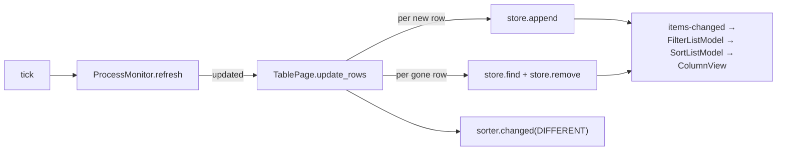
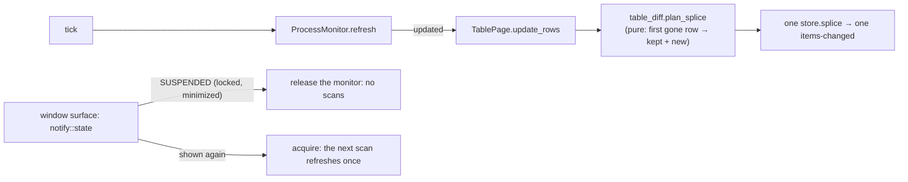

# Bug 22: The window freezes after unlocking or waking from suspend

Plan: [plan/bugs/bug-22-the-window-freezes-after-unlocking-or.md](../../plan/bugs/bug-22-the-window-freezes-after-unlocking-or.md)

*[PLAN.md, Bug 22](../../plan/bugs/bug-22-the-window-freezes-after-unlocking-or.md). Fixed (to confirm over a locked night).* The window that froze had been stalling for
18 hours before the unlock: 9–24 s at a time, every stack in a table
page's `update_rows` (`store.append` and `store.remove`), while a
container restarted every 15 s, with 1.1 GiB and 94 % of a core at the
end. The table diffs one row at a time, so each row added or removed is
a separate `items-changed` through the filter, the sorter and the column
view, and `store.find` is a linear scan:

The fix, after a benchmark showed the column view rebinding every visible
cell on each of hundreds of changes per refresh:

- `self.rows` (a dict) keeps the store's order, so positions come from
  it, not from `store.find`.
- Selected rows that the splice puts back are selected again.
- `compat.toplevel_suspended()` reads `Gdk.ToplevelState.SUSPENDED`
  (GTK ≥ 4.12); older GTK never reports it, and the table keeps scanning
  as before.
