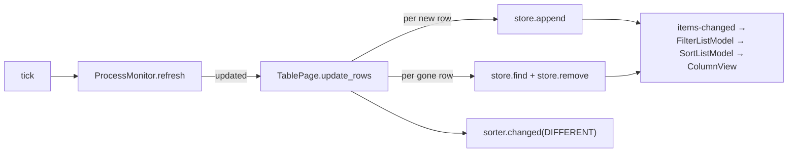

# Bug 22: The window freezes after unlocking or waking from suspend

Plan: [plan/bugs/bug-22-the-window-freezes-after-unlocking-or.md](../../plan/bugs/bug-22-the-window-freezes-after-unlocking-or.md)

*[PLAN.md, Bug 22](../../plan/bugs/bug-22-the-window-freezes-after-unlocking-or.md). Open.* The window that froze had been stalling for
18 hours before the unlock: 9–24 s at a time, every stack in a table
page's `update_rows` (`store.append` and `store.remove`), while a
container restarted every 15 s, with 1.1 GiB and 94 % of a core at the
end. The table diffs one row at a time, so each row added or removed is
a separate `items-changed` through the filter, the sorter and the column
view, and `store.find` is a linear scan:

Proposed, once a reproduction confirms where the time goes: one
`splice` per refresh with a key → row index, and no table refreshes
while the window isn't shown.
