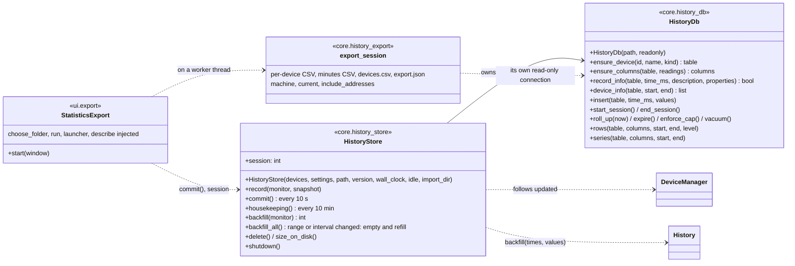
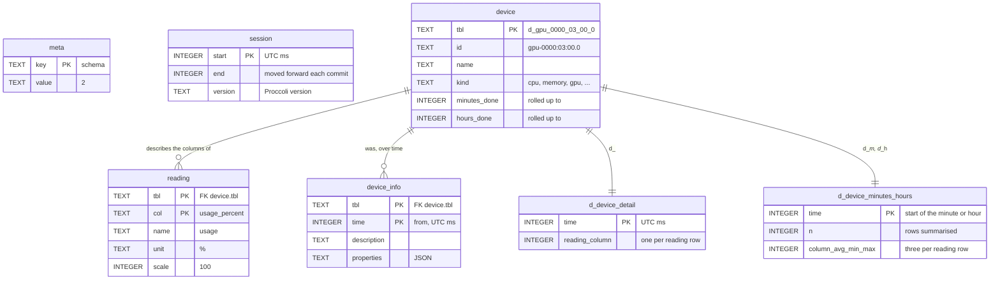
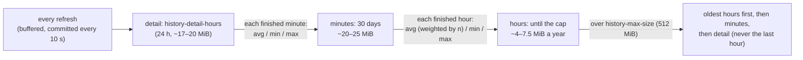
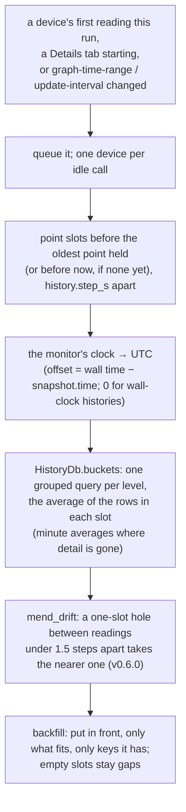

# Feature 2: Metrics history in a SQLite database

Plan: [plan/features/feature-02-metrics-history-in-a-sqlite-database.md](../../plan/features/feature-02-metrics-history-in-a-sqlite-database.md)


*Built in v0.3.0 (PLAN.md has the steps, the measurements and the
deviations from Feature 2).* It replaced the statistics files ([§11](../11-cross-cutting-concerns.md), v0.2.0):
Proccoli no longer writes metric files on its own; files appear only when
the user exports.

**Why SQLite** (Python's `sqlite3`, nothing to install), measured on the
development laptop (61 readings per refresh) for Feature 2, and again on
another machine with `tests/ui/history_size.py` (37 readings, v0.3.0):

| | Disk at full detail | Private memory | Reading 10 min of 3 devices |
|---|---|---|---|
| CSV files (v0.2.0) | 452 B/s | ~1 MiB (`csv`) | parse the file tails |
| SQLite, table per device, scaled integers | **239 B/s** (207 B/s with 37 readings) | ~0.9 MiB (512 KiB cache; the library is shared) | **6 ms** (1.5 ms), indexed |

It can also summarise old data in place, which files can't.



`HistoryDb` is the SQL only (no GObject, no settings, no timers), so the
roll-ups and the cap are tested on their own. `HistoryStore` decides when:
it has no timers of its own. Each reading checks whether 10 s have passed
since the last commit and 10 minutes since the last housekeeping, so tests
drive it with a fake wall clock and no main loop. It's started by
`Application` after the context (never in `--demo`); errors are logged
once and recording stops, never raised into the main loop.

**Schema** (`$XDG_STATE_HOME/proccoli/history.sqlite3`, 0600 in a 0700
folder; WAL, `synchronous=NORMAL`, `auto_vacuum=INCREMENTAL`, 512 KiB
cache). All times are UTC epoch milliseconds:

```sql
CREATE TABLE meta    (key TEXT PRIMARY KEY, value TEXT);          -- 'schema': '2'
CREATE TABLE device  (tbl TEXT PRIMARY KEY, id TEXT, name TEXT, kind TEXT,
                      minutes_done INTEGER, hours_done INTEGER);  -- roll-up marks
CREATE TABLE reading (tbl TEXT, col TEXT, name TEXT, unit TEXT, scale INTEGER,
                      PRIMARY KEY (tbl, col)) WITHOUT ROWID;
CREATE TABLE session (start INTEGER PRIMARY KEY, end INTEGER, version TEXT);
-- schema 2 (v0.5.0): what each device was, a row from `time` on, only on change
CREATE TABLE device_info (tbl TEXT, time INTEGER, description TEXT,
                          properties TEXT,                     -- JSON object
                          PRIMARY KEY (tbl, time)) WITHOUT ROWID;
-- per device: detail, then the two summary levels
CREATE TABLE "d_cpu"   (time INTEGER PRIMARY KEY, usage_percent INTEGER,
                        temperature_celsius INTEGER, cpu0_percent INTEGER, …);
CREATE TABLE "d_cpu_m" (time INTEGER PRIMARY KEY, n INTEGER, usage_percent_avg INTEGER,
                        usage_percent_min INTEGER, usage_percent_max INTEGER, …);
CREATE TABLE "d_cpu_h" (…same as d_cpu_m…);
```

How the tables relate (`tbl` is the per-device table's name; SQLite
doesn't enforce these keys, `HistoryDb` keeps them consistent):



`session` stands alone: graphs and exports compare times against it
(the time Proccoli wasn't running, [Feature 10's design](feature-10-shade-the-time-proccoli-wasn-t.md)).

- **Times:** every row's `time` (its primary key) is UTC epoch
  milliseconds. In a detail table it's when the reading was taken: the
  wall clock (`time.time()`, UTC by definition) at the moment the
  `HistoryStore` receives the device's `updated`, in the same tick as
  the read, so within a few milliseconds of it. Readings that are rates
  or shares (processor %, bytes per second) cover the update interval
  that **ends** at that time. A GPU's `detail/…` columns from a running
  detail source (`intel_gpu_top`, `nvidia-smi`) carry the GPU's tick
  time, not the tool's own sample time, so they can be up to one of the
  tool's intervals older. In the minute and hour tables, `time` is the
  start of that minute or hour (UTC). Exports write it as ISO 8601 UTC
  (`2026-11-25T17:38:10.738Z`).
- **Names:** a device's table is `d_` plus its ID in snake case
  (`gpu-0000:02:00.0` → `d_gpu_0000_02_00_0`; the v0.2.0 file name of the
  same device gives the same table, which is how the import finds it).
  Columns are the v0.2.0 CSV columns (`column_name`: `usage_percent`,
  `read_bytes_per_second`), so the export header is the column list.
- **Values** are integers in fixed units (`SCALES`: hundredths of a
  percent and of a degree, milliwatts, kHz for MHz, bytes, hertz; other
  units thousandths). SQLite stores small integers in 1–2 bytes and zero
  in none, which is most of the saving. `reading.scale` keeps the scale,
  so the file describes itself.
- **A reading that appears later** (a GPU's details starting, per-CPU
  readings after the first sample) is `ALTER TABLE … ADD COLUMN` on all
  three tables, which SQLite does without rewriting them.
- **A clock set back** overwrites only rows at the same times
  (`INSERT OR REPLACE`); the roll-ups start from the earlier of their mark
  and now, so they redo those minutes.
- **Sessions:** a row per run; each commit moves its end forward, so a
  crash loses at most 10 s.

**Retention** (housekeeping every 10 minutes, so it holds for a Proccoli
that never quits):



Each level is deleted only once it has been rolled up (`expire` stops at
each device's mark). Typical steady state: about 40–52 MiB after a year,
120 MiB after ten. Worst case (64 logical CPUs, busy, 0.25 s refresh):
about 260 MiB after a year, 420 MiB after ten, still under the 512 MiB
default cap, which stays a safety net. Without levels, a year at full
detail would be 6–7 GiB. Tests simulate a week and three years.

**Long ranges** (v0.3.0): *Graph Time Range* goes up to a day (30 s; 1,
2, 5, 10, 30 minutes; 1 and 6 hours; 1 day). A graph never keeps more
than `MAX_GRAPH_POINTS` (1200) points: `ticker.history_plan(span,
interval)` gives `(points, every)`, and `History.set_plan(points, every,
step_s)` makes each point the average of `every` samples
(`core.history.Averager`; a gap drops a half-made point). A day at 1 s is
1184 points of 73 samples; 10 minutes at 1 s is unchanged (601 of 1),
and 10 minutes at 0.25 s drops from 2401 points to 801 of 3. So a day
costs no more memory or drawing than ten minutes did. `DeviceManager`
gives every monitor the plan (`Monitor.set_history_plan`) when it's
added and when the range or speed changes; the Intel and NVIDIA detail
histories follow it too, at their own interval.

**Graphs from history** (`HistoryStore.backfill`):



The rows still buffered never need to be read back while the history
holds points: they're newer than its oldest. A history with no point yet
(the first `every` samples of a long range) commits first.

**The Details tabs** (v0.3.0): a running detail source's readings go into
the GPU's table too, as `detail/<key>` columns (`DetailBackend.
history_readings()`, added by `GpuController.sample` to the
`GpuSnapshot`: Intel's `group/name`, NVIDIA's series names, in base
units). `Monitor.detail_history()` (the controller: the running source's
`history_target()`) is filled the same way, once per Details tab and
again after a range or speed change: the Intel history keeps wall-clock
times (`WALL_TIMES`), the NVIDIA one the monitors' clock. *Clear History*
on the Intel tab isn't undone by a refill.

**Export** (main menu → *Export Statistics…*, or Preferences → *History*):
`StatisticsExport` asks for a folder (`Gtk.FileDialog`, portal-friendly),
commits what's buffered, and runs `export_session` on a worker thread with
its own read-only connection; a toast shows progress per device, then
*Open Folder*. It writes a new folder `proccoli-statistics-<UTC>Z` (with
` (2)` if taken, so nothing is overwritten) holding, for the running
session (`time >= session.start`):

- one RFC 4180 CSV per device (`time_utc` ISO 8601 UTC with milliseconds,
  `<reading>_<unit>` columns in real units, empty for no reading);
- `<device>-minutes.csv` (`_avg`/`_min`/`_max`) for the part older than
  the detail kept;
- `export.json`: the version, the session's start and end, the machine,
  each device's details and changes (v0.5.0, [Feature 14's design](feature-14-exported-statistics-describe-their-devices.md)), and each file's
  device, name, kind, level and columns with units;
- `devices.csv`: the device details, one row per property (v0.5.0).

**Preferences → General → *History*:** *Keep History* (turning it off
closes the database and offers to delete it), *Keep Every Reading For*,
*Maximum Size*, *Size on Disk* with *Delete History…* (an
`Adw.AlertDialog`), and *Export…*.

**The v0.2.0 files** (`stats/*.csv`, `.csv.1`) are imported on the first
start with the database, one file per idle call, as detail rows; the next
housekeeping summarises and expires them like any others. Then the folder
is removed and one line is logged.
