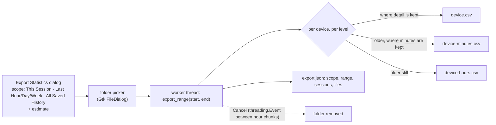

# Feature 7: Export any part of the history

Plan: [plan/features/feature-07-export-statistics-for-the-session-or.md](../../plan/features/feature-07-export-statistics-for-the-session-or.md)

*[PLAN.md, Feature 7](../../plan/features/feature-07-export-statistics-for-the-session-or.md).* *Export Statistics…* (v0.3.0) writes only the running
session. The database holds more: detail for `history-detail-hours`,
minutes for 30 days, hours until the cap. The design lets the user pick
a scope first, then splits the range by level, so each moment is
exported once, from the most detailed level that still holds it:

- `scope_range(scope, now, session_start, oldest)` gives `(start, end)`;
  `HistoryDb.oldest(table, level)` per level gives the split points.
- `estimate()` counts rows per level in one query and multiplies by an
  average CSV row width per device. A free-space check through `System`
  warns before a large export.
- The existing pieces stay: its own read-only connection, hour-sized
  chunks, a new `proccoli-statistics-<UTC>Z` folder (never overwriting),
  and the toast with *Open Folder*, which gains progress and *Cancel*.
