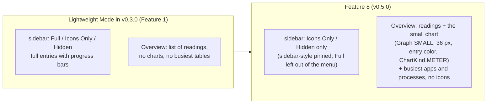

# Feature 8: Lightweight Mode: small charts on the Overview, a minimal sidebar

Plan: [plan/features/feature-08-lightweight-mode-small-charts-on-the.md](../../plan/features/feature-08-lightweight-mode-small-charts-on-the.md)

*[PLAN.md, Feature 8](../../plan/features/feature-08-lightweight-mode-small-charts-on-the.md). Built in v0.5.0; as built below.* It changes
[Feature 1's design](feature-01-lightweight-mode.md) (v0.3.0): in Lightweight Mode the trend moves from the
sidebar to the Overview, and the Overview keeps the busiest apps and
processes.

- `ProfileSettings` pins `sidebar-style` to `icons`; `sidebar-shown`
  still chooses between the rail and *Hidden*. `primary_menu(goto,
  modes)` gets `sidebar_style.menu_modes(full_allowed)`, and
  `SidebarVisibility` maps *Full* to *Icons Only* (`choose(...,
  full_allowed=False)`). The overlaid sidebar of a narrow window is icons
  only too: the pin applies everywhere.
- `OverviewCard(chart="small")` builds the same graph as `Meter`
  (`GraphStyle.SMALL`, `METER_HEIGHT`, filled, bound as
  `ChartKind.METER`): no axes, no hover, at most the pinned 1-minute
  range. The page keeps the 3-column list (no grid fitting).
- The busiest apps and processes (`TopTables`) stay below the cards,
  without icons (`profile.app_icons` off; `TopTable(icons=False)` builds
  no image), five rows each (`Profile.overview_top_count`).
  `Profile.overview_tables` is true in Lightweight Mode. The process scan
  still runs only while the Overview, Apps or Processes is shown, and the
  list is dropped when none is (`keep_process_data`), so the tables cost
  only while visible.
- An icons-only sidebar never shows meters, so `StackSidebarItem` builds
  its `Meter` only when first needed (the `meter` property; `has_meter`),
  bound to the sidebar's `ChartSettings` and entry color then.
- **Measured** (`tests/ui/mem.py`, three runs each): 37.1 MiB at start
  against 35.4 MiB before (the process list and two tables while the
  Overview shows); 55.8 MiB against 52.9 MiB after visiting every page.
  Still well under half the full profile's.
