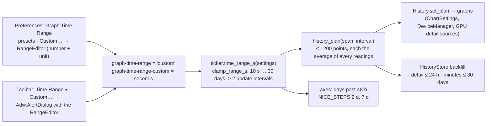

# Feature 9: Custom graph time range

Plan: [plan/features/feature-09-custom-graph-time-range.md](../../plan/features/feature-09-custom-graph-time-range.md)

*[PLAN.md, Feature 9](../../plan/features/feature-09-custom-graph-time-range.md). Done as v0.5.0; as built:* any range from 10
seconds to 30 days, besides the presets. One function turns the setting
into seconds, so the rest of the graph code doesn't change:

- **One set of keys:** `ticker.RANGE_KEYS` (`graph-time-range`,
  `graph-time-range-custom`) and `PLAN_KEYS` (plus `update-interval`);
  every listener that re-plans histories (`DeviceManager`,
  `HistoryStore`, `ChartSettings`, the Intel, NVIDIA and AMD sources)
  connects to those, so a change to the custom seconds refills graphs
  like a preset change does (v0.4.0). `preset_s(nick)` is the old lookup.
- **Number and unit:** `ui/time_range.py` (display-free) shows seconds
  in the largest unit that divides them (5400 s is "90 Minutes"), so a
  value comes back as typed; `limit_note` says why a value was clamped.
  `widgets/range_editor.RangeEditor` (a `SpinButton` and a `DropDown`)
  is shared by Preferences (a row shown only while *Custom…* is chosen)
  and the toolbar's dialog. The toolbar's menu button names the range
  ("3 Days").
- **Memory is flat:** `MAX_GRAPH_POINTS` caps every history at 1200
  points, so a longer range means more readings per point (the
  `Averager` keeps sums). Measured: a history of 8 lines filled to its
  plan holds 351 KiB at 1 day and 354 KiB at 30 days.
- **The 30-day ceiling** is the minute averages' retention
  (`MINUTES_KEPT_DAYS`). Past it only hour averages are left, coarser
  than a point.
- **Lightweight Mode** keeps a custom choice but pins
  `graph-time-range-custom` to at most 60 s; presets over a minute read
  as 1 minute, as before.
