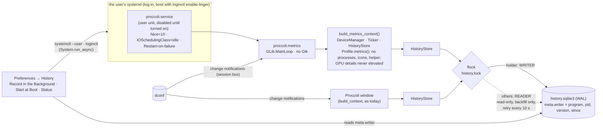
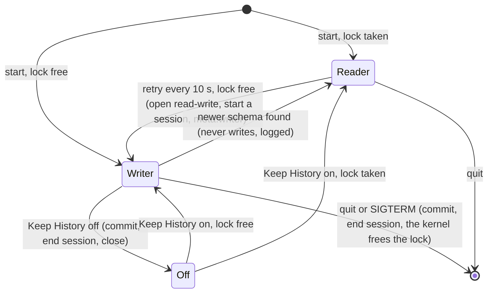
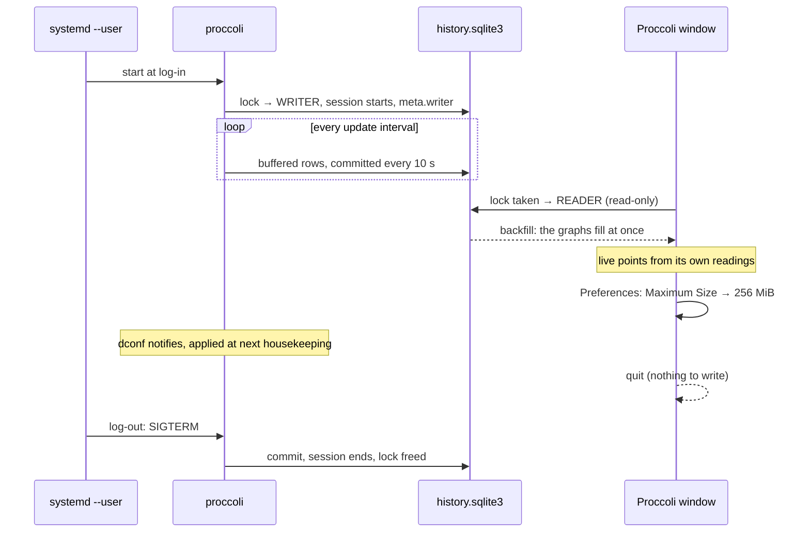

# Feature 13: Record the history in the background

Plan: [plan/features/feature-13-record-the-history-in-the-background.md](../../plan/features/feature-13-record-the-history-in-the-background.md)

*[PLAN.md, Feature 13](../../plan/features/feature-13-record-the-history-in-the-background.md). Done as v0.5.0; as built (the diagrams are the
design, unchanged).*
`proccoli` records while the window is closed; a lock decides
who writes. PLAN.md has the scope, settings table, failure cases, cost
targets and steps; this section has the structure.

**Processes and what starts them:**

**A `HistoryStore`'s role over time** (the same class in both
processes; the lock is the only difference):

**A day with both** (the window opens and closes while the collector
records):

- **New and changed parts:** `core/history_lock.py` (`System.try_lock`,
  fakeable), `HistoryStore(role)`, `Profile.metrics()`,
  `context.build_metrics_context`, `proccoli/metrics.py` (main loop,
  signals, `--once`, `--status`, `--version`),
  `data/proccoli.service`, Preferences' three rows. Nothing in
  `ui/` is imported by the collector (a static test walks its imports).
- **Interfaces between the two:** the database (the lock and
  `meta.writer`) and dconf, never Python calls or D-Bus, so either can
  run alone (and Feature 15 can package them separately).
- **As built:** `HistoryStore(lock=HistoryLock(system, lock_path(path)),
  program=…, graphs=…)`; a store without a lock writes, as before (tests).
  A reader opens the file read-only only once the writer has made it;
  `record` opens on the first reading, so the role is settled before
  anything is buffered. `commit` is where a reader retries the lock and a
  writer notices a deleted file. `session_start()` gives a reader the
  writer's run, for *Export Statistics…*. `Profile.metrics()` has
  `gpu_elevate=False`, which `GpuController` turns into "Detailed
  statistics need administrator rights" without ever calling `pkexec`.
  `MetricsContext.start()` starts the ticker itself. Preferences' rows
  come from `core/background.py` (`BackgroundService`, `status_text`),
  which runs `systemctl --user` and `loginctl` through `System.run_async`.
- **Where it shows (v0.5.0):** the unit runs in the desktop's app slice for
  Proccoli (`Slice=app-<app ID>.slice`, cgroup
  `…/app.slice/app-<app ID>.slice/proccoli.service`), so the Apps
  page (`app_id_for_cgroup`) and other process lists group it with the
  window; the Processes page names it `proccoli` (Bug 7).
- **Measured:** 15.6 MiB private memory; 1.08 % of one core at 1 s on the
  Ryzen 3 4300U (half of it the GPU's per-process `fdinfo`).
