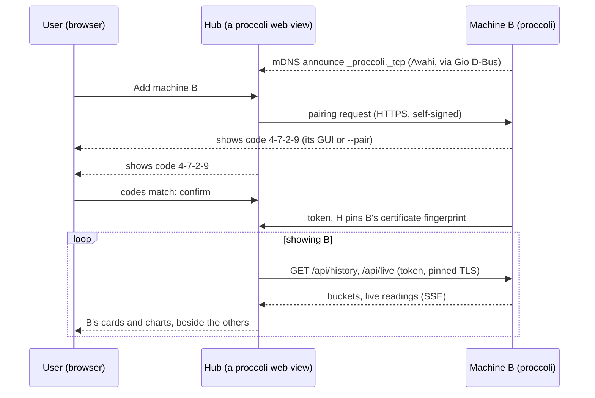

# Feature 17: The Web GUI for machines on the local network (brainstorm)

Plan: [plan/features/feature-17-the-web-gui-for-machines-on.md](../../plan/features/feature-17-the-web-gui-for-machines-on.md)

*[PLAN.md, Feature 17](../../plan/features/feature-17-the-web-gui-for-machines-on.md).* Several machines, each running `proccoli`
with its API on the network; one Web GUI (the hub) pulls from them:

- **Pull first:** each machine keeps its own history; the hub stores
  only paired machines (name, address, token, fingerprint).
- **Times line up** because everything is UTC epoch milliseconds; the hub
  warns about a machine whose clock is off.
- **Off by default** on every machine; listening only on chosen
  interfaces, never on a public network.
