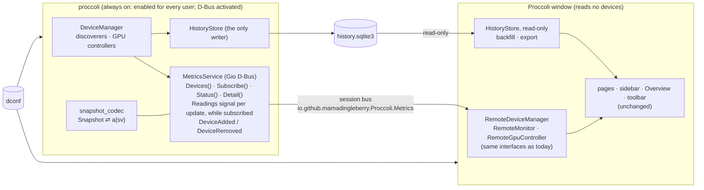
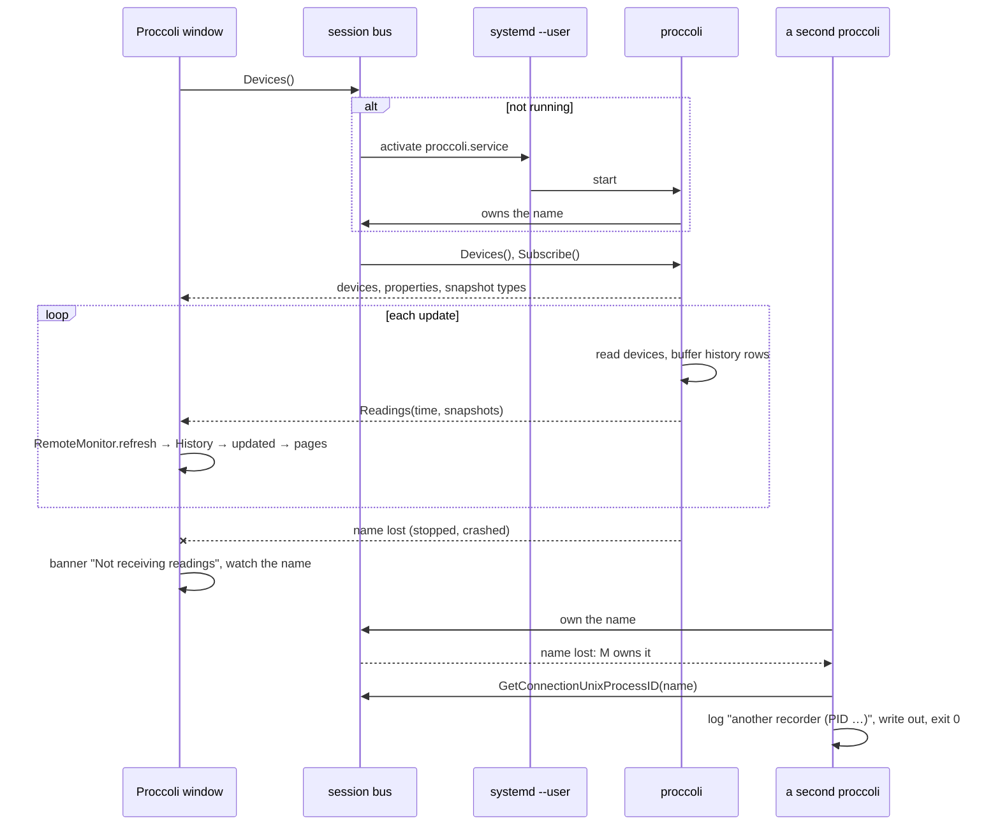

# Feature 19: The window reads nothing: `proccoli` serves every reading

Plan: [plan/features/feature-19-the-window-reads-nothing-proccoli-metrics.md](../../plan/features/feature-19-the-window-reads-nothing-proccoli-metrics.md)

*[PLAN.md, Feature 19](../../plan/features/feature-19-the-window-reads-nothing-proccoli-metrics.md). In three parts: **19a built** (v0.5.0: the service and
the codec), **19b built** (v0.5.0: the window on it), 19c to come.* The collector
is the only process that reads devices or writes the history; the window
shows what it sends, and reads the history read-only:

- **One recorder per user (v0.6.0):** a recorder whose `bus_own_name` ends
  in *name lost* while it has a bus asks the bus for the owner's PID
  (`owner_pid`), logs it and calls `MetricsService.on_superseded`;
  `metrics.run` quits its loop, so `Collector.stop` commits, ends the
  session and frees the lock, and the program exits 0 (started from a
  terminal, it also names the window's program). Without a bus it keeps
  recording, as before.

- **Interfaces kept:** `RemoteDeviceManager` and its monitors have the
  `DeviceManager` / `Monitor` / `GpuController` interfaces the UI uses,
  so pages don't change; snapshots arrive as the same dataclasses.
- **What it replaces from v0.5.0:** the window's writer role, the lock
  takeover, *Record in the Background*. The collector keeps the lock
  (against a second collector).
- **Open:** the process list, Intel Details and memory module details
  ([PLAN.md, Feature 19](../../plan/features/feature-19-the-window-reads-nothing-proccoli-metrics.md), questions 1–3).
- **As built in 19a (v0.5.0):** `metrics_service.MetricsService` owns
  `BUS_NAME` (the app ID + `.Metrics`) at `OBJECT_PATH`, registers the
  interface from `INTROSPECTION`, and connects to the ticker after the
  device manager, so its `send_readings` runs after each refresh.
  Payloads are JSON strings (`Devices`, `Status`, the signals): GVariant
  has no null. A reading is `{device id: {"snapshot": …, "gpu": {state,
  message, source, sample, processes}}}`. `devices/snapshot_codec` builds
  only the classes in `TYPES`. `Subscribe` watches the caller's bus name
  (`Gio.bus_watch_name_on_connection`) so a closed window stops the
  signals. Clients call asynchronously (`watch()`).
- **As built in 19b (v0.5.0):** `devices/remote.py`: `RemoteDeviceManager`
  watches `BUS_NAME` with `AUTO_START` (the bus starts the collector
  through its D-Bus service file, `SystemdService=proccoli.service`),
  calls `Devices()`, then `Subscribe()`, and counts as connected once that
  returns. `RemoteMonitor.feed` puts each decoded snapshot on the
  window's own clock (`dataclasses.replace(time=now)`), so history
  filling and live points line up. `RemoteGpuController` keeps the GPU
  page's interface; while the source runs, a `RemoteDetailBackend` gives
  the vendor's views (`AmdgpuBackend.create_views`, NVIDIA's) the
  `sample`, `history`, `gpu` and `source_note` they read; Intel's views
  need `intel_gpu_top` itself (19c). Turning a GPU's details on or off
  is the setting only; the collector's `GpuController` follows
  `gpu-details-disabled`. Devices also carry their sort name
  (`Monitor.sort_name()`, moved there from `ui/summaries`), the
  processor's thread names and sensor, a GPU's `GpuInfo` and plan, and a
  failed device's message (its error page; *Try Again* calls `Retry`).
  `build_context(remote=True)` makes the window's devices remote (local
  only for `--demo` and tests); its `HistoryStore` is `read_only` (no
  lock, never writes, never takes over). The process list stays in the
  window. The window shows a banner over every page when readings stop
  (after a 5 s grace at start), with *Try Again* (`reconnect`).
  Packaging: the D-Bus service file, a `user-preset` (`enable`), and the
  metrics package's `postinst` enables the unit for every user
  (`systemctl --global enable`) and restarts it for those logged in.
