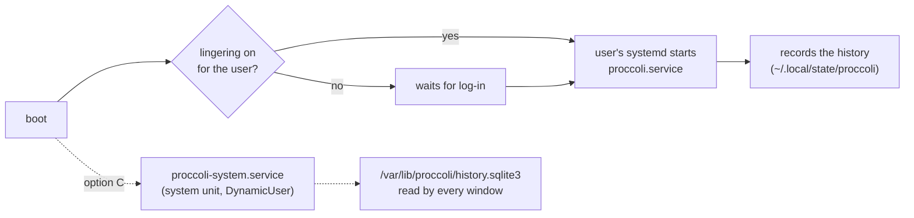

# Feature 22: Recording from boot (lingering)

Plan: [plan/features/feature-22-recording-from-boot.md](../../plan/features/feature-22-recording-from-boot.md)


*[PLAN.md, Feature 22](../../plan/features/feature-22-recording-from-boot.md).* When the recorder runs, per choice:



- **A (built in v0.6.0):** offer lingering once (a dialog, and
  `proccoli --start-at-boot`); the decision is pure
  (`should_offer_linger`), the call goes through `System`.

```mermaid
sequenceDiagram
    participant A as Application.do_activate
    participant B as BackgroundService
    participant D as RecordFromBootDialog
    participant L as loginctl
    A->>A: linger-offered? → stop
    A->>B: refresh (systemctl is-enabled, is-active; loginctl Linger)
    B-->>A: state
    A->>A: should_offer_linger(state, offered, history on)<br/>and no other dialog up
    A->>D: present
    D->>D: any answer → linger-offered = true
    D->>L: Turn On → enable-linger <uid>
```

  The command line (`--start-at-boot`, `--no-start-at-boot`) calls
  `background.start_at_boot`, through `System.run` (synchronous: no
  main loop there); `--status` adds a line when `linger_on` is False.
- **B:** `postinst` turns lingering on for people with a login; it
  starts all of their user services at boot, not only Proccoli's.
- **C:** kept as [Feature 25](feature-25-a-recorder-for-the-whole-machine.md): a system-wide recorder and history; pairs with the Web GUI
  features ([Feature 16's design](feature-16-a-web-gui-hosted-locally.md), [Feature 17's design](feature-17-the-web-gui-for-machines-on.md)).
