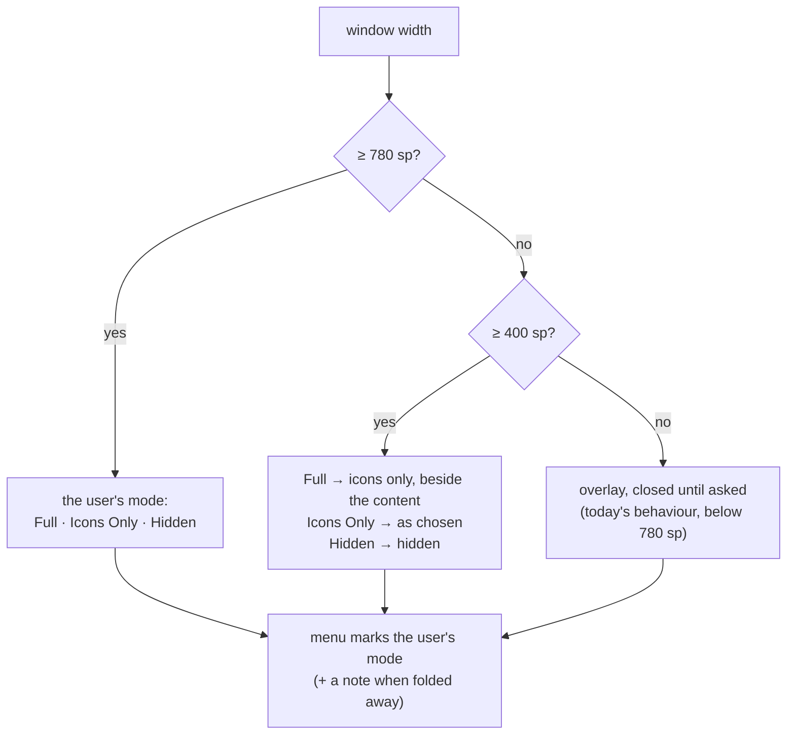

# Feature 23: Icons Only on narrow windows

Plan: [plan/features/feature-23-icons-only-on-narrow-windows.md](../../plan/features/feature-23-icons-only-on-narrow-windows.md)

*[PLAN.md, Feature 23](../../plan/features/feature-23-icons-only-on-narrow-windows.md).* Proposed (B with C): the window's width picks how the
sidebar shows; the user's choice is never overwritten.

- `sidebar_style.effective_layout(width, mode)` is pure; the window only
  applies it, and `SidebarVisibility` never saves a style the width chose.
