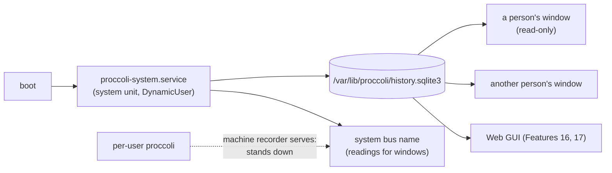

# Feature 25: A recorder for the whole machine

Plan: [plan/features/feature-25-a-recorder-for-the-whole-machine.md](../../plan/features/feature-25-a-recorder-for-the-whole-machine.md)

*Open.* Option C of [Feature 22's design](feature-22-recording-from-boot.md).

- One writer for the machine; per-user recorders find its bus name and
  leave, as a second per-user recorder does now (Bug 15).
- Open design points: machine-wide settings, other users' process
  details, read access to the history (see the plan's questions).
