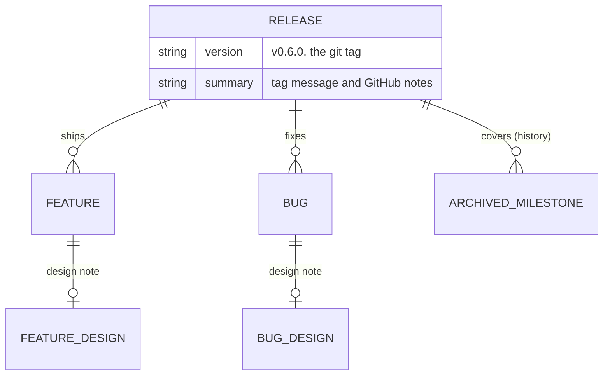

# Feature 26: Releases and Features

Plan: [plan/features/feature-26-releases-and-features.md](../../plan/features/feature-26-releases-and-features.md)

*Built.* The standing description is [§13 Features, Bugs and Releases](../13-features-bugs-and-releases.md); this note keeps the first sketch.

- A release file is the single source for its tag message and its
  GitHub release notes, so the three never disagree.
- Cutting a release: list Features and Bugs whose status changed since
  the last tag, write `plan/releases/vX.Y.Z.md`, bump `__version__`,
  the metainfo `<release>` and the README package names (`test_meta`
  checks the README), commit, tag, and publish once the user says so.
