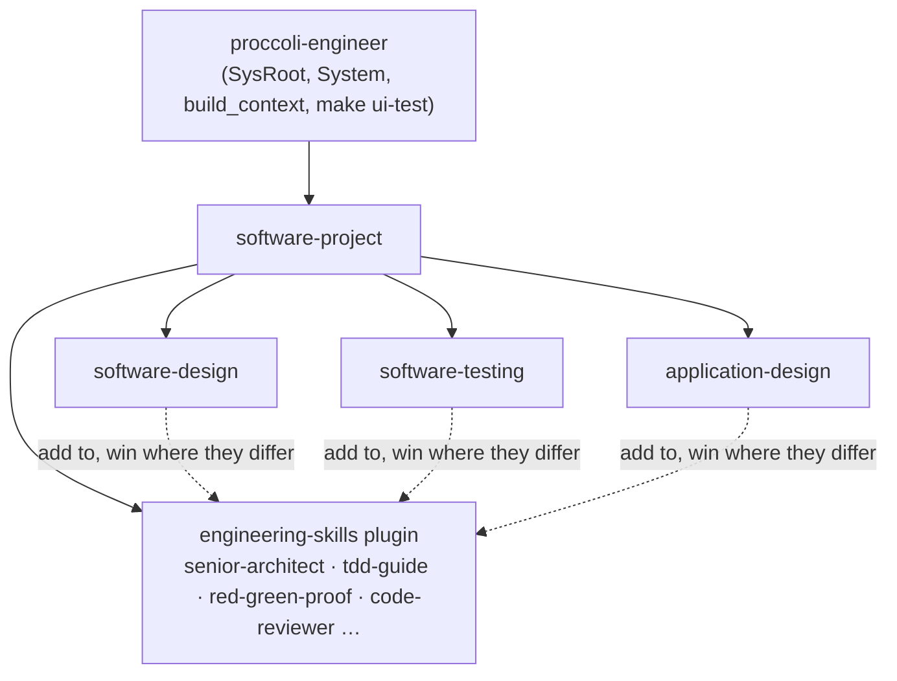

# Feature 29: Engineering skills

Plan: [plan/features/feature-29-engineering-skills.md](../../plan/features/feature-29-engineering-skills.md)

*Built.* The generic standards come from the `engineering-skills` plugin; ours add the rest and win where they differ ([the plan](../../plan/features/feature-29-engineering-skills.md) lists the four differences).

The general skills say *what* good practice is; `proccoli-engineer` says
*where* that lives in this repo.
