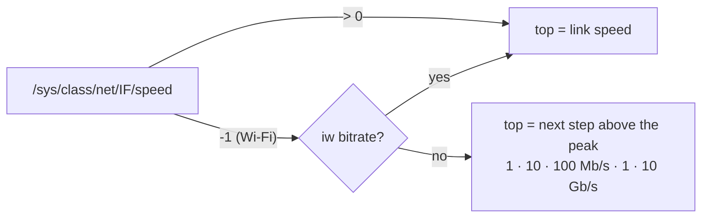

# Feature 30: Network graphs scaled to the link speed

Plan: [plan/features/feature-30-network-graphs-scaled-to-link-speed.md](../../plan/features/feature-30-network-graphs-scaled-to-link-speed.md)

*Proposed.*

Both directions share one top, so receive and send read on the same
axis.
