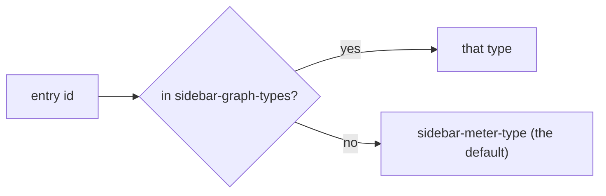

# Feature 32: Graph Type per sidebar entry

Plan: [plan/features/feature-32-graph-type-per-sidebar-entry.md](../../plan/features/feature-32-graph-type-per-sidebar-entry.md)

*Built.* Stored like `sidebar-hidden-fields`: a dictionary keyed by
entry id, holding only the entries that differ from the default, so
changing the default still changes every other entry.

