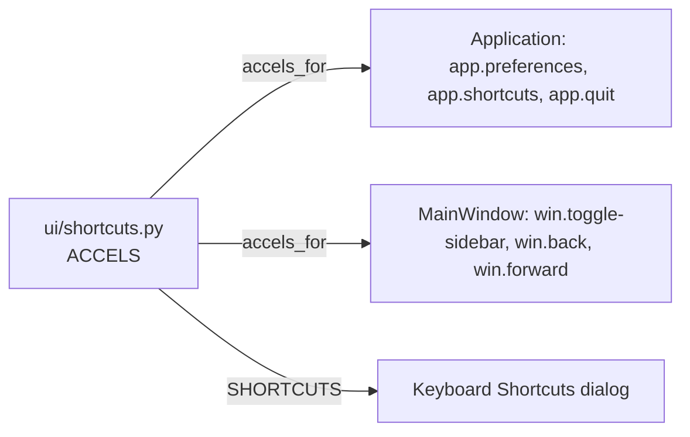

# Feature 34: F1 and F2 shortcuts

Plan: [plan/features/feature-34-f1-and-f2-shortcuts.md](../../plan/features/feature-34-f1-and-f2-shortcuts.md)

*Built.* One table, `ui/shortcuts.py` (`ACCELS`, pure data), sets the
window's and the app's accelerators (`accels_for`) and fills the
Keyboard Shortcuts dialog (`SHORTCUTS`), so the two can't drift. Each
action's first accelerator is the one menus show, so F2 and F1 come
first; the dialog lists both, space-separated, as GTK's alternatives.

