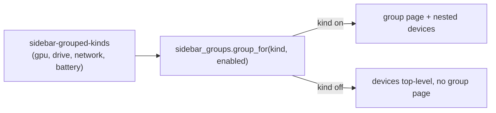

# Feature 35: Optional sidebar groups

Plan: [plan/features/feature-35-optional-sidebar-groups.md](../../plan/features/feature-35-optional-sidebar-groups.md)

*Proposed.* Which kinds group becomes a setting; everything else in
Feature 18 already works per group, so a kind turned off simply has no
group page and its devices aren't nested.

