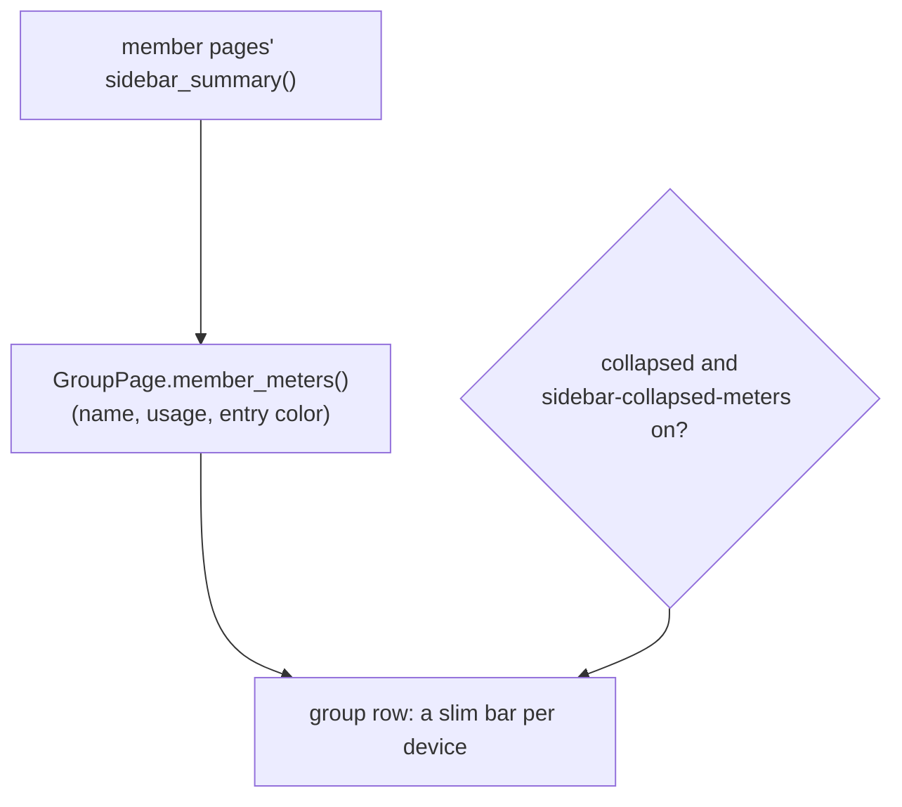

# Feature 36: Meters on collapsed groups

Plan: [plan/features/feature-36-meters-on-collapsed-groups.md](../../plan/features/feature-36-meters-on-collapsed-groups.md)

*Proposed.* The group row already follows its devices' summaries
(`GroupPage` listens to each member's `summary-changed`); the bars read
the same summaries, so nothing new is collected.

