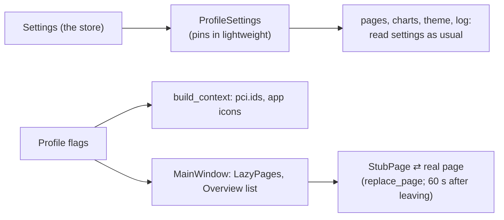
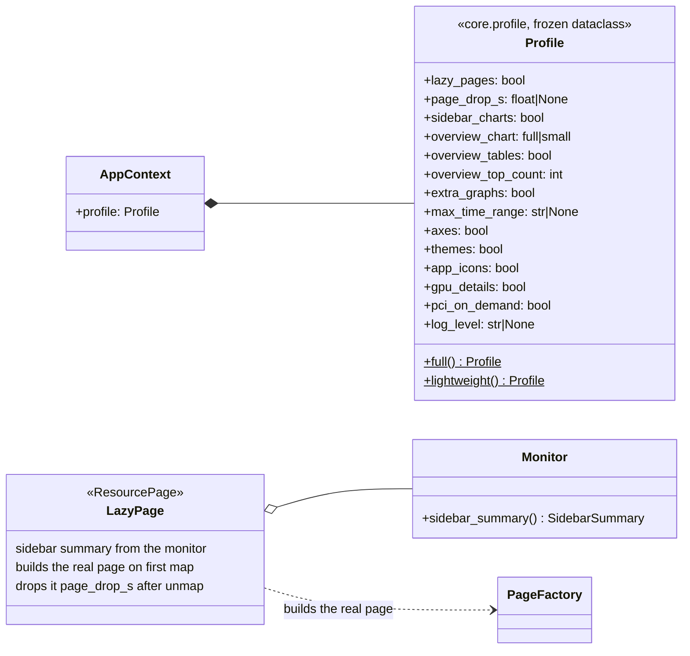

# Idea 1: Lightweight mode (minimal memory)

Plan: [plan/ideas/idea-01-lightweight-mode.md](../../plan/ideas/idea-01-lightweight-mode.md)

*Built in Milestone 66 (PLAN.md has the steps, the measurements and the
deviations). As built:*

- **`core/profile.py`:** `Profile.full()` / `Profile.lightweight()`,
  chosen once by `Application` (`lightweight` setting or
  `--lightweight`). Everything gets `ProfileSettings`: the same store, with
  the profile's **pins** answering some keys (time range ≤ 1 minute, no
  axes or grids, no per-CPU chart, an icons-only sidebar (M71; was
  progress-bar meters), Follow System and
  the System palette, log ≤ warnings, no performance lines, table columns
  cut to name, ID, processor and memory), including in change
  notifications. So pages, charts, the theme and the log follow the mode
  without knowing it; Preferences greys pinned rows out. The user's own
  choices stay in the store and come back when the mode is off.
- **Flags** for what has no preference: `lazy_pages` (the window adds a
  `StubPage` per device and for Apps and Processes; `LazyPages` builds
  the real page on first visit and drops it 60 s after it's left,
  through `replace_page`), `overview_chart`/`overview_tables`/
  `overview_top_count` (since M71 a list of cards with the small chart,
  and the five busiest apps and processes without icons, [Idea 8's design](idea-08-lightweight-mode-small-charts-on-the.md)),
  `extra_graphs` (`DevicePage.add_graph` draws only
  the first graph; the others keep title and figures as text),
  `app_icons` (`ctx.app_icons = None`, `table.shown_column`),
  `gpu_details` (`GpuController` doesn't start the source and says why),
  `pci_on_demand` (`pciids.OnDemandPciIds`), `theme_css`,
  `keep_process_data` (`ProcessMonitor.release` drops the list).
- **Summaries from monitors** (`ui/summaries.py`): an entry's usage,
  detail, series and facts come from its monitor alone, so a stub's entry
  and Overview card look like the built page's (device pages use it too).
- **Measured** (`tests/ui/mem.py`): about 55 % less private memory at
  start, about 35 % after visiting every page (freed memory isn't given
  back by glibc and GTK).

*The design as planned (Idea 1):*

**Aim:** the basic figures (every device's usage, the process list) with
as little memory as possible. Measured on Ubuntu 24.04, Proccoli's private
memory is about 100 MB against 15–17 MB for an empty libadwaita window,
and its Python heap is only about 12 MB of that. The rest is GTK's: every
page's widget tree (all built at start) and what drawing them leaves
behind. So the mode builds and draws less, rather than tuning Python data.

- **One choice, read once:** the `lightweight` setting (or
  `--lightweight`) picks `Profile.lightweight()` in `build_context`.
  Everything else reads `ctx.profile`, never the setting, so tests build
  either profile directly. Changing it applies at the next start
  (Preferences offers *Restart Now*): the profile decides what the
  composition root builds, and rebuilding a running window is more
  teardown risk than it's worth.
- **Lazy pages:** `LazyPage` stands in for a device page. Its sidebar entry
  and summary come from the monitor (`Monitor.sidebar_summary()`, moved
  out of the pages), so the sidebar never needs the real page. The real
  page is built on first map and dropped `page_drop_s` (60 s) after the
  user leaves it; the Overview stays built.
- **Draw less:** sidebar entries show usage text only; the Overview is a
  compact list (name, usage) without charts or busiest tables; each device
  page keeps one graph (its main usage, at most a 1-minute range, no axes) and shows its
  other figures as text rows; no per-CPU chart.
- **Look:** Follow System and the System palette only; no `ThemeCss`
  provider; the Appearance rows are insensitive with a note.
- **No icons** in Apps and Processes (`ctx.app_icons = None`, no icon
  column).
- **No GPU detail sources** (`GpuController(start_details=False)`): no
  intel_gpu_top stream or NVIDIA polling; the Details tabs say how to turn
  them on. Detection still runs, so every GPU keeps its Overview tab.
- **pci.ids on demand:** `PciIds.on_demand` scans the file for the IDs
  asked for and keeps only those (about 3.6 MB of Python objects saved).
- **Logging:** warning level by default, no performance lines; the
  watchdog stays (one thread, a timestamp).
- **Kept as is:** device discovery and monitors, error pages, Apps and
  Processes tables and their actions, the sidebar modes.
- **Measuring:** `tests/ui/mem.py` reports private memory after start,
  after visiting every page and after 10 minutes, for both profiles; the
  target is at least 40 % less in lightweight mode, with no growth. The
  GTK renderer (cairo instead of GL) is measured on a real desktop and
  adopted only if it pays.

- **Rendering (M81):** Lightweight Mode sets `GSK_RENDERER=cairo`
  before any window (`profile.apply_renderer`; a user's own value wins,
  and Proccoli's own is cleared when *Restart Now* goes back to the full
  window). On a real desktop OpenGL's driver memory dominated: measured
  on Wayland, Lightweight Mode went from 128 MiB private and 19.8 % of a
  core (more than the full window's 117 MiB and 15.1 %) to 56 MiB and
  10.4 %. Earlier figures in this section were headless (Cairo) only.
